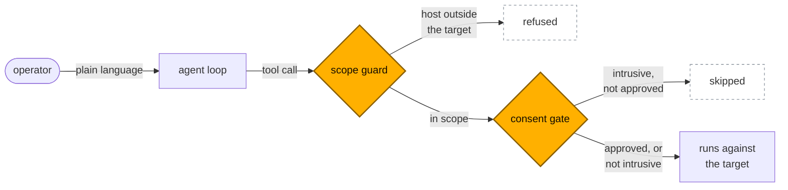

<p align="center">
  
</p>

<p align="center">
  An agentic network pentest tool you talk to.
</p>

<p align="center">
  <a href="https://github.com/0x45dd/pwner/actions/workflows/ci.yml"></a>
  <a href="https://pypi.org/project/pwner/"></a>
  <a href="https://github.com/0x45dd/pwner/blob/main/LICENSE"></a>
  
</p>

<p align="center">
  <b>English</b> &nbsp;·&nbsp;
  <a href="https://github.com/0x45dd/pwner/blob/main/README.es.md">Español</a> &nbsp;·&nbsp;
  <a href="https://github.com/0x45dd/pwner/blob/main/README.de.md">Deutsch</a> &nbsp;·&nbsp;
  <a href="https://github.com/0x45dd/pwner/blob/main/README.ja.md">日本語</a> &nbsp;·&nbsp;
  <a href="https://github.com/0x45dd/pwner/blob/main/README.tr.md">Türkçe</a>
</p>

<p align="center">
  <a href="#safety-model">Safety model</a> &nbsp;·&nbsp;
  <a href="#install">Install</a> &nbsp;·&nbsp;
  <a href="#first-run">First run</a> &nbsp;·&nbsp;
  <a href="#your-model">Your model</a> &nbsp;·&nbsp;
  <a href="#pci-dss-segmentation-testing">PCI DSS</a> &nbsp;·&nbsp;
  <a href="#documentation">Documentation</a>
</p>

<p align="center">
  
</p>

<p align="center">
  <sub><b>Example session</b> against a fictional lab host. The agent's wording and the counts
  are illustrative, not a recording of a live run. Note the last four lines: it asks before
  anything intrusive, and a refusal stops it.</sub>
</p>

`pwner` is an LLM-driven agent that plans and runs a network penetration test from your
terminal. It discovers hosts, fingerprints services, checks them against known issues, and —
when the target warrants it and **you** approve — exploits them to prove impact. It drives
real tools (nmap, nuclei, netexec, impacket, hydra and others) rather than simulating them,
and it reports confirmed findings with severity, evidence and a fix.

It runs on your own model, or on no model at all.

- **You talk to it.** Not a flag soup: say *"scan it, focus on the database"* and it decides
  what to run, shows you its reasoning as it goes, and you can redirect it mid-run.
- **Scope is enforced in code.** Every tool call is checked against the target you named
  before it runs — not asked of the model in a prompt. See [Safety model](#safety-model).
- **Intrusive actions are denied by default.** Brute-force, remote command execution,
  credential dumping and reverse shells need your explicit approval.
- **Your model, your machine.** OpenAI, Anthropic, Google, DeepSeek, or a server on your
  own hardware — Ollama, Lemonade, llama.cpp, anything OpenAI-compatible. A local
  endpoint needs no API key. Nothing is sent anywhere until you configure one.
- **Works with no model.** `--no-ai` runs the full discovery → fingerprint → detect pipeline
  deterministically, with no API key and nothing leaving the machine.
- **52 tools** across nmap, HTTP, web crawling and parameter probing, per-service probes,
  Active Directory and credential work,
  each a thin wrapper over the standard binary rather than a reimplementation.

## Safety model

Two mechanisms, both in the tool layer, both outside the model's reach. The model can ask
for anything; it cannot widen its own authorization.



A refusal is not an error that stops the run: it goes back to the model as a tool result,
so the agent learns it overstepped and carries on inside the boundary.

**Scope lock.** [`build_dispatch`](https://github.com/0x45dd/pwner/blob/main/pwner/tools/core.py) wraps every tool so each
host-carrying argument is checked against your target *before* the tool body runs. Tools are
in-scope-by-default: one that forgets its own check is still guarded, and an unregistered
tool name fails closed. A network argument has to sit entirely inside the authorization, so
a `/24` scope cannot be widened to a `/16` by a tool argument.

**Changing the scope.** The one thing the guard cannot check is `set_target`, because its
argument *is* the new scope, so there is nothing to check it against. It carries its own
gate instead: narrowing, or returning to something you already authorized, is free, and
moving anywhere else needs your answer every time. An earlier approval for some other
action does not buy it, `--auto-consent` does not cover it, and a non-interactive run
refuses it outright.

**Consent gate.** Anything active is denied unless you approve it in that session. The agent
cannot self-approve — consent is resolved outside the model — and a non-interactive run
refuses it unless you launched it with `--auto-consent`.

These two are the part of the codebase under the most test: 77 tests on the scope boundary
in [`tests/test_scope.py`](https://github.com/0x45dd/pwner/blob/main/tests/test_scope.py), 32 more on the scope-change gate in
[`tests/test_scope_change.py`](https://github.com/0x45dd/pwner/blob/main/tests/test_scope_change.py), and 13 on the consent gate in
[`tests/test_consent.py`](https://github.com/0x45dd/pwner/blob/main/tests/test_consent.py), out of 785 overall. If you are going to
read one thing before pointing this at a network, read those.

Intended use:

- Authorized penetration tests, with written permission and an agreed scope
- Bug-bounty work, inside the program's stated rules
- Your own lab, your own hardware, CTFs
- Security research on systems you own

Not this tool's purpose, and not defensible:

- Anything on a host you do not own and have no written permission to test
- "Just checking" a network you happen to be on
- Anything where you cannot name who authorized it

## Install

Python **3.10+**. **nmap is the only hard requirement** — everything else enables more tools
and is optional.

```bash
curl -fsSL https://raw.githubusercontent.com/0x45dd/pwner/main/install.sh | bash
```

That builds an isolated virtualenv under `~/.local/share/pwner`, leaves your system
Python alone, and puts `pwner` on your PATH so it works from any directory. Add
`--with-tools` to install nmap and the optional scanners too, and `--uninstall` to take
it all back out.

It is on PyPI too, if you would rather use your own Python tooling:

```bash
pipx install pwner      # isolated, and `pwner` lands on your PATH
uv tool install pwner   # the same, through uv
pip install pwner       # inside a virtualenv
```

Reach for `pipx` or `uv tool` over a bare `pip install`: they give you the same isolation
the installer script does, and installing into the system Python is refused outright on
most current distributions anyway.

On macOS there is also a tap:

```bash
brew install 0x45dd/tap/pwner
```

That brings nmap with it. From source instead:

```bash
git clone https://github.com/0x45dd/pwner.git
cd pwner
python3 -m venv .venv && source .venv/bin/activate
pip install -e .
```

Then the external tools, and a check:

```bash
./scripts/install-deps.sh   # brew/apt/kali/pacman/dnf
pwner doctor               # what's missing
```

`install-deps.sh` installs only what is missing and skips anything your distro does not
package instead of failing. `pwner doctor` reports every external tool, what each one
enables, and the install command *for the system you are on*; it exits non-zero only when
nmap is missing, so it works as a setup check in a script.

**On Kali there is almost nothing to install.** A default Kali image already ships 8 of the
11 external tools pwner drives — nmap, hydra, netexec, impacket, certipy, searchsploit,
hashcat and snmpwalk. `sudo apt install nuclei bloodhound.py` adds two more, and only
kerbrute is unpackaged. pwner detects Kali as its own ecosystem rather than as Debian, so
`pwner doctor` hands you apt commands instead of the source builds a plain Debian box needs.
If you are choosing where to run this, run it there.

<details>
<summary><b>uv, or just the command</b></summary>

```bash
uv tool install pwner          # from PyPI, command on your PATH
uv venv && uv pip install -e . # from a clone, editable
pipx install -e .              # from a clone, command on your PATH
```

</details>

<details>
<summary><b>Docker</b></summary>

The whole toolchain in one image, nothing installed on your host. The base is Kali, so
every tool but kerbrute comes from apt:

```bash
docker build -t pwner .
docker run --rm -it --net=host \
  --cap-add=NET_RAW --cap-add=NET_ADMIN \
  -v pwner-config:/root/.config/pwner \
  -v pwner-sessions:/root/.local/share/pwner \
  pwner
```

`--net=host` and the two capabilities are what let nmap do SYN scans and ICMP/ARP discovery;
without them it quietly falls back to slower connect scans and finds fewer hosts. The
volumes persist your key and your saved transcripts.

The image is ~2.7 GB and carries 10 of the 11 external tools plus nuclei's 14k templates,
baked in so the first scan does not stall on a download. kerbrute is the one omission: it
has no Kali package and no arm64 release. Built and run on arm64; the package set resolves
on amd64 too.

</details>

## First run

```bash
pwner
```

The first run asks for a provider and an API key once and saves them to
`~/.config/pwner/config.json` (owner-only). Every run after that drops you straight into a
session. Change it later with `pwner --pick` for a provider/model menu, `pwner setup` for the
full prompts, or `/model` and `/provider` from inside a running session.

```bash
pwner chat 10.0.0.5          # session, target set
pwner 10.0.0.0/24 --no-ai    # sweep, no model
pwner doctor                 # tool status
pwner --pick                 # choose a provider/model, then open a session
```

In a session you talk to the agent and steer it while it works; `/help` lists the commands,
`/findings` and `/topology` show what it has built so far, and `/dump` writes the transcript
to `~/.local/share/pwner/sessions/` (owner-only — it contains every credential the
engagement turned up, in cleartext).

## Your model

Point it at a provider and give it a key. Presets cover OpenAI, Anthropic, Google and
DeepSeek; anything else that speaks the OpenAI API works via `--base-url`.

```bash
export PWNER_API_KEY=...
pwner chat 10.0.0.5 --provider anthropic
```

The model has to support tool calling. `pwner chat --help` lists the presets and every
override; each preset's default model is in [`pwner/llm.py`](https://github.com/0x45dd/pwner/blob/main/pwner/llm.py). Model names move
too fast to be worth pinning in a README.

### How hard it thinks

`/effort low|medium|high|off` sets the reasoning budget for the rest of the session, and
`off` is the default: a model that does not implement `reasoning_effort` answers 400 to it
rather than ignoring it, so nothing is sent unless you ask. It is not saved to your config,
because the right setting depends on what you are doing right now.

Two things raise it on their own, both by one notch and only for a few steps. A tool that
found something says so in its result, so a `param_probe` that moved the response or a
segmentation test that did not hold buys more deliberation for the turns that read it. And
when the agent stops calling tools while your ledger still has an unresolved hypothesis or
a service nothing has touched, that state goes back to it once, with more budget to answer.

That last one is the only thing in the loop arguing for more work rather than less: the
other three guards all exist to stop an agent that is spinning. It reports state and never
an instruction, it is capped, and deciding a hypothesis is not worth chasing is a complete
answer — so it makes a shallow stop visible without making it impossible.

### On your own hardware

`ollama` and `lemonade` are presets too, and a local endpoint needs **no API key** — if
one is given it is still sent, since Lemonade does separate inference from admin keys.

```bash
pwner chat 10.0.0.5 --provider ollama
pwner chat 10.0.0.5 --provider lemonade
```

Local servers are named after whatever that machine has pulled, so there is no sensible
default model. When none is set, pwner asks the server's `/models` endpoint and uses what
it finds; `pwner setup` lists them and lets you pick one to save. Any other OpenAI-compatible
server — llama.cpp, LM Studio, vLLM — works the same way with `--base-url`, and is treated
as keyless whenever the URL points at loopback or a private network.

```bash
pwner chat 10.0.0.5 --base-url http://192.168.1.50:13305/api/v1 --model Qwen3-Coder-30B
```

## Running without a model

`--no-ai` runs the deterministic suite: host discovery, port scan, service detection, OS
fingerprint and known-issue detection, then the same findings report. No API key, no network
calls beyond the scan itself, and reproducible — which makes it the mode to use in CI, on an
air-gapped engagement, or when the data cannot leave the building.

The active tools are the agent's; they need both a model and your consent.

## PCI DSS segmentation testing

Two of the things PCI DSS v4.0.1 asks for are pure network-layer work, and `pwner pci` does
them with no model and no agent:

```bash
pwner pci 10.0.0.0/24                       # is the CDE isolated from here?
pwner pci 10.0.0.0/24 --json > evidence.json
```

Run it from a segment that is **out of scope** for the CDE. It tries to reach the CDE and
reports whether the boundary held — that is **11.4.5**, or **11.4.6** on the six-month cycle
if you are a service provider. Because it is deterministic, re-running it after a fix is the
retest **11.4.4** asks for, and the exit code makes that a gate: `0` isolated, `2` not
isolated, `3` inconclusive.

It is not asking what a port scan asks. A port scan wants to know what is listening; this
wants to know whether a packet can get there at all, so a **closed** port that answers with a
RST is a failure of isolation rather than a pass — something on the path replied. Whether that
RST came from the host or from a firewall rejecting on its behalf cannot be told from a TCP
connect, so that case is reported as `inconclusive` rather than guessed in either direction.
Settle those from the segmentation control's own logs.

> [!NOTE]
> **This does not make anyone compliant.** 11.4.2 and 11.4.3 require a qualified tester with
> organizational independence, 11.4.1 requires a documented methodology, and the quarterly
> external scan in 11.3.2 has to come from an Approved Scanning Vendor. This is an instrument
> a tester uses. What it contributes is the evidence an assessor asks for — when, from where,
> against what, and what came back — attached to the result instead of reconstructed later.

## Documentation

Full command and config reference, the agent loop, the module catalogue and the rules live at
**[pwner.si](https://www.pwner.si/)**:

- [Docs](https://www.pwner.si/docs) — install, first session, every command and flag
- [Agent](https://www.pwner.si/agent) — how the loop works and what it can and cannot do
- [Modules](https://www.pwner.si/modules) — all 52 tools and what each one drives
- [Rules](https://www.pwner.si/rules) — scope, consent, responsible use
- [Contributing](https://github.com/0x45dd/pwner/blob/main/CONTRIBUTING.md) — development setup, the tools package, adding a tool
- [Security](https://github.com/0x45dd/pwner/blob/main/SECURITY.md) — reporting a vulnerability in pwner itself

## Contact

For anything that does not belong in a public issue — questions, private feedback, or
getting in touch directly — email [berk@planckproof.ai](mailto:berk@planckproof.ai).

Bugs and feature requests work better as [issues](https://github.com/0x45dd/pwner/issues), and security vulnerabilities
should go through [SECURITY.md](https://github.com/0x45dd/pwner/blob/main/SECURITY.md) so they stay private until there is a fix.

## License

[GNU AGPL-3.0-or-later](https://github.com/0x45dd/pwner/blob/main/LICENSE). Copyright (C) 2026 Berk D.

Strong copyleft, with a network clause: if you modify pwner and let other people use it over
a network, you owe them the modified source too.

> [!WARNING]
> **Authorized use only.** pwner sends real traffic to the hosts you name and, with your
> approval, actively breaks into them. Only run it against systems you own or have explicit,
> written permission to test, and stay inside the agreed scope. Unauthorized testing is
> illegal in most jurisdictions.
> Obtaining that authorization is your responsibility, not the tool's. pwner is provided
> as is, with no warranty and no liability for misuse. The scope lock and the consent gate
> are engineering, not a legal defence.
