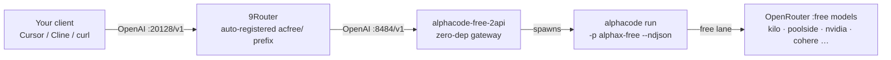

<p align="center">
  
</p>

<h1 align="center">alphacode-free-2api</h1>

<p align="center"><b>Turn alphacode's built-in free AI lane into an OpenAI-compatible API.</b><br/>Plug it into 9Router, Cursor, Cline, or any LLM client. Zero dependencies.</p>

<p align="center">
  <a href="#-english">English</a> ·
  <a href="README.id-ID.md">Bahasa Indonesia</a> ·
  <a href="README.es.md">Español</a> ·
  <a href="README.zh-CN.md">简体中文</a> ·
  <a href="README.ja.md">日本語</a>
</p>

<p align="center">
  
  = 18"/>
  
  
  
  
</p>

---

## What is this?

[alphacode](https://github.com/dragonked2/alphacode) ships with a **built-in free lane** (`alphax-free`) — free LLM models routed through OpenRouter's `:free` tier, no API key required. This project wraps that lane in a tiny HTTP gateway and speaks the **OpenAI Chat Completions protocol**, so anything that can call OpenAI can now call your alphacode free models.

It also registers the gateway into [9Router](https://9router.com) as an OpenAI-compatible node, so the models show up there with a clean `acfree/` prefix.

## Features

- **OpenAI-compatible** — `GET /v1/models` and `POST /v1/chat/completions`, streaming (`stream: true` via SSE) and non-streaming
- **Zero dependencies** — pure Node.js (`http` module only), single file
- **Free forever** — uses alphacode's official free lane; no keys, no signup
- **9Router integration** — one curl to add it as an `acfree/` provider node
- **Safe by design** — request queue with concurrency limit, hard upstream timeout, 5 MB body cap
- **Single-user, local-first** — runs on your machine, your quotas

## How it works



## Repository structure

```text
alphacode-free-2api/
├── assets/
│   └── logo.svg            # project logo
├── src/
│   └── alphacode-2api.js   # the entire gateway (single file, zero deps)
├── CONTRIBUTING.md         # contribution guide
├── SECURITY.md             # security policy
├── package.json            # metadata + npm start
├── LICENSE                 # MIT
├── README.md               # English (this file)
├── README.id-ID.md         # Bahasa Indonesia
├── README.es.md            # Español
├── README.zh-CN.md         # 简体中文
└── README.ja.md            # 日本語
```

## Requirements

| Requirement | Notes |
|---|---|
| [alphacode](https://github.com/dragonked2/alphacode) v1.0.84+ | installed and on `PATH` (`alphacode --version`) |
| Node.js ≥ 18 | runtime for the gateway |
| Linux / macOS | anywhere `alphacode` runs |

## Installation

**Step 1 — Install Node.js ≥ 18**

```bash
# Debian/Ubuntu
curl -fsSL https://deb.nodesource.com/setup_20.x | sudo -E bash - && sudo apt-get install -y nodejs
# macOS (Homebrew)
brew install node
# or use the official installer: https://nodejs.org
node --version   # must be >= 18
```

**Step 2 — Install alphacode**

```bash
# macOS / Linux — one line
curl -fsSL https://raw.githubusercontent.com/dragonked2/alphacode/main/scripts/install.sh | bash

# verify
alphacode --version   # expect v1.0.84 or newer
```

> **Troubleshooting:** if the binary fails with `libxkbcommon.so.0: cannot open shared object file`, grab the **musl (static) build** instead — it has no shared-library dependencies:
> ```bash
> curl -fL https://github.com/dragonked2/alphacode/releases/latest/download/alphacode-linux-musl-x86_64.tar.gz -o alphacode.tar.gz
> tar -xzf alphacode.tar.gz && sudo install -m 755 alphacode /usr/local/bin/
> ```
> (use `alphacode-linux-musl-aarch64.tar.gz` on ARM). Verify with `alphacode --version`.

**Step 3 — Get this project**

```bash
git clone https://github.com/0xgetz/alphacode-free-2api.git
cd alphacode-free-2api
```

**Step 4 — First run**

```bash
node src/alphacode-2api.js
```

First launch triggers alphacode's one-time onboarding (agree with `[y]` once) — after that the gateway runs unattended.

## Quick start

```bash
# 1. Verify alphacode is installed
alphacode --version

# 2. Start the gateway
node src/alphacode-2api.js
# → alphacode-2api listening on http://0.0.0.0:8484/v1

# 3. List models
curl http://localhost:8484/v1/models

# 4. Chat
curl http://localhost:8484/v1/chat/completions \
  -H "Content-Type: application/json" \
  -d '{
    "model": "kilo-auto/free",
    "messages": [{"role": "user", "content": "Say hello"}]
  }'
```

## Connect to 9Router (automatic)

The gateway registers itself in 9Router on startup — no manual node creation, no API keys to paste.

### Step 1 — Install and start 9Router

```bash
npm install -g 9router
9router          # dashboard: http://localhost:20128
```

9Router listens on `127.0.0.1:20128` and protects its dashboard with a password (`123456` on a fresh install).

### Step 2 — Start the gateway

```bash
node src/alphacode-2api.js
```

On startup it logs in to 9Router, creates the `acfree` node and the provider connection, then reports:

```text
alphacode-2api listening on http://0.0.0.0:8484/v1 (provider: alphax-free, models: 9)
[9router] node created: openai-compatible-chat-… (prefix acfree)
[9router] connection created: 5ffae499-…
[9router] connected -> http://127.0.0.1:20128 | models available as acfree/<model>
```

Order does not matter: if 9Router is not running yet, the gateway retries every 15 seconds until it connects. Restarting the gateway is safe — existing nodes and connections are reused, not duplicated.

### Step 3 — Verify

Open the 9Router dashboard → **Providers**. You should see **AlphaCode Free 2API** (active), and under **Models** every entry prefixed `acfree/`.

### Step 4 — Use it

Create an API key in the dashboard (**Keys**), then call 9Router like any OpenAI endpoint:

```bash
curl http://localhost:20128/v1/chat/completions \
  -H "Authorization: Bearer <your-9router-key>" \
  -H "Content-Type: application/json" \
  -d '{"model":"acfree/kilo-auto/free","messages":[{"role":"user","content":"hello"}]}'
```

Or point any client at `http://localhost:20128/v1` and pick a model starting with `acfree/`.

### Settings

| Variable | Default | Description |
|---|---|---|
| `AUTO_CONNECT_ROUTER` | `1` | `0` disables auto-connect |
| `ROUTER_URL` | `http://127.0.0.1:20128` | 9Router address (change if using another port/host) |
| `ROUTER_PASSWORD` | `123456` | 9Router dashboard password — must match yours |
| `ROUTER_PREFIX` | `acfree` | Model prefix inside 9Router |
| `ROUTER_RETRY_MS` | `15000` | Retry interval while 9Router is unreachable |

### Troubleshooting

| Symptom | Cause / fix |
|---|---|
| `[9router] not connected yet (...); retrying` | 9Router is not running — start it with `9router` |
| `router login failed` | Password differs from `ROUTER_PASSWORD`; set the correct one |
| `ECONNREFUSED` | Wrong `ROUTER_URL` or 9Router bound to another port (`9router --port 8080`) |
| Gateway works but 9Router has no models | Node exists without a connection — delete it in **Providers** and restart the gateway |
| Models answer slowly | First call per model warms up the free lane; increase `UPSTREAM_TIMEOUT_MS` on slow links |

<details>
<summary>Manual setup (fallback)</summary>

```bash
# 1. Create the node (login first: cookie from POST /api/auth/login)
curl -X POST http://localhost:20128/api/provider-nodes \
  -H "Content-Type: application/json" \
  -d '{"name":"AlphaCode Free 2API","prefix":"acfree","apiType":"chat","type":"openai-compatible","baseUrl":"http://127.0.0.1:8484/v1"}'

# 2. Create a connection for the node (any placeholder key works)
curl -X POST http://localhost:20128/api/providers \
  -H "Content-Type: application/json" \
  -d '{"provider":"<node-id from step 1>","apiKey":"sk-placeholder","displayName":"AlphaCode Free 2API","isActive":true}'
```

</details>

## API endpoints

| Method | Path | Description |
|---|---|---|
| `GET` | `/v1/models` | List available free models |
| `POST` | `/v1/chat/completions` | Chat completion (supports `"stream": true`) |
| `GET` | `/health` | Gateway status |

## Available models

| Model ID | Owner |
|---|---|
| `kilo-auto/free` | Kilo |
| `poolside/laguna-s-2.1:free` | Poolside |
| `nvidia/nemotron-3-super-120b-a12b:free` | NVIDIA |
| `nvidia/nemotron-3-ultra-550b-a55b:free` | NVIDIA |
| `inclusionai/ling-3.0-flash-sante:free` | InclusionAI |
| `cohere/north-mini-code:free` | Cohere |
| `liquid/lfm-2.5-2.6b:free` | Liquid |
| `thinkingmachines/inkling-small:free` | Thinking Machines |
| `dots-studio/dots-3-note-preview:free` | Dots Studio |

## Configuration

All configuration is via environment variables — sensible defaults included.

| Variable | Default | Description |
|---|---|---|
| `PORT` | `8484` | HTTP listen port |
| `API_KEY` | *(empty — open)* | If set, all requests require `Authorization: Bearer <key>` |
| `AC_PROVIDER` | `alphax-free` | alphacode provider to invoke |
| `AC_CWD` | `/tmp/bcode/acidemo` | Working directory passed to `alphacode run` |
| `MAX_CONCURRENT` | `4` | Max parallel upstream alphacode processes |
| `UPSTREAM_TIMEOUT_MS` | `240000` | Hard timeout per upstream call |

## Disclaimer

This tool wraps **alphacode's official free lane** for personal, single-user use. It does not create accounts, bypass quotas, or harvest credentials. Use it within the terms of service of alphacode and the upstream model providers.

## License

[MIT](LICENSE) © alphacode-free-2api contributors
