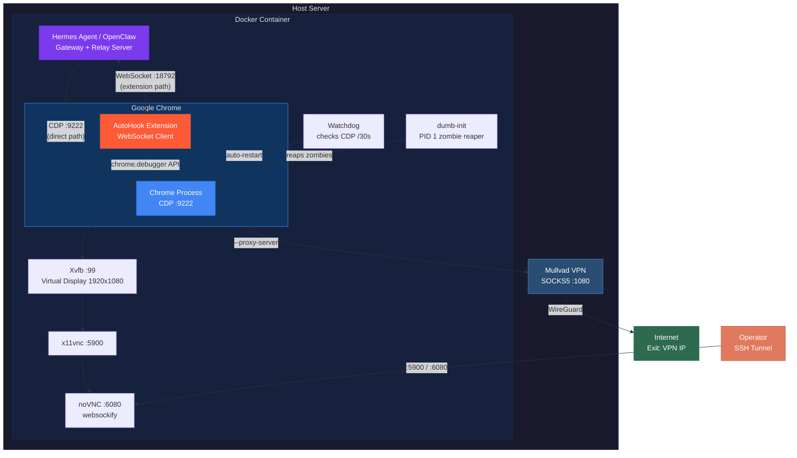
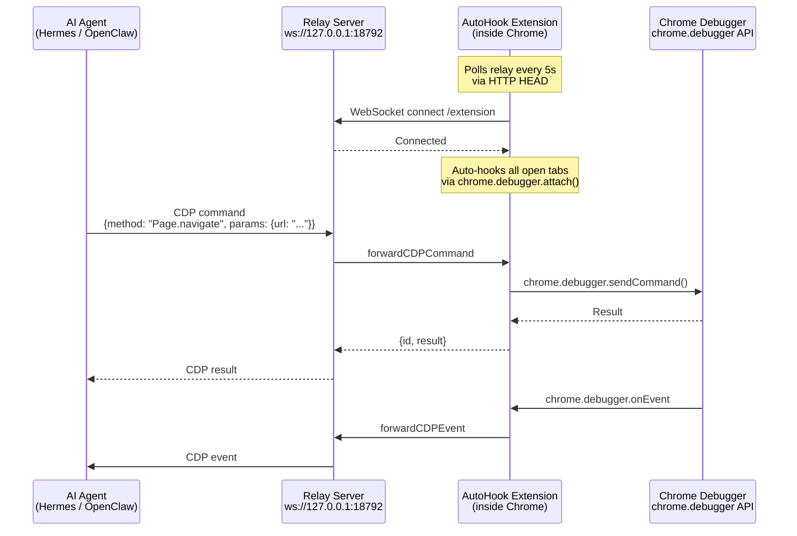
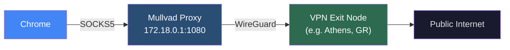

# VirtualPerson

[](LICENSE)
[](https://ubuntu.com)
[](https://docker.com)
[](https://chromedevtools.github.io/devtools-protocol/)
[](https://mullvad.net)
[](https://github.com/NousResearch/hermes-agent)
[](https://github.com/openclaw/openclaw)

Secure, VPN-routed Chrome environment for managing virtual personas on headless Linux servers. Built for AI agent orchestration with [Hermes Agent](https://github.com/NousResearch/hermes-agent) and [OpenClaw](https://github.com/openclaw/openclaw).

## Overview

VirtualPerson gives your AI agent a real browser. Not a headless stub or a Playwright-managed Chromium, but a full Google Chrome instance running on a virtual display, routed through Mullvad VPN, and visible through VNC for human monitoring.

Two control paths are available:

- **AutoHook Extension** (fast path): A Chrome extension that acts as a WebSocket bridge between the agent and Chrome's internal debugger API. The agent's relay server sends CDP commands over WebSocket, the extension executes them via `chrome.debugger`, and forwards events back. No external debug port needed. Tested with both Hermes Agent and OpenClaw.

- **Direct CDP** (reliable path): Standard Chrome DevTools Protocol connection to `127.0.0.1:9222`. Slightly more latency since it goes through Chrome's external debug interface, but rock solid for complex automation sequences. Everything can be turned into a reusable skill.

Both paths route all traffic through the VPN. The agent browses, posts, messages, and manages accounts. The operator watches over VNC when needed.

### Features

- Real Google Chrome with persistent profile (cookies, sessions, localStorage survive restarts)
- All traffic routed through Mullvad VPN via SOCKS5 proxy
- WebRTC leak protection enabled by default
- Two browser control paths: AutoHook Extension (WebSocket) and Direct CDP
- VNC + noVNC for visual monitoring via SSH tunnels
- Anti-detection flags (no automation banners, no `navigator.webdriver`)
- Zombie process reaping via `dumb-init` (PID 1)
- Chrome watchdog with automatic crash recovery (checks CDP every 30s)
- Docker and bare-metal deployment

## Architecture



### AutoHook Extension Flow

The extension bridges the agent and Chrome without exposing an external debug port:



**How it works:**

1. The extension runs as a Chrome service worker (Manifest V3)
2. Every 5 seconds it checks if the agent's relay server is reachable (`HTTP HEAD` to `127.0.0.1:18792`)
3. When the relay comes online, it opens a WebSocket connection to `ws://127.0.0.1:18792/extension`
4. It then auto-attaches to every open tab using `chrome.debugger.attach(tabId, "1.3")`
5. New tabs are hooked automatically on page load via `chrome.tabs.onUpdated`
6. Incoming CDP commands from the agent arrive over WebSocket, get executed via `chrome.debugger.sendCommand()`, and results flow back
7. Chrome debugger events (`onEvent`) are forwarded to the agent in real time
8. Tab lifecycle is managed transparently: `Target.createTarget` creates tabs, `Target.closeTarget` removes them, `Target.activateTarget` focuses them

The extension requires `debugger`, `tabs`, `activeTab`, and `storage` permissions. It only connects to `127.0.0.1`.

### Network Flow



All services bind to `127.0.0.1`. Nothing is exposed to the public internet. Access is exclusively via SSH tunnels.

## Deployment

### Option A: Docker (Recommended)

Best for use with [Hermes Agent](https://github.com/NousResearch/hermes-agent) or [OpenClaw](https://github.com/openclaw/openclaw). The Dockerfile installs Hermes Agent automatically.

**Prerequisites:** Docker, Docker Compose, Mullvad VPN account, SSH access.

```bash
git clone https://github.com/0xyg3n/VirtualPerson.git
cd VirtualPerson

cp .env.example .env
# Edit .env with your proxy address if needed

docker compose up -d

# Verify
docker logs hermes 2>&1 | grep -E '\[entrypoint\]|\[launch-chrome\]'
docker exec hermes curl -sf http://127.0.0.1:9222/json/version | head -1
```

### Option B: Bare-Metal Scripts

For servers where Chrome runs directly without Docker.

**Prerequisites:** Ubuntu 22.04+, Chrome, Xvfb, x11vnc, websockify, WireGuard, firejail, socat, microsocks.

```bash
git clone https://github.com/0xyg3n/VirtualPerson.git ~/virtual-person
cd ~/virtual-person

# Install deps
sudo apt update && sudo apt install -y \
  xvfb x11vnc websockify socat firejail wireguard-tools google-chrome-stable

# Set up VPN namespace
sudo ./scripts/setup-vpn-namespace.sh

# Start (VPN + CDP, recommended for production)
./scripts/start-vpn-cdp.sh

# Check status
./scripts/status.sh
```

| Mode | Script | VPN | CDP | Use Case |
|------|--------|:---:|:---:|----------|
| No VPN | `start.sh` | | x | Initial setup, login, debugging |
| VPN only | `start-vpn.sh` | x | | Browse-only via VNC |
| VPN + CDP | `start-vpn-cdp.sh` | x | x | Production |

### VNC Access

```bash
# SSH tunnel
ssh -N -L 6080:localhost:6080 user@your-server

# Open in browser
# http://localhost:6080/vnc.html
```

## Agent Integration

### Hermes Agent

[Hermes Agent](https://github.com/NousResearch/hermes-agent) is installed automatically in the Docker image. The gateway starts after the display stack is ready.

The agent accesses Chrome through `BROWSER_CDP_URL` (direct CDP) or the AutoHook relay (WebSocket on port 18792). All browser automation goes through the VPN proxy transparently.

Create skills under `.hermes/skills/` to teach the agent platform-specific workflows. Each platform interaction (posting, messaging, profile updates) can become a reusable skill the agent loads when needed.

### OpenClaw

[OpenClaw](https://github.com/openclaw/openclaw) connects to Chrome via the AutoHook relay or direct CDP.

**AutoHook Relay** (preferred): Load the extension from `extensions/autohook/`, set up an SSH reverse tunnel for the relay port, and use `browser(action="snapshot/act", profile="chrome")`. The extension auto-hooks all tabs.

**Direct CDP** (fallback):
```python
from playwright.sync_api import sync_playwright

with sync_playwright() as p:
    browser = p.chromium.connect_over_cdp("http://127.0.0.1:9222")
    page = browser.contexts[0].pages[0]
    page.goto("https://example.com")
```

## AI Agent Setup Prompt

Use this prompt with Hermes Agent, OpenClaw, Claude Code, or any AI assistant to deploy VirtualPerson on a fresh Ubuntu VPS:

<details>
<summary><b>Expand setup prompt</b></summary>

```
You are setting up VirtualPerson on this server. Follow these steps exactly.

PREREQUISITES:
- Fresh Ubuntu 22.04+ with SSH access and sudo
- Mullvad VPN account number (or existing WireGuard config)

STEP 1: Clone
  git clone https://github.com/0xyg3n/VirtualPerson.git ~/virtual-person
  cd ~/virtual-person

STEP 2: Choose deployment mode

  [A] DOCKER (recommended):
    - Install Docker and Docker Compose if missing
    - Install Mullvad VPN on the HOST:
        curl -fsSL https://repository.mullvad.net/deb/mullvad-keyring.asc \
          | sudo gpg --dearmor -o /usr/share/keyrings/mullvad-keyring.gpg
        echo "deb [signed-by=/usr/share/keyrings/mullvad-keyring.gpg arch=$(dpkg --print-architecture)] \
          https://repository.mullvad.net/deb/stable $(lsb_release -cs) main" \
          | sudo tee /etc/apt/sources.list.d/mullvad.list
        sudo apt update && sudo apt install -y mullvad-vpn
    - Log in and connect:
        mullvad account login <ACCOUNT_NUMBER>
        mullvad socks5 set state on
        mullvad connect
    - Verify: mullvad status && curl https://wtfismyip.com/text
    - Configure: cp .env.example .env
    - Build and start: docker compose up -d
    - Verify Chrome: docker exec hermes curl -sf http://127.0.0.1:9222/json/version

  [B] BARE-METAL:
    - Install deps:
        sudo apt update && sudo apt install -y \
          xvfb x11vnc websockify socat firejail wireguard-tools google-chrome-stable
    - Install microsocks:
        git clone https://github.com/rofl0r/microsocks.git /tmp/microsocks
        cd /tmp/microsocks && make && sudo cp microsocks /usr/local/bin/
    - Configure Mullvad WireGuard:
        Download .conf from mullvad.net/en/account/wireguard-config
        Save to ~/virtual-person/mullvad/wg0.conf (chmod 600)
    - Create VPN namespace: sudo ./scripts/setup-vpn-namespace.sh
    - Start: ./scripts/start-vpn-cdp.sh
    - Verify: ./scripts/status.sh

STEP 3: Firewall
  sudo ufw default deny incoming
  sudo ufw default allow outgoing
  sudo ufw allow ssh
  sudo ufw enable

STEP 4: Verify
  - Chrome running with CDP on :9222
  - External IP shows VPN exit node, NOT server IP
  - VNC accessible via SSH tunnel on :5900 or :6080
  - No ports exposed to public internet

STEP 5: Load AutoHook extension
  - The extension is pre-loaded via --load-extension in launch-chrome.sh
  - Verify: open Chrome options page and confirm relay status is green
  - If using OpenClaw, start the browser relay server and confirm the
    extension badge shows "ON" on all tabs

RULES:
  - NEVER bind anything to 0.0.0.0
  - NEVER commit VPN configs, credentials, or Chrome profiles
  - Only launch Chrome via launch-chrome.sh (Docker) or start scripts (bare-metal)
  - All access through SSH tunnels only
```

</details>

## AutoHook Extension

`extensions/autohook/` contains the browser relay extension (Manifest V3, version 0.3.0). Originally developed for [OpenClaw](https://github.com/openclaw/openclaw), it works with any agent that speaks CDP over WebSocket.

### How it works

The extension runs as a Chrome service worker with `debugger`, `tabs`, `activeTab`, and `storage` permissions. It acts as a bidirectional bridge:

1. **Relay discovery**: Polls `http://127.0.0.1:18792` every 5 seconds via `HTTP HEAD`
2. **WebSocket connect**: When the relay is up, opens `ws://127.0.0.1:18792/extension` (optional token auth)
3. **Tab hooking**: Attaches to every open tab via `chrome.debugger.attach(tabId, "1.3")`. New tabs are auto-hooked on load.
4. **Command forwarding**: Agent sends CDP commands through the relay WebSocket. The extension executes them via `chrome.debugger.sendCommand()` and returns results.
5. **Event streaming**: Chrome debugger events (`chrome.debugger.onEvent`) are forwarded to the agent in real time.
6. **Tab management**: `Target.createTarget`, `Target.closeTarget`, and `Target.activateTarget` are handled natively through `chrome.tabs`.
7. **Reconnection**: If the relay goes offline, the extension detaches all tabs and resumes polling. When connectivity returns, all tabs are re-hooked automatically.

### Configuration

Open the extension options page (or `chrome-extension://<id>/options.html`):

| Setting | Default | Description |
|---------|---------|-------------|
| Relay Port | `18792` | WebSocket port of the agent's relay server |
| Gateway Token | *(empty)* | Optional auth token appended as `?token=` query param |
| AutoHook | `on` | Automatically attach to all tabs when relay is reachable |

### Extension vs Direct CDP

| | AutoHook Extension | Direct CDP |
|---|---|---|
| Connection | WebSocket to agent relay | TCP to `127.0.0.1:9222` |
| Speed | Faster (in-process debugger API) | Slightly slower (external debug protocol) |
| Setup | Extension must be loaded in Chrome | Just enable `--remote-debugging-port` |
| Reliability | Depends on relay + extension health | Very reliable, standard protocol |
| VPN namespaces | Works without socat bridges | Needs socat bridge if Chrome is in a namespace |
| Skillability | Works with browser relay commands | Everything can be a reusable agent skill |
| Best for | Real-time browsing, quick actions | Complex automation, multi-step workflows |

## Project Structure

```
VirtualPerson/
├── Dockerfile                 # Hermes Agent + Chrome + display stack
├── docker-compose.yml         # Docker deployment config
├── entrypoint.sh              # Container startup: Xvfb > Chrome > VNC > gateway
├── launch-chrome.sh           # Chrome launcher (flags, proxy, watchdog)
├── .env.example               # Environment template
├── scripts/
│   ├── start.sh               # Bare-metal: no VPN
│   ├── start-vpn.sh           # Bare-metal: VPN, no CDP
│   ├── start-vpn-cdp.sh       # Bare-metal: VPN + CDP (production)
│   ├── stop.sh                # Stop services
│   ├── status.sh              # Health check
│   └── setup-vpn-namespace.sh # WireGuard namespace setup
├── extensions/
│   └── autohook/              # Browser relay extension (Manifest V3)
│       ├── background.js      # Service worker: relay, debugger, auto-hook
│       ├── manifest.json      # Permissions: debugger, tabs, activeTab, storage
│       ├── options.html       # Config UI (port, token, autohook toggle)
│       ├── options.js         # Settings persistence + relay health check
│       └── icons/             # Extension icons (16/32/48/128)
├── docs/
│   ├── ACCESS.md              # SSH tunnel guide
│   └── MULLVAD-SETUP.md       # VPN setup guide
└── .gitignore
```

## Security

| Measure | Detail |
|---------|--------|
| Binding | All services on `127.0.0.1` only |
| Access | SSH tunnels required for VNC, CDP, noVNC |
| VPN | All Chrome traffic through Mullvad WireGuard |
| WebRTC | Leak protection via `disable_non_proxied_udp` |
| Detection | Automation flags suppressed (`AutomationControlled`, `infobars`) |
| Extension | Only connects to `127.0.0.1`, optional token auth |
| Process | `dumb-init` PID 1 reaps zombie Chrome children |
| Recovery | Watchdog checks CDP every 30s, auto-restarts on crash |
| Memory | `shm_size: 512m` prevents Chrome shared-memory crashes |

## Links

| Resource | URL |
|----------|-----|
| Hermes Agent | [github.com/NousResearch/hermes-agent](https://github.com/NousResearch/hermes-agent) |
| OpenClaw | [github.com/openclaw/openclaw](https://github.com/openclaw/openclaw) |
| Mullvad VPN | [mullvad.net](https://mullvad.net) |
| Chrome DevTools Protocol | [chromedevtools.github.io](https://chromedevtools.github.io/devtools-protocol/) |

## License

AGPL-3.0
