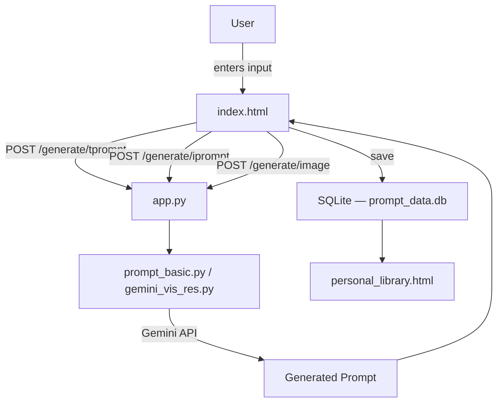

## Prompt Sanctuary

### Overview

Prompt Sanctuary is a Flask web application powered by the Google Gemini API. It lets users generate structured text and image prompts from their own input, upload an image to extract a prompt from it, or hit random generation for both modes. Generated prompts can be saved to a personal library, edited, and copied.

The UI follows the **Swiss International Typographic Style** — strict grid layout, Montserrat sans-serif, high-contrast black/white palette with a single red accent (`#E30613`), no shadows or gradients, and numbered section indices throughout.

### Project Structure

```text
app/
├── database/          # SQLite databases (auto-created on first run)
├── static/
│   ├── font/          # Montserrat, Rubik, Caveat (local TTF)
│   ├── icon/          # favicon, logo
│   ├── script/        # generator.js, side_panel.js, save.js, etc.
│   └── style/         # generator.css, side.css, login.css, mylib.css, footer.css
├── templates/
│   ├── index.html          # Main generator page
│   ├── login.html          # Login / signup
│   └── personal_library.html  # Saved prompts library
├── app.py
├── prompt_basic.py    # Text and image prompt generation (Gemini)
├── gemini_vis_res.py  # Image-to-prompt (Gemini Vision)
└── .env
```

### Installation

1. Clone the repository:

   ```bash
   git clone https://github.com/1999AZZAR/prompt-generator
   cd prompt-generator
   ```

2. Create a virtual environment and install dependencies:

   ```bash
   python -m venv .venv
   source .venv/bin/activate
   pip install -r requirements.txt
   ```

### Configuration

1. Get a Gemini API key from [Google AI Studio](https://aistudio.google.com/app/apikey).

2. Create `app/.env`:

   ```bash
   GENAI_API_KEY=your_api_key_here
   ```

   Multiple keys (round-robin) are supported — separate with commas:

   ```bash
   GENAI_API_KEY=key_one,key_two,key_three
   ```

### Usage

Run from inside the `app/` directory:

```bash
cd app
python app.py
```

Open [http://localhost:5000](http://localhost:5000).

| Feature | How |
|---|---|
| Text prompt | Enter a topic → Generate |
| Random text prompt | Click Random |
| Image prompt from text | Select Text radio → enter topic → Generate |
| Image prompt from file | Select File radio → upload image → Generate |
| Random image prompt | Select Random radio → Generate |
| Save prompt | Generate → Save → enter title |
| Edit / delete | Saved Prompts page |

### Flowchart



### Dependencies

- [Flask](https://flask.palletsprojects.com/)
- [google-generativeai](https://ai.google.dev/docs)
- [python-dotenv](https://pypi.org/project/python-dotenv/)
- [Pillow](https://pillow.readthedocs.io/)

### Contributors

- [azzar](https://github.com/1999AZZAR)

### License

See [LICENSE.md](LICENSE.md) for details.
