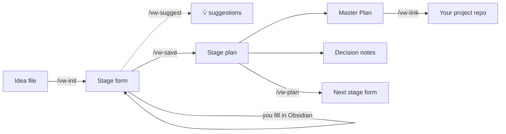

<div align="center">


# Vaultwright

### From raw idea to battle-tested plan, built stage by stage inside your Obsidian vault.

**An AI planning agent for Claude Code and any coding agent.** Vaultwright reads your idea, builds a planning repository in Obsidian, interviews you with forms tailored to your project, and turns your answers into a clear, decision-oriented master plan.

[](LICENSE)


[Quick start](#-quick-start) · [Tutorial](#-full-tutorial) · [Commands](#-commands) · [How it works](#-how-it-works) · [Other agents](#-using-with-other-agents) · [Português](docs/TUTORIAL.pt-BR.md)

</div>

---

## Why Vaultwright?

Most ideas die between "this would be cool" and "here's the plan". A chat with an AI gives you a generic plan. A blank Notion page gives you nothing.

Vaultwright works differently:

- 🧭 **Staged.** Ten stages, from Vision to Metrics. Each one is planned only when the previous one is solid.
- 📝 **Form-driven.** For each stage you get a form in Obsidian with questions written for *your* project. It already knows your audience and constraints, and it doesn't ask twice.
- 🤖 **Pre-filled, never presumptuous.** Anything it can infer from your idea is pre-filled and marked 🤖, so you confirm or correct it. It never overwrites your answers.
- 💡 **Suggestions on demand.** Stuck on a question? `/vw-suggest` adds concrete options with trade-offs (and sources, when it researches the web) right below the question.
- 🧱 **Synthesis, not transcripts.** `/vw-save` checks the form for gaps and contradictions, then writes a clean stage plan, updates a living **Master Plan**, and logs each **decision** as a note.
- 🔗 **Plan ↔ project.** `/vw-link` connects the vault plan to your code repo, so your coding agent reads the plan before it builds.
- 🌍 **Any project, any language.** Software, business, product, event, book, research, course, campaign, nonprofit. Forms are written in the language of your idea.
- 🗂️ **Plain Markdown you own.** No database and no lock-in. Everything lives in your vault, with optional Dataview views.

## ⚡ Quick start

**Requirements:** [Claude Code](https://claude.com/claude-code) (or another agent, see [below](#-using-with-other-agents)) and an [Obsidian](https://obsidian.md) vault.

### Option A: Claude Code plugin (recommended)

Inside Claude Code:

```
/plugin marketplace add 1felip/vaultwright
/plugin install vaultwright@vaultwright
```

Restart Claude Code, then:

```
/vw-init path/to/my-idea.md path/to/MyVault
```

### Option B: manual install (skill + commands)

```bash
git clone https://github.com/1felip/vaultwright.git
cd vaultwright
./install.sh --vault "/path/to/MyVault"        # macOS / Linux / Git Bash
# or
./install.ps1 -Vault "C:\Users\me\MyVault"      # Windows PowerShell
```

Setting the vault saves `VAULTWRIGHT_VAULT`, so you can omit the vault path in commands. To remove: `./install.sh --uninstall` or `./install.ps1 -Uninstall`.

## 🧰 Commands

| Command | What it does |
|---|---|
| `/vw-init <idea-file> [vault]` | Reads your idea, detects language and project type, creates the planning repository, and writes the **Stage 1 form** with inferred answers |
| `/vw-plan [stage]` | Creates the form for the next stage (or a specific one), tailored to everything saved so far |
| `/vw-suggest [stage] [Qx.y]` | Adds concrete suggestions under empty or weak answers, without touching your text |
| `/vw-save [stage]` | Validates the form, flags gaps and contradictions, writes the **stage plan**, updates the **Master Plan**, and logs **decisions** |
| `/vw-link [project-path]` | Connects the plan to a project folder or repo (`PLAN.md`, `.vaultwright.json`, a `CLAUDE.md`/`AGENTS.md` section, optional export and issues) |
| `/vw-status` | Shows the progress table and the single best next step |

> If another plugin uses the same names, the namespaced form works too: `/vaultwright:vw-init`.

## 📖 Full tutorial

This walkthrough uses the example idea in [`examples/idea-freelance-invoices.md`](examples/idea-freelance-invoices.md).

### 1. Write your idea, however rough

Any format works: a paragraph, bullet points, a voice-note transcript, a `.txt`, or a `.md`. Include whatever you know (problem, audience, budget, deadline, doubts). Vaultwright uses every scrap.

```markdown
# Idea: Paid on Time
I'm a freelance designer… clients pay late… a web app that sends polite,
escalating reminders by email and WhatsApp… live in 3 months, R$ 500/month…
Not sure: is WhatsApp allowed? Do I need PIX? Would people pay?
```

### 2. Initialize the planning repository

```
/vw-init examples/idea-freelance-invoices.md ~/Documents/MyVault
```

Vaultwright:
1. reads the idea and detects **language** and **project type** (here: `software` + `business`);
2. creates the repository in your vault (in `Projects/` if that folder exists, otherwise at the root):

```
MyVault/Projects/Paid on Time/
├── 00 - Dashboard.md        ← start here: stage board, next step, decisions, links
├── Idea.md                  ← your idea, verbatim
├── Master Plan.md           ← grows with every saved stage
├── Stages/
│   └── 01 - Vision/
│       └── Form.md          ← your first form
├── Decisions/
├── Suggestions/
├── Attachments/
└── .vaultwright.json        ← config (vault, stages, status, linked repos)
```

3. writes the **Vision form**, pre-filling what your idea already says (marked 🤖).

### 3. Fill the form in Obsidian

Open `Stages/01 - Vision/Form.md`. Each question has:

- a **★** if it's required;
- a collapsible **"Why this matters"** note, plus an **example** when the question is abstract;
- an **answer area** between two markers. Switch to *Live Preview* or *Source mode* to see them:

```markdown
### Q1.2 — How much money and time does a typical freelancer lose to late payments today? ★
<!-- vw:answer Q1.2 -->
Around 30% of my invoices are paid 2+ weeks late. ~2h/month writing reminders.
<!-- /vw:answer -->
```

Choice questions use checkboxes (`- [x]`). Table questions have an empty table inside the answer area. For 🤖 answers, correct them if needed, then delete the 🤖 line to confirm.

See a full sample form: [`examples/sample-vault/…/01 - Vision/Form.md`](examples/sample-vault/Projects/Paid%20on%20Time/Stages/01%20-%20Vision/Form.md).

### 4. Stuck? Ask for suggestions

```
/vw-suggest 01            # all empty or weak questions in stage 01
/vw-suggest 01 Q3.2       # one specific question
```

Suggestions appear as a collapsible 💡 callout **below** the answer area, with 1–3 concrete options and their trade-offs. Your text is never touched. Long research (competitor tables, market numbers) goes to `Suggestions/` and is linked from the callout. Copy what you like into your answer.

### 5. Save the stage

Tick the **Ready?** checklist, then:

```
/vw-save
```

Vaultwright parses the form and:
- **stops and asks** if required questions are empty, 🤖 answers are unconfirmed, or answers contradict earlier stages. You choose to finish them or save them as open items;
- writes `Stages/01 - Vision/Plan.md`: a decisive synthesis with key decisions, details, assumptions, open items, and links back to each question;
- creates `Decisions/001 - ….md` notes (ADR style: context, decision, alternatives, consequences, "revisit if");
- updates only the Vision section of `Master Plan.md`, and the Dashboard.

### 6. Plan the next stage, and repeat

```
/vw-plan
```

The **Discovery** form is written with Vision in mind. It won't ask who your user is again; it builds on that ("Given your first users are Brazilian freelance designers billing 3–15 clients/month, which alternatives do they use today?").

Loop **plan → fill → suggest → save** through all ten stages:

| # | Stage | Done when… |
|---|---|---|
| 01 | Vision | problem, audience, value and success are explicit |
| 02 | Discovery | assumptions listed; alternatives, competitors and users understood |
| 03 | Scope & Requirements | in/out of v1 decided and prioritized (MoSCoW) |
| 04 | Solution Design | how it works is decided (architecture, format, operations) |
| 05 | Resources & Budget | people, skills, tools, money and time matched to needs |
| 06 | Roadmap & Milestones | phases, dated milestones, dependencies |
| 07 | Risks & Assumptions | risks scored with mitigations; riskiest assumption has a test |
| 08 | Execution Plan | first milestone broken into owned tasks |
| 09 | Launch & Distribution | how it reaches its audience |
| 10 | Metrics & Review | north-star metric, feedback loops, review cadence |

Questions adapt to the project type. Stage 04 means *stack and data model* for software, *venue and run-of-show* for an event, *methodology* for research, and *outline and production pipeline* for a book. A stage that doesn't apply can be skipped.

Edited a form after saving it? It becomes 🔁 *revised*. Run `/vw-save` again to regenerate its plan (a revision history is kept).

### 7. Link the plan to your project

When it's time to build:

```
cd ~/code/paid-on-time
/vw-link
```

This creates:
- `.vaultwright.json`, so every `/vw-*` command works from the project folder;
- `PLAN.md`, a generated pointer with the stage table and `obsidian://` links to each plan;
- a marked **Vaultwright section** in your existing `CLAUDE.md` / `AGENTS.md`, telling coding agents to read the Master Plan before significant work;
- with your consent: a `docs/plan/` snapshot (wikilinks converted to Markdown links), and a task checklist or GitHub issues from the Execution stage.

Obsidian stays the source of truth. Nothing is symlinked unless you ask.

### 8. Check progress anytime

```
/vw-status
```

## 🔍 How it works



Vaultwright is a **Claude Code plugin** made of:

```
vaultwright/
├── .claude-plugin/           plugin + marketplace manifests
├── commands/                 /vw-init, /vw-plan, /vw-save, /vw-suggest, /vw-link, /vw-status
├── skills/vaultwright/
│   ├── SKILL.md              the method: all six procedures
│   ├── references/           stage catalog + question banks, form spec, Obsidian conventions
│   └── templates/            Dashboard, Form, Plan, Master Plan, Decision, Suggestions, config
├── AGENTS.md                 how to run the same method with any other agent
├── examples/                 sample idea + sample form
└── install.ps1 / install.sh  manual install
```

The commands are thin. The method lives in `SKILL.md`, which loads its references and templates only when a procedure needs them.

**Form format.** Answers sit between `<!-- vw:answer ID -->` and `<!-- /vw:answer -->` markers. They're invisible in Reading view and easy to parse reliably. Suggestions carry a `<!-- vw:suggestion ID -->` marker, so re-running suggest replaces them instead of duplicating. The full spec is in [`skills/vaultwright/references/form-spec.md`](skills/vaultwright/references/form-spec.md).

**Safety rules.** Vaultwright never writes inside your answers, never deletes or renames your notes, never touches `.obsidian/`, and asks before anything outward-facing (exports, GitHub issues).

## 🤝 Using with other agents

The method is plain Markdown, so any agent that can read and write files can run it: OpenAI Codex CLI, Cursor, Gemini CLI, GitHub Copilot, Windsurf, Aider, OpenCode. See [`AGENTS.md`](AGENTS.md). Either copy its instructions into your agent's rules file, or drop `skills/vaultwright/` into your agent's skills folder. Then talk to it in plain words:

```
vw init ideas/my-idea.md ~/MyVault
vw suggest 02
vw save
```

## 💡 Tips

- **Recommended Obsidian plugins (optional):** Dataview (live Dashboard table) and Excalidraw (diagrams in Solution Design). Mermaid works out of the box.
- **Version your vault** with git (or Obsidian Git) to see how your plan evolves.
- **Several projects** can live in one vault. Each folder has its own `.vaultwright.json`.
- **Planning out of order** is allowed (`/vw-plan 07`). Vaultwright warns you about context that's missing.
- **Your language:** write the idea in Portuguese, Spanish or anything else, and the forms follow.

## 🛣️ Roadmap

- [ ] Obsidian community plugin with buttons for each command
- [ ] Custom stage sets (`stages.md` overrides per vault)
- [ ] Export to PDF / slide deck
- [ ] Multi-person forms (one answer column per stakeholder)

Ideas and PRs are welcome. Open an issue.

## 📄 License

[MIT](LICENSE) © 1felip
