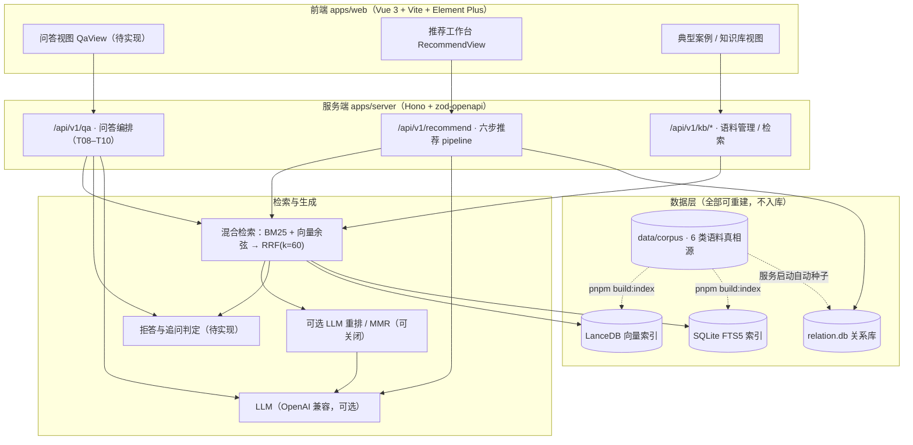
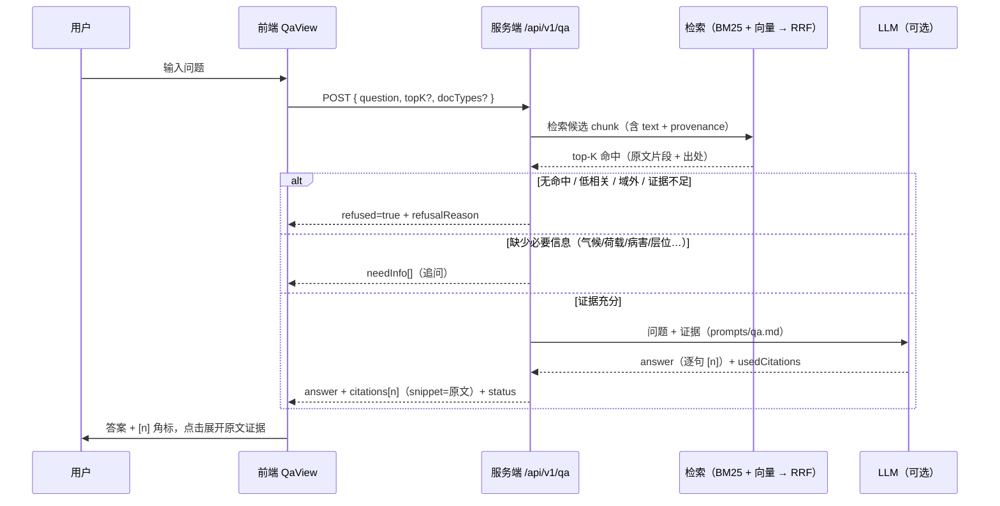

# 沥知问答 · AI_RAG

> **面向沥青路面养护材料的领域知识库问答系统：检索 → 原文证据引用 → 可信拒答**
>
> 研究生《课程设计》· 方向 1 · 工程实践题目 1：**带证据引用与可信拒答的领域知识库问答系统**
> 仓库：`github.com/2019wakeup/AI_RAG`（public） ｜ 产品中文名：**沥知问答**

**一句话**：输入一个用自然语言提出的材料问题，系统在 11,143 块领域语料中做 BM25 + 向量混合检索，返回**带 `[n]` 角标、可展开原文**的答案；证据不足时**明确拒答**，信息不足时**追问**——而不是编造答案。

- 领域：**沥青路面养护材料**（规范条文 / 论文题录 / 论文全文 / 定量表格 / 材料知识条目 / 企业资料）
- 技术栈：Vue 3 + Hono + SQLite FTS5 / LanceDB + transformers.js 本地嵌入 + 可选 LLM
- 规模：语料 6 类、**11,143 块 / 395 文档**；检索金标准 38 条；单测 **486 passed / 3 skipped**
- 现状：检索、语料、证据结构与推荐下游应用**已具备**；**问答编排与可信拒答是本课程设计的核心待交付项**（见 [当前状态](#6-当前状态)）

---

## 1. 选题与定位

### 1.1 课程题目出处

| 项 | 内容 |
|---|---|
| 课程 | 研究生《课程设计》 |
| 方向 / 题目 | 方向 1 · 工程实践题目 1：**带证据引用与可信拒答的领域知识库问答系统** |
| 本仓库 | `AI_RAG`（产品名：沥知问答），public，GitHub 账号 `2019wakeup` |
| 要求要点 | ① 明确领域 ② 基于文档问答（RAG） ③ 返回原文证据片段 ④ 证据不足可信拒答 ⑤ 至少三种检索方案对比 |

逐条对位（做法 / 落点 / 现状）见 **[docs/选题与项目边界.md](docs/选题与项目边界.md) §1**。

### 1.2 与「推荐系统」旧定位的边界

本仓库代码前身是一个「沥青材料智能推荐系统」（六步确定性 pipeline + 报告），已完整迁移过来。**新的定位是问答系统**：

| 维度 | 问答链路（**主交付**） | 推荐链路（遗留下游应用，**冻结**） |
|---|---|---|
| 入口 | `POST /api/v1/qa` | `POST /api/v1/recommend`、`/api/v1/recommend/stream` |
| 做什么 | 检索文档 → 组织证据 → 受证据约束地作答 → 绑定引用 → 必要时拒答/追问 | 场景 → 目标性能 → 关系表过滤 + 配方组合 → 报告（RAG 只做证据附件） |
| 是否 RAG 检索 | ✅ BM25 + 向量 → RRF(k=60) 融合 | ❌ 关系库 SQL 硬过滤，不是向量检索 |
| 价值 | 课程题目的核心要求 | 「问答与证据链能力落到真实工程流程」的验证 |

**边界约定**：推荐链路不再新增功能，只修 bug；`/api/v1/chat` 目前只是把推荐报告 JSON 塞进 prompt 的对话，**不检索、无引用**，不能当作问答能力。范围清单见 [docs/选题与项目边界.md](docs/选题与项目边界.md) §3。

---

## 2. 架构



**一次问答的目标链路**（S1/S2 里程碑实现；当前端点只返回 `501` 骨架）：



---

## 3. 快速开始

> 完整命令、端口策略、降级与 FAQ 见 **[docs/复现指南.md](docs/复现指南.md)**。以下是最短路径。

```bash
# 0) 环境：Node ≥ 24、pnpm 12（本仓库不含索引与模型缓存）
node -v && pnpm -v

# 1) 安装依赖（仓库根目录）
#    ONNXRUNTIME_NODE_INSTALL_CUDA=skip 跳过 onnxruntime 的 CUDA 下载（无 GPU 机器必加，否则 postinstall 404）
ONNXRUNTIME_NODE_INSTALL_CUDA=skip pnpm install

# 2) 配置环境变量（演示端口 3011 / 5175；无可用 LLM 时改 LLM_OFF=1）
cp .env.example .env

# 3) 首次构建索引：11,143 块，e5-small（384 维），约 729 s；需联网下载模型
HF_ENDPOINT=https://hf-mirror.com EMBEDDING_MODEL=multilingual-e5-small \
pnpm build:index -- --rebuild --backend=lancedb --model=multilingual-e5-small

# 4) 启动后端（另开终端）
PORT=3011 EMBEDDING_MODEL=multilingual-e5-small \
pnpm -C apps/server run dev
#    → 沥知问答 RAG 服务已启动：http://localhost:3011（OpenAPI 文档 /openapi）
curl -s http://127.0.0.1:3011/api/v1/health
#    → {"vectorStore":{"backend":"lancedb","count":11143,"ok":true},...}

# 5) 启动前端（另开终端）
API_PROXY_TARGET=http://localhost:3011 \
pnpm -C apps/web run dev -- --port 5175 --strictPort
#    → 打开 http://localhost:5175
```

**端口**：后端 3011、前端 5175（默认 3000 / 5173 常被其它进程占用）；三个变量必须指向同一后端端口：`PORT` = `API_PROXY_TARGET` 端口 = `E2E_BASE_URL` 端口。

**离线 / 降级**（依赖不可用时系统不崩，只是能力降级）：

| 情况 | 行为 |
|---|---|
| 无 LLM（未配 key / `LLM_OFF=1` / 余额不足 402） | 文案降级为模板或抽取式答案，`llmStatus=degraded`；检索与确定性计算不受影响 |
| 嵌入模型下载失败 | 检索降级为**纯 BM25**，服务继续可用 |
| LanceDB 初始化失败 | 自动降级 SQLite 后端 |
| 索引不存在 / 为空 | `/health` 显示 `ok=false`，先跑 `pnpm build:index` |

---

## 4. 目录结构

```
AI_RAG/
├── apps/
│   ├── server/                  # Hono API
│   │   └── src/
│   │       ├── routes/          # qa / recommend / kb / cases / chat / health / feedback
│   │       ├── qa/              # 问答链路：检索→证据选择→生成→引用→拒答（待实现，见 qa/README.md）
│   │       ├── rag/             # LLM 重排
│   │       ├── relation/        # 关系库（推荐链路用，启动自动种子）
│   │       └── orchestrator.ts  # 六步推荐 pipeline（冻结）
│   └── web/                     # Vue 3 SPA：首页 / 推荐工作台 / 典型案例 / 知识库
├── packages/
│   ├── contracts/               # zod 契约：QaRequest/QaResponse/QaCitation、SearchHit、报告
│   ├── retrieval/               # LanceDB + SQLite(FTS5) 双引擎、RRF 融合、入库管线
│   └── embedding/               # transformers.js 本地嵌入（e5-small 384 维 / bge-m3 1024 维）
├── scripts/                     # build-index / golden-eval / e2e / validate-corpus / faithfulness…
├── prompts/                     # LLM 提示词（qa.md / report.md / rerank.md / extract-scene.md / chat.md）
├── data/
│   ├── corpus/                  # 语料真相源（6 类，见 data/corpus/README.md）
│   ├── golden/golden.json       # 检索金标准 38 条
│   ├── index/                   # 向量索引 + manifest（不入库，可重建）
│   └── db/relation.db           # 关系库（不入库，启动自动种子）
├── docs/                        # 本套文档（plan/、archive/ 见各目录 README）
├── .github/workflows/ci.yml     # CI：typecheck + 单测（不跑需模型/索引的评测）
├── .env.example                 # 环境变量模板（.env 不入库）
├── NOTICE.md / LICENSE
└── README.md
```

### 接口速览

| 端点 | 说明 | 状态 |
|---|---|---|
| `POST /api/v1/qa` | 领域问答：检索 → 证据 → `[n]` 答案（无 LLM 抽取式降级） | ✅（T08/T09） |
| `POST /api/v1/qa/stream` | 问答 SSE：`meta → delta×n → citation×n → done` | ✅（T10） |
| `POST /api/v1/kb/search` | 检索并返回 chunk（含原文与 provenance） | ✅ |
| `POST /api/v1/recommend`、`/recommend/stream` | 六步推荐 + SSE 流式 | ✅（冻结） |
| `GET /api/v1/cases`、`/api/v1/cases/:id` | 5 个典型案例 | ✅ |
| `GET /api/v1/kb/stats`、`POST /api/v1/kb/documents`、`/kb/rebuild` | 知识库统计 / 上传 / 重建 | ✅ |
| `GET /api/v1/health` | 向量库计数、LLM 是否配置、A/C 适配器模式 | ✅ |
| `GET /openapi` | OpenAPI 3.1 文档 | ✅ |

---

## 5. 测试与评测

```bash
# 类型检查 + 全仓单测（不需要索引）
pnpm typecheck
pnpm test

# 语料校验（42 条目 / 94 关系 / 8 规范 / 57 条文 / 142 题录 / 5 案例，秒级）
pnpm eval:corpus

# 检索金标准 38 条：三种方案（务必用 pnpm exec，本机无全局 tsx）
pnpm exec tsx scripts/golden-eval.ts lancedb --bm25                     # 纯 BM25
HYBRID_WEIGHTS=0,1 EMBEDDING_MODEL=multilingual-e5-small \
  pnpm exec tsx scripts/golden-eval.ts lancedb                          # 纯向量
EMBEDDING_MODEL=multilingual-e5-small \
  pnpm exec tsx scripts/golden-eval.ts lancedb                          # 混合 RRF（默认）

# 端到端（需后端已启动、索引非空）
E2E_BASE_URL=http://127.0.0.1:3011 pnpm e2e
```

检索金标准实测（38 条，doc 级 recall@5）：

| 方案 | 达标条数 | mean recall@5 |
|---|---|---|
| 纯 BM25 | 35/38 | 0.857 |
| 纯向量 | 36/38 | 0.882 |
| **混合 RRF（生产默认）** | **38/38** | **0.9187**（micro 82/91） |

> 口径提醒：38/38 是「达标条数」而非召回率；报告请写 mean **0.9187**（doc 级 micro 82/91）。更多命令（重排、查询扩展、引用支撑率）见 [docs/复现指南.md](docs/复现指南.md) §7。

---

## 6. 当前状态

### ✅ 已具备

- **语料与索引**：6 类语料、11,143 块 / 395 文档；每条 chunk 带 7 字段 provenance（`sourceDocId/contentHash/embeddingModel/modelVersion/dim/pipelineRev/embeddedAt`），可逐条溯源；索引可幂等重建。
- **检索**：SQLite FTS5（trigram BM25）与 LanceDB 双引擎；BM25 + 向量余弦 → RRF(k=60)；`HYBRID_WEIGHTS` 可调；可选 LLM 重排（`RERANK=off` 可关）与 MMR。
- **证据结构**：`SearchHit` 自带 `text`（原文片段）与 provenance；前端 `EvidencePanel.vue` 可展开原文——问答页可直接复用。
- **检索评测**：38 条金标准 + 三方案对比；混合检索 mean recall@5 **0.9187**。
- **问答链路（后端）**：`/api/v1/qa` 已打通 检索 → 证据选择（相关度主序、原文 snippet、3–8 条）→ 生成 → `[n]` 双向校验（越界剔除）；`/api/v1/qa/stream` 提供 SSE（`meta → delta → citation → done`）；无 LLM/402 时回落**抽取式答案**并标 `status:"degraded"`、流式仍发 done（T08–T10）；**拒答判据核心（T17）**已就绪（`qa.refusal.ts`），待 T19 接入编排。
- **问答前端**：`apps/web/src/api/qa.ts`（类型化客户端 + 六类错误归一）、`stores/qa.ts`（idle→loading→done|error、partial 保留）与 **问答页 `views/QaView.vue`**（空/加载/错误/答案四态 + 证据卡片 + `/qa` 路由与导航，T12/T13）已就绪。
- **问答契约**：`QaRequest` / `QaResponse` / `QaCitation` / `QaRefusalReason` / `RefusalDecision` / `NeedInfoSlot` 已在 `packages/contracts` 定义（契约先行）。
- **推荐下游应用**：5 案例端到端 + 确定性复跑 + 三档降级（LLM/A/C 适配器/LanceDB→SQLite）。
- **工程质量**：`pnpm typecheck` + `pnpm test`（**486 passed / 3 skipped**）+ GitHub Actions CI。

### 🚧 待实现（课程设计核心，按 [任务拓扑](docs/plan/task-topology.md) 推进）

| 待实现项 | 落点 | 负责人 |
|---|---|---|
| 追问 needInfo 与拒答接入编排（判据核心 T17 已完成；remain T18 追问 + T19 接入） | `apps/server/src/qa/{needinfo,index}.ts` | C / B |
| 角标定位原文 + 拒答/追问 UI（页面与证据卡片已完成，T14/T21 收口） | `apps/web/src/components/{CitationBadge,RefusalNotice,NeedInfoForm}.vue` | D |
| QA 金标集（含负样本）与 `qa-eval` 评测 | `data/golden/qa.json`、`scripts/qa-eval.ts` | E / F |
| 三方案对比的显式开关（`--vector` / `--rerank`）与结果落盘 | `scripts/golden-eval.ts`、`docs/experiments/` | F |
| 语料治理：域外表格剔除、<30 字碎块过滤 | `data/corpus/`、`scripts/validate-corpus.ts` | E |
| chunk 质量报告（块长分布 / 重复 hash / OCR 噪声抽样） | `scripts/chunk-quality-report.ts` | C |
| 演示预检脚本（集中参数 `config/params.json` 已完成） | `scripts/preflight.ts` | A |
| 项目报告 6 章（问题定义/架构/实验/失败案例/局限） | `docs/报告-完整版.md` | F |

---

## 7. 数据来源摘要

语料真相源在 `data/corpus/`，索引由 `pnpm build:index` 重建（**11,143 块 / 395 文档**，`Xenova/multilingual-e5-small`，384 维）：

| 类别 | 规模 | 原文性 | 可追溯凭证 |
|---|---|---|---|
| 规范条文 `standards/` | 8 部 / 57 条 | ✅ 原文（摘录） | 规范号 + 条号 |
| 论文全文 `literature-full/` | 40 篇 / 9,753 块 | ✅ 原文（MinerU 节选） | 原始 PDF 路径 + DOI（32/40） |
| 定量表格 `tables/` | 1,041 张 / 107 docId（85 个题名） | ✅ 原文（表格） | 论文题名 + 表题 + 页码 |
| 论文题录 `literature/` | 142 条 | ⚠️ 仅题录 | DOI 109 条；33 条以「期刊, 年份」兜底 |
| 材料知识条目 `knowledge/` | 42 条 / 94 块 | ❌ 二次加工 | 条目/关系级 `sourceRef` |
| 企业资料 `enterprise/` | 56 条 | ❌ 脱敏样例 | `sourceRef` 文字说明（原始数据不在仓库） |

- 逐类来源、切分规则、清洗与无效值处理、已知问题、**数据划分声明（无 train/val；检索金标准 38 条 + QA 金标 + 端到端 5 案例互不复用；闭集评测）**：见 **[docs/数据来源与清洗说明.md](docs/数据来源与清洗说明.md)**
- 目录与文件格式：见 **[data/corpus/README.md](data/corpus/README.md)**
- 已登记的已知问题：约 12% 表格属域外文献、企业数据不可追溯、部分全文块 <30 字（OCR 噪声）

---

## 8. 团队与分工

本项目由 6 人团队（代号 **A–F**）按模块分工，覆盖：平台与集成、问答链路后端、可信拒答、前端问答体验、数据与语料治理、评测与实验。

- 每位成员的模块、文件路径、验收标准与答辩要点：见 **[docs/团队分工.md](docs/团队分工.md)**
- 里程碑、任务编号（T01–T28）、依赖与写域：见 **[docs/plan/task-topology.md](docs/plan/task-topology.md)**

---

## 9. 许可与免责

- **代码**：MIT License，见 [LICENSE](LICENSE)。
- **语料**：仅供教学研究；规范条文为摘录、论文全文为 MinerU 抽取节选、企业数据为脱敏样例，**不得再分发原始规范/论文全文/企业数据**。
- **第三方**：transformers.js、Xenova 嵌入模型、LanceDB、SQLite FTS5、Hono、Vue 生态等遵循各自许可；LLM 服务（默认 DeepSeek）受服务方条款约束。
- **免责**：本项目是课程设计作品，不构成工程设计或施工依据；LLM 输出可能有误，重要结论请回原文核实。

完整条款见 **[NOTICE.md](NOTICE.md)**。

---

## 10. 文档导航

| 文档 | 内容 |
|---|---|
| [选题与项目边界](docs/选题与项目边界.md) | 题目逐条对位、in/out-of-scope、模块边界、术语表、已知局限 |
| [数据来源与清洗说明](docs/数据来源与清洗说明.md) | 6 类语料来源/切分/清洗、数据划分声明、入库流程、已知问题 |
| [复现指南](docs/复现指南.md) | 从零跑通的全量命令、端口策略、降级矩阵、FAQ、10 分钟核对清单 |
| [任务拓扑](docs/plan/task-topology.md) | 里程碑与 T 编号任务、依赖、写域 |
| [团队分工](docs/团队分工.md) | A–F 成员模块与验收 |
| [团队手册](docs/团队手册.md) | **新人先读**：跑起来 / 你的任务 / 一个 PR 怎么走完 / 八条硬规矩 |
| [任务看板](docs/plan/dashboard.html) | 按 Wave 拓扑排序 + 依赖图 + 完成状态（Issue/PR 变化时由 Actions 自动重建；本地 `pnpm plan:board`） |
| [团队上手 Prompt](docs/团队上手Prompt.md) | 复制给成员 AI 的上手提示词 |
| [贡献指南](CONTRIBUTING.md) | 认领 Issue、分支/PR 规范、自检清单、合入规则 |
| [data/corpus/README.md](data/corpus/README.md) | 语料目录结构与文件格式 |
| [NOTICE.md](NOTICE.md) / [LICENSE](LICENSE) | 许可、版权与免责 |
| [docs/archive/](docs/archive/README.md) | 旧项目历史材料（开发过程证据，数字以新文档为准） |
| [apps/server/src/qa/README.md](apps/server/src/qa/README.md) | 问答模块边界与硬约束（实现前必读） |
