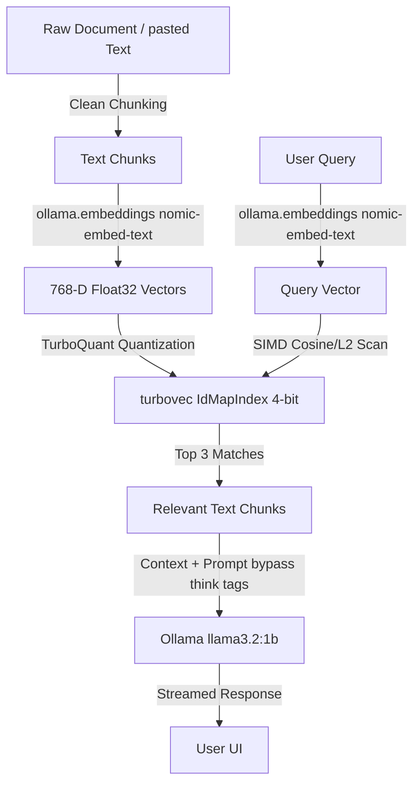

<div align="center">
  <a href="https://youtu.be/hfFvE0ivm5Y">
    
  </a>
  <h3>📺 <a href="https://youtu.be/hfFvE0ivm5Y">Watch the full tutorial on YouTube</a></h3>
</div>

# TurboVec: Run Google's AI RAG on 4 GB RAM!

[](https://www.python.org/)
[](https://opensource.org/licenses/MIT)
[](https://github.com/google/turbovec)
[](https://ollama.com/)

PotatoRAG is a hyper-optimized, privacy-first, local Retrieval-Augmented Generation (RAG) system engineered to run on extremely low-resource hardware. By leveraging `turbovec` - an ultra-fast vector index utilizing Google's advanced **TurboQuant** algorithm - PotatoRAG compresses high-dimensional text embeddings into ultra-lightweight 4-bit representation with virtually zero loss in retrieval accuracy. 

No cloud APIs. No data leakage. Zero subscription fees. Just lightning-fast local intelligence that fits in the palm of your hand (or your oldest potato laptop).

---

## 🛠️ Tech Stack

- **Vector Database**: `turbovec` (SIMD-optimized local vector index based on Google's TurboQuant algorithm)
- **Local LLM Engine**: `ollama` (Running `llama3.2:1b` for generation and `nomic-embed-text` for embeddings)
- **User Interface**: `streamlit` (A clean, interactive, and responsive web interface)
- **Data Operations**: `numpy` (For fast array manipulation and embeddings alignment)

---

## 🚀 Quick Start Guide

Follow these simple steps to run PotatoRAG fully local and air-gapped on your machine:

### 1. Prerequisites
Ensure you have Python 3.9+ and [Ollama](https://ollama.com) installed.

### 2. Download Ollama Models
Start the Ollama service and run the following commands to pull the necessary models:
```bash
# Pull the embedding model (768 dimensions)
ollama pull nomic-embed-text

# Pull the generation model (1.3B parameters, optimized for low memory)
ollama pull llama3.2:1b
```

### 3. Clone and Install Dependencies
Navigate to the project directory and install the required Python libraries:
```bash
pip install -r requirements.txt
```

### 4. Run the Streamlit Application
Fire up the web application and start chatting with your documents:
```bash
streamlit run app.py
```

---

## 🧠 How It Works



1. **Document Ingestion**: The raw text or uploaded `.txt` files are chunked into overlapping segments.
2. **Quantized Vector Indexing**: Each chunk is embedded using `nomic-embed-text` to produce a 768-dimensional vector. These vectors are quantized to **4-bit width** using `turbovec.IdMapIndex`, reducing RAM requirements by up to 80% while retaining high retrieval accuracy.
3. **Retrieval**: The user's query is converted to a vector and matched against the quantized database using SIMD-accelerated CPU instructions.
4. **Fast Generation**: The retrieved text chunks are combined with the user query. The local `llama3.2:1b` LLM generates a response streaming directly to the UI, utilizing system prompt directives to bypass/disable thinking tags (`<think>`) for maximum throughput.

---

## 🎯 Real-World Use Cases

- **🔒 Confidential Document Auditing**: Scan sensitive legal briefs, financial ledgers, or internal product specifications on completely air-gapped workstations without external network requests.
- **🎒 Field Research & Travel**: Run a full knowledge base assistant on a standard laptop in areas with limited or no internet connectivity (e.g., marine vessels, remote fieldwork).
- **💻 Developer Code Assistant**: Index repository documentation, API manuals, and legacy codebases locally to search and generate code without relying on paid commercial subscriptions.
- **🎓 Student Study Buddy**: Upload textbook chapters, lecture notes, and PDFs to interactively query and summarize concepts on budget laptops with less than 8GB of RAM.
- **🏥 Privacy-Compliant Healthcare Companion**: Query patient records, clinical guidelines, and medical textbooks in environments with strict HIPAA compliance requirements.

---

## 🔮 Future Feature Roadmap

- **💾 Hybrid Persistence**: Implement serialization to save and load `turbovec` indices to disk to bypass re-indexing large documents on restart.
- **📄 Multiformat Parser**: Support direct PDF, docx, CSV, and markdown parsing without needing pre-conversion to plain text.
- **🔍 Hybrid Dense/Sparse Search**: Combine `turbovec` dense embeddings with BM25 sparse keyword matching for enhanced retrieval quality.
- **🔗 Conversation History Memory**: Implement context-aware conversational memory to allow multi-turn RAG dialogue.
- **⚡ Batched Ingestion Pipeline**: Implement parallel multi-threaded document processing and batch API calls to Ollama to speed up ingestion of massive document libraries.

---

## Keywords
`turbovec`, `turbovec + ollama`, `turbovec llamacpp`, `turboquant`, `google turboquant`, `turbovec google`, `turbovec github`, `github turbovec`, `vector database`, `faiss`, `retrieval augmented generation`, `rag tutorial`, `rag agent`, `n8n tutorial`, `turbovex`, `turbovac`, `what is rag`, `rag ai`, `vector search`
