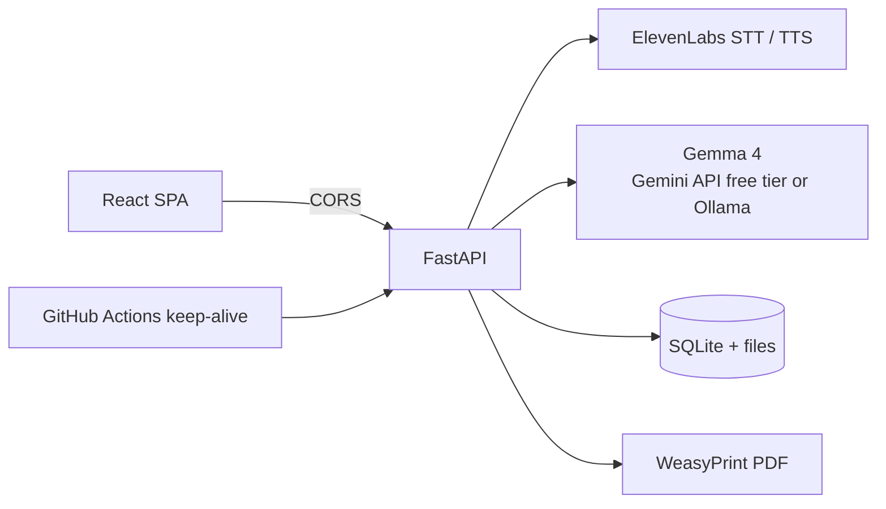

# Salt & Story

*Because Every Recipe Has A Story*

Salt & Story turns voice memos of a relative cooking into clean, printable recipes, while keeping the speaker's own words beside them. Record or upload a memo, an open-weight model (**Gemma 4**) writes it up, and you export a cookbook PDF that looks like a gift.

It is built for one real family: the person who tells recipes out loud and has never written them down, and the grandchild who wants to keep them.

Built by **Aditya Kumar** ([@ADITYA-KUMAR-2358](https://github.com/ADITYA-KUMAR-2358)) for the DEV Hacktoberfest Weekend Challenge, "Build for a Friend".

> Agents and contributors: start with [`docs/`](docs/) ([PRD](docs/PRD.md), [Architecture](docs/ARCHITECTURE.md), [Rules](docs/RULES.md), [Design](docs/DESIGN.md), [Tasks](docs/TASKS.md), [Memory](docs/MEMORY.md)).


## What it does

- **Capture**: record in the browser (live level meter), upload a memo, paste a transcript, or write a recipe by hand.
- **Write it up**: ElevenLabs transcribes; Gemma 4 structures the recipe. Vague amounts get a measurement *and* keep the original words ("1/4 tsp turmeric (a pinch)"). Nothing is invented. One line is kept exactly as it was said, checked against the transcript in code.
- **Accounts**: Sign in with Google only (no passwords, no throwaway email addresses); every family's recipes are private to their account; each account can have 5 recipes written by the AI per day, and each network at most 2 new accounts and 10 AI requests per day, so a shared link cannot drain the free quota.
- **Keep it tidy**: heart your favourites (filter Your recipes to just those, or put them all in the book in one tap) and delete recipes from the list, with a confirmation first.
- **Use it**: a reading view with ingredient check-off, **cook mode** (one big step at a time, screen kept awake), narration, photos, editing with an unsaved-changes guard.
- **Pages**: landing, recipes, add a memo, recipe, make the book, guide (with FAQ), privacy, terms of use, accessibility, photo credits, plus 404, error, offline and server-waking states.
- **Make the book**: choose and order recipes, add a dedication, see a live cover preview, download an A5 cookbook PDF. Each recipe is a spread: photo, story and quote on the left, ingredients and method on the right.
- **Start fast**: six American and European family classics (fictional voices, real dishes, openly licensed photos) can be added in one click.
- 


## Why open innovation matters

- **The family's voice stays in the family's hands.** Recipes and audio live on your own server. Audio goes to ElevenLabs only to be transcribed; the writing is done by an open-weight model.
- **The model is swappable.** Gemma is reached through any OpenAI-compatible endpoint: Google AI Studio's free tier, local Ollama, or another host. Three env vars.
- **Free to run.** Gemma 4 on the Gemini API free tier, or locally with Ollama.
- **You can change how it behaves.** The prompt is plain text in `backend/app/prompts.py`.

## Architecture



Pipeline: `uploaded -> transcribing -> structuring -> ready | failed`. Failures carry a readable reason and a next step (retry, paste, or write by hand). Details in [docs/ARCHITECTURE.md](docs/ARCHITECTURE.md).

## Run it with Docker (easiest, everything included)

```bash
cp .env.example .env          # fill in ELEVENLABS_API_KEY and LLM_API_KEY
docker compose up --build     # then open http://localhost:8080
# No Google sign-in set up yet? Try it with one local account:
AUTH_MODE=dev docker compose up --build
```

Two containers: `web` (nginx serving the app and proxying `/api`, `/media`, `/health` to the API, so there is no CORS) and `api` (FastAPI with the PDF engine built in). Only port 8080 is published. Recipes, audio and photos live in the `salt-data` volume and survive restarts. Both containers run as non-root users; secrets come from `.env` at runtime and are never baked into an image. Stop with `docker compose down` (add `-v` to also delete the data).

## Run it locally without Docker

Needs Python 3.11+ and Node 20+.

```bash
# 1. Settings
cp .env.example .env
#    Fill in ELEVENLABS_API_KEY and LLM_API_KEY (a free key from https://aistudio.google.com/apikey).
#    .env is gitignored. Never commit it.

# 2. Backend
cd backend
pip install -r requirements.txt
uvicorn app.main:app --reload            # http://localhost:8000

# 3. Frontend (new terminal)
cd frontend
npm install
npm run dev                              # http://localhost:5173
```

No ElevenLabs key yet? Use **Paste words**; the **Try a sample** button fills in a fictional transcript.

**PDF export without Docker** needs WeasyPrint's native libraries (Pango) once per computer:

| OS | One-time setup |
| --- | --- |
| Windows | `powershell -ExecutionPolicy Bypass -File scripts/setup-pdf-windows.ps1` (installs privately into `backend/.gtk` with conda; nothing global changes; the backend finds it automatically) |
| macOS | `brew install pango` |
| Debian / Ubuntu | `sudo apt install libpango-1.0-0 libpangoft2-1.0-0` |

Without them everything else works, and Make the book explains the exact fix for your OS. Docker and Render need none of this: the backend image includes the libraries.

### Which model?

| Option | Settings | Notes |
| --- | --- | --- |
| **Gemma 4 on Google AI Studio (default, free)** | `LLM_BASE_URL=https://generativelanguage.googleapis.com/v1beta/openai`<br>`LLM_MODEL=gemma-4-26b-a4b-it`<br>`LLM_THINKING_LEVEL=minimal` | ~15-35 s per recipe. Rate limited, so the app throttles and caps itself (below). |
| Local Ollama | `LLM_BASE_URL=http://localhost:11434/v1`<br>`LLM_MODEL=gemma3:4b`<br>`LLM_API_KEY=ollama` | `ollama pull gemma3:4b`; needs ~8 GB RAM. |

Do not switch to a Gemini model: the challenge requires open-weight AI.

### Protecting a free API quota

- **Minimal thinking**: Gemma 4 answers in seconds instead of minutes, using far fewer tokens.
- **Identical transcripts are reused**: pressing *Try a sample* again costs nothing. (*Rewrite from transcript* always asks the model fresh.)
- **Throttle and queue**: at most `LLM_MAX_RPM` calls a minute, one at a time; 429s wait for the provider's retry delay, 5xx errors back off and retry.
- **Daily cap**: `LLM_MAX_PER_DAY` model calls, then a friendly "try tomorrow, or write it by hand".
- **Per-visitor limit**: `SUBMIT_LIMIT` quota-spending requests per visitor per 10 minutes.
- **No hidden calls**: keep-alive pings, page polling and the status check do not call the model; the reachability check reuses the last real result or asks at most every 10 minutes.

### Environment variables

| Variable | Purpose | Default |
| --- | --- | --- |
| `APP_ENV` | `production` turns off API docs | `development` |
| `DATA_DIR` | SQLite, uploads, photos, narration | `./data` |
| `CORS_ORIGINS` | Comma-separated allowed origins (exact) | `http://localhost:5173` |
| `MAX_UPLOAD_MB` / `MAX_PHOTO_MB` / `MAX_TRANSCRIPT_CHARS` | Input limits | `25` / `10` / `20000` |
| `ELEVENLABS_API_KEY` | Transcription and narration (**secret**) | none |
| `ELEVENLABS_STT_MODEL` / `ELEVENLABS_TTS_MODEL` / `ELEVENLABS_VOICE_ID` | ElevenLabs options | `scribe_v1` / `eleven_multilingual_v2` / a stock voice |
| `LLM_BASE_URL` / `LLM_MODEL` / `LLM_API_KEY` | Any OpenAI-compatible endpoint (**key is secret**) | Google AI Studio, `gemma-4-26b-a4b-it` |
| `LLM_THINKING_LEVEL` | Gemma 4 reasoning on Google (`minimal` is fast) | `minimal` |
| `LLM_TIMEOUT` / `LLM_MAX_RPM` / `LLM_MAX_WAIT` | Timeout, calls per minute, longest polite wait on 429 | `240` / `10` / `45` |
| `LLM_MAX_PER_DAY` / `SUBMIT_LIMIT` | Daily model calls; per-visitor requests per 10 min (0 = off) | `300` / `8` |
| `GOOGLE_CLIENT_ID` | OAuth Client ID for Sign in with Google (public). Required in production | none |
| `SESSION_SECRET` | Signs sessions (**secret**) | random per start |
| `ALLOWED_EMAILS` | Only these Google accounts may sign in (optional) | anyone |
| `USER_DAILY_LIMIT` | AI recipes or narrations per account per day (0 = unlimited) | `5` |
| `AUTH_MODE` | `google`, or `dev` for one local account without sign-in | automatic |
| `BLOCKED_EMAIL_DOMAINS` | Extra email domains to refuse (throwaway domains are always refused) | none |
| `ACCOUNTS_PER_IP_PER_DAY` / `IP_DAILY_LIMIT` | Anti-spam per network (IP stored only as a salted hash): new accounts per day, AI requests per day | `2` / `10` |
| `CLIENT_IP_HEADER` | Header with the visitor's real IP: `true-client-ip` on Render, `x-real-ip` behind nginx | direct connection |
| `VITE_API_URL` | Backend URL baked into the frontend (not secret) | `http://localhost:8000` |

### Tests

```bash
cd backend && ruff check . && ruff format --check . && pytest --cov=app   # 76 tests, coverage >= 90%; ElevenLabs and the model are mocked
cd frontend && npm run lint && npm run typecheck && npm run build
cd e2e && npm ci && WEB=http://localhost:8080 API=http://localhost:8080 npm test   # browser tests against Docker
python scripts/demo.py                   # real model: samples -> demo-book.pdf (run inside Docker for the PDF)
```

## Deploy

The full guide is in **[docs/DEPLOYMENT.md](docs/DEPLOYMENT.md)**: Render step by step, plus a generic guide for any Docker host or separate API and static hosts.

**Render in short** (free plan, using the `render.yaml` Blueprint):

1. Push to GitHub. `git status` must not list `.env`. Rotate any key that was ever shared.
2. On Render: **New → Blueprint** (not New → Web Service), pick the repo. Enter `ELEVENLABS_API_KEY`, `LLM_API_KEY`, and `CORS_ORIGINS=https://salt-and-story-web.onrender.com`.
3. If Render gives the API a different address, update `VITE_API_URL` and the CSP lines in `render.yaml`, and set `CORS_ORIGINS` to the website's real address.
4. Check `https://<api>/health` and `/api/status`, then make a recipe and a book on the website. The PDF engine is in the API's Docker image, so books work on Render.
5. Optional: add a `BACKEND_URL` repository secret so `.github/workflows/keep-alive.yml` keeps the free API awake.

**Any server with Docker:** `cp .env.example .env`, add the keys, `docker compose up -d --build`, and put HTTPS (for example Caddy) in front of port 8080.

**Free hosting loses data** on restart or redeploy: use **Back up recipes** on the Recipes page, or a paid disk (`disk:` block in `render.yaml`). The website shows "Waking up the kitchen" while a sleeping free server starts. This is a demo setup, not "always on".

## Security

- Secrets live only in backend env vars: `.env` locally (gitignored and dockerignored), Render dashboard in production. The frontend holds no secrets; CI fails if anything key-shaped reaches `dist/` or a `.env` is tracked, and runs gitleaks.
- The API never logs or returns key values; provider errors are mapped to fixed messages.
- CORS is an explicit allow-list; no wildcard, no credentials.
- Uploads: extension and size limits, empty files rejected, photos re-encoded with EXIF/GPS stripped, random filenames.
- Production: API docs off, security headers on the API and a strict CSP on the static site, container runs as a non-root user with a health check.
- If a key was ever pasted into a chat, ticket or commit, rotate it.

## Limits and next steps

- English only for now; strings are centralised for Hindi and Hinglish next (with a Devanagari PDF font).
- Free hosting loses data on restart: Postgres or a paid disk for real use.
- Shared family libraries, playback of the original memo, servings scaling.

## Contributing

Every pull request runs lint, formatting, type checks, backend tests on Python 3.13 and 3.14 (coverage at least 90%), dependency audits, a secret scan, CodeQL security analysis, Docker builds and the full browser suite; see [CONTRIBUTING.md](CONTRIBUTING.md). Please also read the [Code of Conduct](CODE_OF_CONDUCT.md) and, for security issues, [SECURITY.md](SECURITY.md).

## Licence

[MIT](LICENSE) for the code. Photos, fonts and third-party services keep their own licences (listed in `LICENSE`).

## Credits

Gemma (Google, open weights), ElevenLabs, Render, WeasyPrint, FastAPI, React, GSAP. Fonts: Bricolage Grotesque, Hanken Grotesk, Caveat (app) and Lora (PDF), all SIL Open Font License. Photos from Wikimedia Commons, credited on the site's [Photo credits](frontend/public/images/CREDITS.md) page. Sample families are fictional.

Built by Aditya Kumar.
