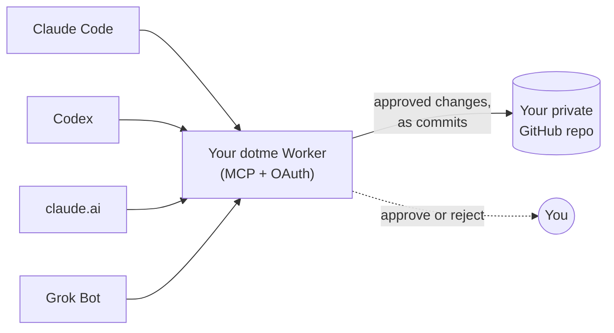

<p align="center">
  <picture>
    <source media="(prefers-color-scheme: dark)" srcset="assets/brand/logo-on-dark.svg">
    
  </picture>
</p>

<h3 align="center">Dotfiles for your AI agents</h3>

<p align="center">
  <b>Dot follows you to every agent.</b><br>
  Self-hosted preferences for your AI agents. You approve every change.
</p>

<p align="center">
  <a href="https://github.com/AFFFPupu/dotme/actions/workflows/ci.yml"></a>
  <a href="LICENSE"></a>
  
  
</p>

<p align="center">
  
</p>

You tell Claude Code to use pnpm. Tomorrow Codex reaches for npm again, and
claude.ai has never heard of either. Every agent keeps its own memory, and
none of them share it.

**dotme** gives them one. Your preferences live as plain Markdown in a
private GitHub repo you own: how agents should talk and work with you, your
stack, and facts such as your timezone. Every agent reads them through one
MCP server. When an agent notices something new, it **proposes** a change;
nothing is saved until you approve it, and every approval lands as a commit
that names the agent and its evidence.

**Why I built this:** I use a growing pile of agents, and each one keeps its
own memory of me. I wanted one memory I own, light enough to work across all
of them.

- **One source of truth.** Claude Code, Codex, claude.ai, Grok Bot and any
  MCP client with OAuth read the same preferences.
- **You stay in charge.** Agents propose, you approve: in the client's own
  dialog, or on a page that works on your phone with Face ID or Touch ID.
- **Yours, in git.** Your data is Markdown in your own repo. Every change is
  a commit with who, when and why.
- **Self-hosted and free.** One Cloudflare Worker on the free plan. No
  account with us, because there is no us.

## How it works



1. **Read.** At the start of every Claude Code and Codex session, a plugin
   hook loads your preferences into context, so the agent follows them
   without having to remember to ask. Cloud clients call `get_preferences`.
2. **Propose.** When you say "always reply in Chinese" or keep correcting
   the same thing, the agent asks you, then calls `propose_change` with the
   evidence.
3. **Approve.** Accept in the client's dialog, or open the link. You can
   scope a preference ("only applies when: personal projects") instead of
   overwriting an old one.
4. **Everywhere.** The next session in any agent already knows.

<p align="center">
  
</p>

Preferences are grouped in categories: `collab` (how to work and talk with
you), `coding` (stack, tools, style) and `life` (personal facts). Add your
own by pushing a Markdown file such as `work.md`. Each connection only sees
the categories you tick for it, and a new category stays hidden from agents
you already connected.

## What it looks like

Every page has Dot on it: connecting an agent, signing in, a proposal,
batch approval, and the setup status page.


<details>
<summary>Dark mode</summary>


</details>

## What you need

- A GitHub account
- A free Cloudflare account
- Claude Code or Codex, to run the install for you

The install also checks for Node 24 or later and `git`. Setup takes about
5 minutes.

## Install

### Let your agent do it

Open Claude Code or Codex in an empty folder and paste:

```text
Install dotme by following INSTALL.md in https://github.com/AFFFPupu/dotme
```

[INSTALL.md](INSTALL.md) walks the agent through the whole setup: the
private data repo, the Cloudflare Worker, secrets, passkeys and the client
plugins. You only do the steps marked **Human**: signing in, choosing a
passphrase, creating a GitHub token. Secrets go straight into a prompt and
never pass through the agent. `<your-worker>/setup/status` reports what is
configured and what is missing, so you and the agent can check every step.

### Or click

[](https://deploy.workers.cloudflare.com/?url=https://github.com/AFFFPupu/dotme)

The button deploys the server from your browser. Create the data repo and
the GitHub token first, then connect your agents; see
[Deploy to Cloudflare](INSTALL.md#deploy-to-cloudflare) in INSTALL.md.

## Clients

| Client | How it connects | Approve in | Status |
|---|---|---|---|
| Claude Code | Plugin: MCP server, session hook, skills | Dialog or link | Tested |
| Codex | Plugin, plus `npm run codex:hook` | Dialog or link | Tested |
| claude.ai | Custom connector | Link | Tested |
| Grok Bot | Ask it to add the MCP server | Link | Tested |
| ChatGPT, Cursor, grok.com | Any remote MCP client with OAuth | Link | Untested |

Setup for each client, and what to pick on the consent page, is in
[clients/README.md](clients/README.md).

**Known weak spot: cloud clients.** Claude Code and Codex load your
preferences with a session hook, so they always have them. claude.ai, Grok
Bot and other web clients have no hook: they only see your preferences when
they call `get_preferences`, and they don't always do that on their own. If
one ignores a preference, ask it to read dotme first, or put that request in
the client's own custom instructions.

Both plugins also ship two skills:

- **`/dotme-import`** reads your existing `CLAUDE.md`, `AGENTS.md` and
  memory exports and turns the lasting preferences into proposals.
- **`/dotme-review`** looks back over recent conversations and proposes
  what it noticed.

## Security

- **Owner sign-in** uses passkeys first. The passphrase is for the first
  sign-in and recovery, and locks for 15 minutes after 5 wrong tries.
- **Agents** connect with OAuth. You see each app's name and redirect on a
  consent page, and choose which categories it may read and propose to.
- **The GitHub token** is fine-grained, limited to your data repo, and
  `/setup/status` warns 30 days before it expires.
- **The export token** used by session hooks is read-only and stays on your
  machine.

## MCP tools

| Tool | What it does |
|---|---|
| `whoami` | The connection's agent name and categories. |
| `list_categories` | Categories this connection can see. |
| `get_preferences` | Preferences in one or more categories. |
| `propose_change` | Propose adding, changing or removing a preference, with evidence. |
| `list_pending` | Proposals waiting for your approval. |

## Develop

```bash
npm install
printf 'OWNER_PASSPHRASE=local-test-passphrase\nSTORAGE=kv\n' > .dev.vars
npm run dev

npm run typecheck
npm test        # unit tests
npm run e2e     # end to end against wrangler dev with fresh KV
```

This repo is a template and holds no account-specific values. Your Worker
name, URL, KV namespace and data repo go in the gitignored
`dotme.config.json`; deploy with `npm run deploy`, never a bare
`wrangler deploy`. The design and its decisions are in
[docs/v1-scope.md](docs/v1-scope.md); the manual test plan is in
[docs/testing.md](docs/testing.md), and the brand in
[docs/brand.md](docs/brand.md).

Other platforms than Cloudflare are welcome as PRs: storage and platform
code are kept easy to swap.

## FAQ

### How is this different from my agent's built-in memory?

Built-in memory (claude.ai memory, ChatGPT memory, a `CLAUDE.md` file) is
put into the context of every conversation by the client. dotme keeps your
preferences on your own server and agents read them through MCP: Claude
Code and Codex load them once at session start with the plugin hook, and
cloud clients call `get_preferences` when they need them.

| | Built-in memory | dotme |
|---|---|---|
| **Where it lives** | Inside one product | Markdown in your own GitHub repo |
| **Who writes it** | The client, often on its own | The agent proposes, you approve each change |
| **What you see** | A summary the client made | The exact text you approved, with git history |
| **Shared across agents** | No | Yes, every connected client reads the same file |
| **Token cost** | In context for the whole conversation, used or not | Session hook: the same, but only the categories you choose. Cloud clients: the tool definitions (roughly a thousand tokens), plus a category only when they read it |
| **Speed** | No extra step | Session hook: none. Cloud clients: one tool call, usually a second or two |
| **Main risk** | Compressed, wrong or unwanted entries | A cloud agent may not think to call `get_preferences` |

The numbers are rough and depend on the client and how much you store.

In practice: built-in memory suits a few facts that every chat needs. dotme
suits preferences you want to control, share across agents and keep growing,
because an agent only reads the categories it is allowed to and changes wait
for you. They work side by side; just keep each preference in one place so
the two never disagree.

## License

[MIT](LICENSE). Dot is dotme's own pixel character; see
[docs/brand.md](docs/brand.md).
