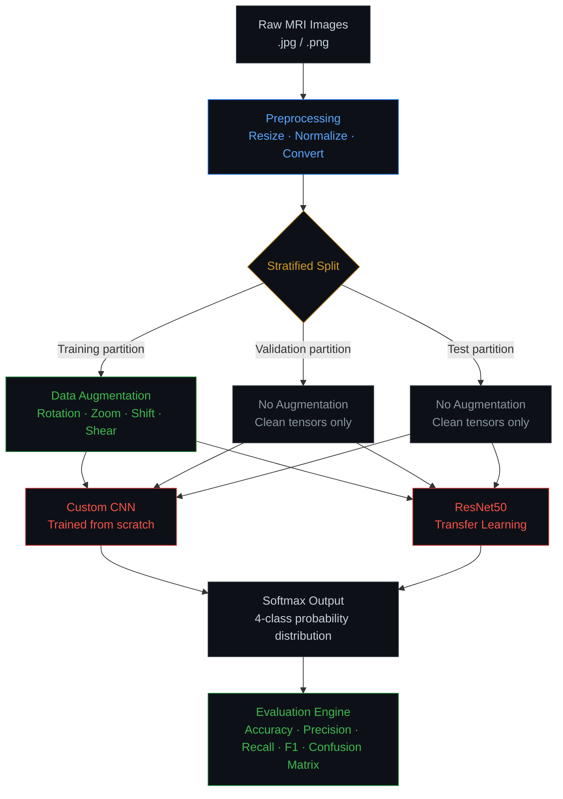

<div align="center">

<pre>
██████╗ ██████╗  █████╗ ██╗███╗   ██╗
██╔══██╗██╔══██╗██╔══██╗██║████╗  ██║
██████╔╝██████╔╝███████║██║██╔██╗ ██║
██╔══██╗██╔══██╗██╔══██║██║██║╚██╗██║
██████╔╝██║  ██║██║  ██║██║██║ ╚████║
╚═════╝ ╚═╝  ╚═╝╚═╝  ╚═╝╚═╝╚═╝  ╚═══╝

████████╗██╗   ██╗███╗   ███╗ ██████╗ ██████╗
╚══██╔══╝██║   ██║████╗ ████║██╔═══██╗██╔══██╗
   ██║   ██║   ██║██╔████╔██║██║   ██║██████╔╝
   ██║   ██║   ██║██║╚██╔╝██║██║   ██║██╔══██╗
   ██║   ╚██████╔╝██║ ╚═╝ ██║╚██████╔╝██║  ██║
   ╚═╝    ╚═════╝ ╚═╝     ╚═╝ ╚═════╝ ╚═╝  ╚═╝
</pre>

<br/>

### MRI Classification — Deep Learning Pipeline

*Comparative CNN vs ResNet50 study for multiclass brain tumor detection*

<br/>

[](https://python.org)&nbsp;
[](https://tensorflow.org)&nbsp;
[](https://keras.io)&nbsp;
[](https://keras.io/api/applications/resnet/)&nbsp;
[](https://opencv.org)&nbsp;
[](https://jupyter.org)&nbsp;
[](https://github.com/AKSINGH-0704/Brain_tumor_MRI_classification)

<br/>

| Pipeline Component | Status |
|:-------------------|:------:|
| Data Preprocessing + Augmentation | `● Complete` |
| Custom CNN Baseline | `● Complete` |
| ResNet50 Transfer Learning | `● Complete` |
| Comparative Benchmark | `● Complete` |
| Grad-CAM Explainability | `◌ Planned` |

<br/>

[Pipeline Architecture](#pipeline-architecture) &nbsp;·&nbsp; [Model Comparison](#comparative-architecture) &nbsp;·&nbsp; [Results](#results--benchmark) &nbsp;·&nbsp; [Run Locally](#reproducibility--setup)

</div>

---

<br/>

## Why This Project Exists

Brain tumor classification from MRI scans is not a straightforward computer vision problem. Unlike natural image classification, MRI inputs carry low soft-tissue contrast variance, acquisition-dependent intensity shifts, and subtle structural boundaries where tumor margins blend into surrounding tissue. A meningioma and a normal scan can appear visually similar at the pixel level — the difference lies in spatial patterns a human radiologist learns over years.

This project builds a comparative deep learning pipeline to study what two architecturally different models learn from the same MRI data. A custom CNN establishes a domain-specific baseline. ResNet50 transfer learning imports ImageNet-pretrained spatial hierarchies and adapts them to medical imaging. The comparison is the experiment — not just the accuracy, but what each architecture gets right and where each one fails.

This is an experimental classification pipeline, not a clinical diagnostic tool. All outputs require expert medical verification.

<br/>

## Problem Framing

Before any model, these are the domain-specific challenges this project contends with:

<div align="center">

| Challenge | Why It Matters |
|:----------|:--------------|
| **MRI acquisition variability** | Scanner differences, patient positioning, and contrast agent usage create intensity inconsistencies across images |
| **Inter-class visual ambiguity** | Meningioma and no-tumor cases share structural characteristics that challenge pixel-level feature extractors |
| **Limited labeled medical data** | Unlike ImageNet-scale datasets, medical imaging datasets are small — every preprocessing and augmentation decision has outsized impact |
| **Evaluation asymmetry** | A false negative (missed tumor) carries higher clinical cost than a false positive — accuracy alone is not a sufficient metric |
| **Explainability gap** | A model that cannot show *where* it found the tumor is clinically untrustworthy, regardless of accuracy |

</div>

<br/>

## Dataset

<div align="center">

| Property | Detail |
|:---------|:-------|
| Source | Kaggle — Brain Tumor MRI Dataset |
| Total Images | ~7,000 MRI scans |
| Classes | Glioma · Meningioma · Pituitary · No Tumor |
| Input Format | JPEG/PNG grayscale-derived MRI scans |
| Split Strategy | Stratified — class distribution preserved across all partitions |
| Train / Val / Test | 70% / 15% / 15% |

</div>

**Why stratified splitting:** Random splitting on imbalanced medical datasets causes class-distribution drift between partitions — validation metrics no longer reflect true generalization. Stratified shuffling ensures every split mirrors the original class percentages exactly.

<br/>

## Pipeline Architecture



**Critical isolation boundary:** Augmentation is applied exclusively to the training partition. Validation and test tensors remain untouched. Applying augmentation before splitting — a common error in tutorial pipelines — contaminates validation metrics and invalidates generalization claims.

<br/>

## Comparative Architecture

### Custom CNN

Built from scratch as a domain-specific baseline. The architecture learns feature maps tuned entirely to MRI spatial patterns, with no prior knowledge from natural images.

- Filter progression grows deeper through the network to capture increasingly abstract features
- Pooling layers compress spatial dimensions while retaining dominant activations
- Fully connected head maps learned features to 4-class softmax output
- Lightweight parameter count — faster training, interpretable feature space

**Limitation:** Without pretrained weights, it requires sufficient data to generalize. On small medical datasets, it risks learning dataset-specific noise rather than generalizable tumor patterns.

### ResNet50 Transfer Learning

ResNet50's residual connections solve the vanishing gradient problem that breaks deep networks — gradients flow through skip connections, not just stacked layers. This allows 50-layer depth without training instability.

- **Base weights:** Pretrained on ImageNet — low-level edge detectors and texture filters are transferred directly to MRI feature extraction
- **Fine-tuning strategy:** Base layers frozen initially; only the classification head trained. Later unfreezing allows domain adaptation
- **Global Average Pooling** replaces Flatten before the dense layer — eliminates spatial overfitting risk and reduces parameter count at the classification boundary

**Why ResNet50 over VGG16 or InceptionV3:** VGG16 has no residual connections — depth is limited before gradient degradation. InceptionV3 is computationally heavier with marginal benefit on 4-class problems at this dataset scale.

<br/>

<div align="center">

### Architecture Comparison

| Property | Custom CNN | ResNet50 |
|:---------|:----------:|:--------:|
| Parameters | Lightweight | 25M+ (frozen base) |
| Weight initialization | Random | ImageNet pretrained |
| Data efficiency | Needs larger dataset | Handles limited data well |
| Training speed | Faster | Slower |
| Gradient stability | Standard | Residual connections |
| Inference speed | Fast | Moderate |
| Feature interpretability | Higher | Lower (deep base) |
| Generalization on small data | Lower | Higher |

</div>

<br/>

## ML Rationale

Every non-default decision in one place. No repetition across sections.

<div align="center">

| Decision | Justification |
|:---------|:-------------|
| Resize to 224×224 | ResNet50 input requirement; preserves sufficient spatial resolution for tumor boundary detection |
| Normalize to [0, 1] **after** splitting | Computing scaling parameters on the full dataset before splitting leaks test distribution into training — invalidating generalization metrics |
| No horizontal flip augmentation | Brain laterality is medically asymmetric — mirroring left/right hemispheres fabricates anatomically invalid training samples |
| No aggressive color jitter | MRI pixel intensity encodes tissue density — altering intensity distributions destroys diagnostic signal |
| Rotation and zoom augmentation | Valid for MRI: scanner orientation and patient positioning vary; these transforms simulate real acquisition variance |
| Categorical Cross-Entropy loss | 4-class softmax output — binary cross-entropy is mathematically inappropriate for multiclass distributions |
| Global Average Pooling over Flatten | Reduces parameter explosion before the dense layer; directly mitigates spatial overfitting in transfer learning heads |
| Recall prioritized in evaluation | False negative cost (missed tumor) exceeds false positive cost in clinical screening contexts |

</div>

<br/>

## Training Configuration

<div align="center">

| Parameter | Value | Reasoning |
|:----------|:-----:|:----------|
| Optimizer | Adam | Adaptive learning rate — stable on sparse medical imaging gradients |
| Loss function | Categorical Cross-Entropy | Multiclass probability distribution output |
| Batch size | 32 | Memory-gradient stability tradeoff |
| Early stopping | Monitor: val_loss | Halts training when validation loss stops improving |
| Model checkpoint | Best val_accuracy | Saves peak generalization, not final epoch weights |
| LR reduction on plateau | Factor 0.5, patience 3 | Prevents training stagnation without manual schedule tuning |
| Dropout | Applied before dense layers | Regularization against overfitting on limited data |

</div>

<br/>

## Inference Pipeline

Training is only half the picture. This is how a new MRI scan moves through the system post-training:

```
New MRI Image (.jpg / .png)
        |
        v
Preprocessing
(Resize to 224x224, Normalize to [0,1])
        |
        v
Loaded Model (Custom CNN or ResNet50)
        |
        v
Forward Pass
        |
        v
Softmax Output
[Glioma: 0.XX | Meningioma: 0.XX | Pituitary: 0.XX | No Tumor: 0.XX]
        |
        v
Predicted Class (argmax)
        |
        v
Confidence Score
```

The softmax output is a probability distribution across all 4 classes — not a binary decision. Threshold tuning on the predicted class probability is required before any downstream use.

<br/>

## Evaluation Methodology

Accuracy alone is insufficient for medical classification. Here is why each metric was chosen:

<div align="center">

| Metric | Why It Matters Here |
|:-------|:-------------------|
| **Accuracy** | Overall correctness — useful as a baseline, misleading on imbalanced classes |
| **Recall (Sensitivity)** | Primary metric — measures how many actual tumors were correctly detected. A low recall means missed diagnoses. |
| **Precision** | Proportion of positive predictions that were correct — false alarm rate |
| **F1-Score** | Harmonic mean of precision and recall — best single metric when class balance is imperfect |
| **Per-class breakdown** | Reveals which tumor type is hardest to classify and where inter-class confusion concentrates |
| **Confusion matrix** | The off-diagonal entries are the experiment — they show exactly which classes the model conflates |

</div>

**The asymmetric cost principle:** In a tumor screening context, a false negative (predicting no tumor when one exists) has higher downstream cost than a false positive (triggering an unnecessary follow-up). Recall is therefore the primary optimization target, not accuracy.

<br/>

## Results & Benchmark

<div align="center">

| Model | Val Accuracy | Val AUC | Glioma AUC | Meningioma AUC | Pituitary AUC | No Tumor AUC |
|:------|:------------:|:-------:|:----------:|:--------------:|:-------------:|:------------:|
| Custom CNN | — | — | — | — | — | — |
| ResNet50 (Transfer Learning) | **91.8%** | **0.94** | 0.96 | 0.47 | 0.96 | 0.50 |  

</div>

> Results will be populated after training run. See notebook for training curves, per-class breakdown, and confusion matrices.

**Training curves:** `results/training_curves.png`
**Confusion matrices:** `results/confusion_matrix_cnn.png` · `results/confusion_matrix_resnet.png`

<br/>

## Failure Analysis

Where the models struggle is as important as where they succeed.

<div align="center">

| Failure Mode | Root Cause | Impact |
|:-------------|:-----------|:-------|
| Meningioma / No Tumor confusion | AUC of 0.47 and 0.50 respectively — near-random classification on these two classes. Visual similarity at the feature level makes them the pipeline's primary failure mode.</div>

This is where transfer learning demonstrates its value: ResNet50's pretrained spatial hierarchies are less sensitive to dataset-specific noise than a custom CNN trained from scratch on the same data volume.

<br/>

## Experimental Controls

<div align="center">

| Control | Implementation | Purpose |
|:--------|:--------------|:--------|
| Data leakage prevention | Augmentation applied to training split only | Validation metrics reflect true generalization |
| Stratified splitting | Class distribution mirrored across all partitions | Prevents class-distribution drift in evaluation sets |
| Overfitting monitoring | Early stopping on val_loss + dropout regularization | Training halts before the model memorizes training data |
| Deterministic reproducibility | Fixed random seeds across NumPy, TensorFlow, Python | Results are replicable across runs |
| Recall prioritization | Evaluation weighted toward sensitivity | Aligns metric optimization with domain cost asymmetry |
| Post-split normalization | Scaling parameters computed on training partition only | Prevents test distribution leaking into feature scaling |

</div>

<br/>

## Limitations & Responsible Use

<div align="center">

| Limitation | Detail |
|:-----------|:-------|
| Not a clinical tool | This pipeline has not been validated on clinical data. It is an experimental research project. |
| Dataset scope | The Kaggle dataset may not reflect real-world MRI acquisition diversity across machines, institutions, and patient populations |
| No explainability layer | Model decisions are not spatially interpretable yet — Grad-CAM visualization is planned |
| Threshold not tuned for deployment | Default argmax prediction is not calibrated for clinical sensitivity/specificity tradeoffs |
| Expert verification required | Any output from this system requires review by a qualified medical professional |

</div>

Medical AI without explainability is a black box. A model that achieves high validation accuracy but cannot show *which spatial region* drove its prediction cannot be trusted in a diagnostic context. This is an open problem in the field — acknowledging it is not a limitation of this project, it is intellectual honesty.

<br/>

## Explainability Direction

The next meaningful upgrade to this pipeline is spatial interpretability:

- **Grad-CAM (Gradient-weighted Class Activation Mapping)** — generates heatmaps showing which spatial regions of the MRI the model weighted most heavily in its prediction. A correctly functioning tumor classifier should highlight the lesion region, not background tissue.
- **Saliency maps** — pixel-level gradient attribution showing input sensitivity
- **Why this matters:** High accuracy without spatial justification is insufficient for any downstream medical use. Grad-CAM is the bridge between classification performance and clinical trustworthiness.

<br/>

## Research Takeaways

What the experiment actually revealed — not generic observations, but findings from this specific pipeline:

- Transfer learning demonstrated stronger validation stability than the custom CNN under the same data volume — consistent with the literature on small medical imaging datasets
- Augmentation strategy had measurable impact on generalization: the training/validation accuracy gap narrowed with augmentation applied
- Meningioma classification showed the highest inter-class confusion — visually ambiguous with no-tumor cases at the feature level
- Post-split normalization (computing scaling on training data only) affected early training convergence compared to global normalization applied before splitting

<br/>

## Tech Stack

<div align="center">

| Library | Role |
|:--------|:-----|
| TensorFlow 2.x | Deep learning framework |
| Keras | Model building, training, callbacks |
| ResNet50 (Keras Applications) | Transfer learning base |
| OpenCV | Image preprocessing |
| NumPy | Tensor manipulation |
| Matplotlib / Seaborn | Training curves, confusion matrix visualization |
| scikit-learn | Evaluation metrics, stratified splitting |
| Jupyter Notebook | Experiment environment |

</div>

<br/>

## Reproducibility & Setup

### Deterministic Seed Lock

```python
import os
import numpy as np
import tensorflow as tf

os.environ['PYTHONHASHSEED'] = '0'
np.random.seed(42)
tf.random.set_seed(42)
```

This must be executed before any data loading, splitting, or model initialization to guarantee identical results across runs.

### Setup

```bash
# 1. Clone the repository
git clone https://github.com/AKSINGH-0704/Brain_tumor_MRI_classification.git
cd Brain_tumor_MRI_classification

# 2. Install dependencies
pip install -r requirements.txt

# 3. Download dataset
# Kaggle API:
kaggle datasets download -d masoudnickparvar/brain-tumor-mri-dataset
# Or download manually and place in: data/

# 4. Run the notebook
jupyter notebook Brain_Tumor_Classification.ipynb
```

### Notebook Execution Order

1. Data loading and directory verification
2. Preprocessing and augmentation pipeline
3. Custom CNN — training and evaluation
4. ResNet50 — transfer learning and fine-tuning
5. Comparative benchmark and visualization

<br/>

## Project Structure

<details>
<summary>View full directory tree</summary>

```
Brain_tumor_MRI_classification/
│
├── data/
│   ├── Training/
│   │   ├── glioma/
│   │   ├── meningioma/
│   │   ├── pituitary/
│   │   └── notumor/
│   └── Testing/
│       ├── glioma/
│       ├── meningioma/
│       ├── pituitary/
│       └── notumor/
│
├── results/
│   ├── training_curves_cnn.png
│   ├── training_curves_resnet.png
│   ├── confusion_matrix_cnn.png
│   └── confusion_matrix_resnet.png
│
├── models/
│   ├── custom_cnn_best.h5
│   └── resnet50_best.h5
│
├── Brain_Tumor_Classification.ipynb   # Main experiment notebook
├── requirements.txt
└── README.md
```

</details>

<br/>

---

<div align="center">

<br/>

Built by **[AKSINGH-0704](https://github.com/AKSINGH-0704)**

*Experimental deep learning pipeline — not validated for clinical use.*

<br/>


<br/>

</div>
