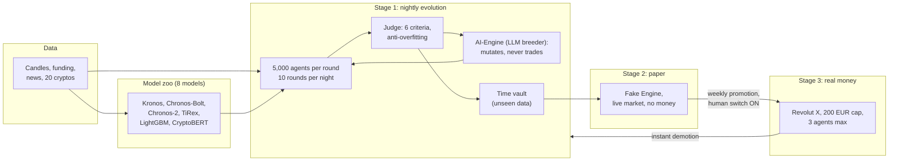
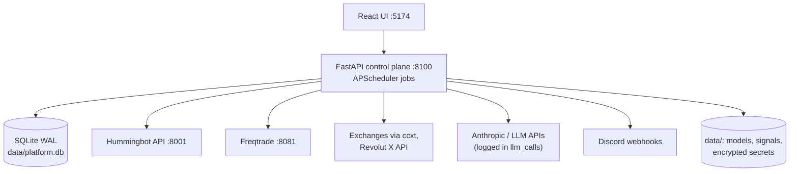

# Maz CryptoBot

**A source-available, self-hosted crypto trading lab where thousands of rule-based agents are evolved every night, judged without mercy, and promoted to real money only through paper trading and a human-operated switch.**

Maz CryptoBot combines open-source trading engines ([Hummingbot](https://github.com/hummingbot/hummingbot), [Freqtrade](https://github.com/freqtrade/freqtrade)) with a home-made control plane (FastAPI, SQLite, React) and its flagship system, the **AI Arena**: a darwinian arena of trading agents fed by a zoo of pre-trained forecasting models.

> [!WARNING]
> This is a personal research project, not financial advice and not a product. Everything runs in paper / dry-run mode by default. Real-money features exist, are capped and are switched on only by a human, but trading crypto can lose all the money involved. Read [Risk and safety](docs/risk-and-safety.md) before touching any live switch.

> [!NOTE]
> The code and identifiers are in English. The user interface, code comments, the in-app guide and the original design records are in French. This README and the [documentation](docs/README.md) are in English.

---

## The AI Arena in one picture



| | |
|---|---|
| **Agents** | JSON genomes: entry and exit rules, signal sources (indicators, model forecasts, sentiment), basket of 1 to 20 cryptos, order type, position size, stops |
| **Evolution** | Every night from 02:15 UTC, 10 rounds of 5,000 agents are backtested on rolling windows, judged, and bred into the next generation |
| **Judge** | Drawdown, regularity, sample size, parameter robustness, behavior per market regime, net gain relative to the market; overfitting checks (PBO per agent, cumulative trials, one-shot time vault) |
| **AI-Engine** | An LLM that watches results and proposes mutations. It never places an order and every call is logged with its cost |
| **Model zoo** | Pre-trained time-series foundation models and classifiers, with training cutoffs tracked to prevent look-ahead leakage, and a measured "uplift" per model |
| **Stages** | 1: backtest, 2: paper trading on the live market, 3: real money on Revolut X behind a human switch, a 200 EUR hard cap, isolated pocket and circuit breakers |
| **Honesty** | No agent has proven an edge yet. Results, including negative ones, are documented in [Results and limits](docs/ai-arena/results-and-limits.md) |

Read the full story in the [AI Arena documentation](docs/ai-arena/README.md).

## The other systems

| System | What it does | Status |
|---|---|---|
| [Core funding-rate arbitrage](docs/systems/core-funding-arb.md) | Delta-neutral funding arb via Hummingbot, own backtest engine | Paper. Backtest verdict: positive but about 1 %/year in the 2024-2026 regime, no-go for real capital |
| [Freqtrade lab](docs/systems/freqtrade-lab.md) | Dry-run strategies, backtests and walk-forward | Dry-run only |
| [Satellite](docs/systems/satellite.md) | New-token sourcing, hard filters, LLM scoring, human approval | Paper |
| [LLM agents](docs/systems/llm-agents.md) | Market watch, explanations, post-mortems; never inside strategies, risk or engines | Running |
| [Revolut X](docs/systems/revolut-x.md) | Real account view, advisor, human-confirmed orders | Real account, every order confirmed |
| [AutoCryptoBot](docs/systems/autocryptobot.md) | Autonomous real-money bot, 200 EUR cap | Behind a human switch |

## Architecture



Details in [Architecture](docs/architecture.md).

## Quick start

Requirements: Docker (OrbStack or Docker Desktop), Python 3.12 with [uv](https://docs.astral.sh/uv/), Node 22, `make`.

```bash
git clone <this-repo> maz-cryptobot && cd maz-cryptobot
make setup      # backend (uv sync) and frontend (npm install)
make dev        # everything in containers: backend :8100, frontend :5174
# or
make dev-local  # backend (uvicorn --reload) and frontend (vite) without Docker
make test       # ruff + mypy strict + pytest, eslint + tsc + vitest
```

Open http://localhost:5174, then enter API keys (trade-only, withdrawals disabled) in the **Configuration** page; they are stored encrypted in `data/secrets.json.enc`. Everything starts in paper mode. The [Getting started](docs/getting-started.md) guide covers model downloads, forecast history and the arena's first night.

## Documentation

| | |
|---|---|
| [Documentation index](docs/README.md) | Map of every page |
| [Getting started](docs/getting-started.md) | Install, configure, first run |
| [Architecture](docs/architecture.md) | Components, data model, scheduled jobs, diagrams |
| [AI Arena](docs/ai-arena/README.md) | Concepts, evolution and judge, model zoo, stages, results |
| [Trading systems](docs/systems/README.md) | Funding arb, Freqtrade lab, satellite, LLM agents, Revolut X, AutoCryptoBot |
| [Risk and safety](docs/risk-and-safety.md) | Non-negotiable rules, live switches, limits, kill switch |
| [Operations](docs/operations.md) | Running it day to day, data layout, backups, troubleshooting |
| [Development](docs/development.md) | Conventions, tests, ADRs, contributing |
| [How it was designed (BMad)](docs/bmad.md) | BMad brainstorming, from ideas to ADRs to code |
| [Architecture decisions](docs/decisions.md) | 40+ ADRs (French) |

## How it was built

The project was built with an AI coding assistant working under explicit rules ([`CLAUDE.md`](CLAUDE.md)), an ordered backlog ([`tasks/`](tasks/STATUS.md)) and one ADR per architecture decision. The AI Arena itself was designed in a structured brainstorming session run with the open-source [BMad Method](https://github.com/bmad-code-org/BMAD-METHOD); the full transcript and synthesis are in [`_bmad-output/`](_bmad-output/brainstorm-ia-trading-crypto/). See [How it was designed](docs/bmad.md).

## Safety model in short

1. Paper / dry-run by default. Real money only through switches a human operates in the Configuration page; the assistant never flips them.
2. Three owner-decided real-money exceptions, each capped and documented: the Revolut X page (every order confirmed by a human), AutoCryptoBot (200 EUR) and AI Arena stage 3 (200 EUR, 3 agents, isolated pocket).
3. Exchange keys are trade-only with withdrawals disabled, encrypted at rest, never in the database or in git.
4. Strategies are pure functions; no LLM call inside `strategies/`, `risk/` or `engines/`.
5. Every position stores the inputs of its decision; every LLM call is logged with model, cost and response.
6. Fees and slippage are included in every PnL and backtest.

## Tech stack

Python 3.12, FastAPI, SQLAlchemy 2, Pydantic 2, APScheduler, ccxt, httpx, PyTorch (model zoo), LightGBM · SQLite (WAL) · React 19, TypeScript, Vite, TanStack Query, Tailwind, shadcn/ui, Recharts · Docker Compose · ruff, mypy strict, pytest, eslint, prettier, vitest.

## Repository layout

```
backend/app/      FastAPI app: api, core, engines, strategies, risk, reconcile,
                  satellite, agents, backtest, arena, revolutx, models
backend/scripts/  one-shot scripts (backfills, backtests, arena signals and nightly)
backend/tests/    pytest suite
frontend/src/     React UI (pages, components, in-app guide)
infra/            Docker Compose, Hummingbot and Freqtrade configs, macOS launcher
docs/             documentation, specs and ADRs
tasks/            ordered backlog per phase and STATUS.md
_bmad/, .agents/  BMad Method installation; _bmad-output/ holds session outputs
data/             runtime data (database, models, secrets), git-ignored
```

## Status

Phases 0 to 6 (bootstrap, funding-arb backtest, Hummingbot paper, risk, Freqtrade lab, satellite, LLM agents) are delivered; the long paper run (phase 7) is ongoing. The Discord/UX work, AutoCryptoBot and the AI Arena (stages 1 to 3) are delivered; the arena's 30 and 90-day reviews are pending. See [`tasks/STATUS.md`](tasks/STATUS.md) (French).

## Acknowledgements

[Hummingbot](https://github.com/hummingbot/hummingbot), [Freqtrade](https://github.com/freqtrade/freqtrade), [ccxt](https://github.com/ccxt/ccxt), [Kronos](https://github.com/shiyu-coder/Kronos), [Chronos](https://github.com/amazon-science/chronos-forecasting), [TiRex](https://github.com/NX-AI/tirex), [CryptoBERT](https://huggingface.co/ElKulako/cryptobert), [LightGBM](https://github.com/microsoft/LightGBM), [BMad Method](https://github.com/bmad-code-org/BMAD-METHOD). Model weights are downloaded at setup time and keep their own licenses.

## License

Source-available under the [PolyForm Strict License 1.0.0](LICENSE): you may read, run and study this code for personal, non-commercial purposes (non-commercial organizations such as schools and public research are covered too). You may **not** use it commercially, modify it to build other works, or redistribute it. For any other use, contact the author.

This is not an OSI open-source license. Third-party parts keep their own licenses:

| Part | License |
|---|---|
| `backend/app/arena/models/vendor/kronos/` (vendored Kronos code) | MIT, see its `LICENSE` |
| `.agents/skills/`, `_bmad/` (BMad Method files) | MIT, from [BMAD-METHOD](https://github.com/bmad-code-org/BMAD-METHOD) |
| Hummingbot, Freqtrade, ccxt and other dependencies | Their own licenses; installed separately, not included here |
| Model weights (Kronos, Chronos, TiRex, CryptoBERT) | Their own licenses; downloaded at setup time |
