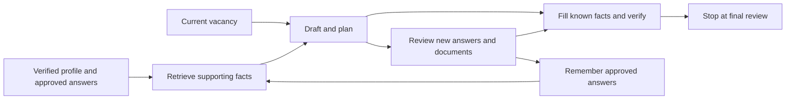

<div align="center">


### Your career facts. Your models. A browser workflow you control.

[Getting started](docs/USAGE.md) · [Chrome extension](extension/README.md) · [What's new](CHANGELOG.md) · [Verified capabilities](RELEASE_READINESS.md)

[](https://github.com/ANASS19/ForgeApply/actions/workflows/tests.yml)


[](LICENSE)

</div>

---

**ForgeApply is an open-source, local-first AI application harness** for turning verified career facts into reviewed job applications. It combines an agentic browser workflow, grounded memory, tailored CV and letter drafts, and your choice of local or hosted models.

Set up your profile once. Retrieve relevant approved answers, fill supported forms, review unfamiliar questions, and keep an inspectable record of browser actions. Bring your preferred local runtime or hosted model API.

Created and maintained by **[Anass Nassiri (ANASS19)](https://github.com/ANASS19)**, part of the Forge AI project family.

**Development preview:** tested with real Chromium against controlled forms. Live employer completion, every ATS variant, and production reliability are not guaranteed. Final submission stays under your control. [Read the evidence and release gaps](RELEASE_READINESS.md).

## What you can do

| Workflow | Included in this preview |
|---|---|
| Keep a reusable profile | Contact details, multiple employment/education records, certifications, languages, skills, resume versions and supporting documents |
| Build grounded application memory | Lightweight RAG-style retrieval from profile facts and relevant human-approved answers, with supporting evidence for review |
| Complete supported steps | Bounded observe/plan/act/verify loop, pause/resume, local checkpoints and a visible virtual cursor |
| Fill an existing Chrome tab | Compact extension, persistent connection, Keep open side panel, reviewed missing answers |
| Prepare complex forms | Native/custom selects, radio groups, factual checkboxes, dynamic fields, repeated sections, multi-page review |
| Use your preferred model | Local runtimes, hosted model APIs, compatible endpoints, or deterministic filling without AI |
| Tailor application materials | Vacancy-focused CV and letter drafts, reviewed PDF export and attachment to selected upload fields |
| Track opportunities | SQLite history, job queue, CSV import/export and public Greenhouse/Lever/Ashby feeds |

Unknown qualifications and personal facts are never intentionally guessed. Legal/consent and protected demographic fields stay manual. LinkedIn/Indeed native inspection and autofill are disabled; use employer application pages where assistance is permitted.

## The application harness



The current harness uses **one bounded orchestrator**. Its grounded memory combines structured facts with lexical retrieval of approved answers; it does not require a vector database or train model weights. Browser actions and new information remain subject to verification and user review.

**Multi-agent roadmap:** specialist discovery, document, browser and verification agents are planned after complete workflows have been measured. Semantic retrieval and broader application types are also future work. See [verified capabilities and remaining work](RELEASE_READINESS.md).

## Quick start

Install **Python 3.13** and Git, then:

```powershell
git clone https://github.com/ANASS19/ForgeApply.git
cd ForgeApply
py -3.13 -m venv .venv
.venv\Scripts\python.exe -m pip install -r requirements.txt
.venv\Scripts\python.exe -m playwright install chromium
.venv\Scripts\python.exe -m forgeapply
```

Open **http://127.0.0.1:8765**. You can also use `start_windows.bat` after downloading and extracting the source. Python 3.11+ is supported; Windows 3.13 is the local validation environment. Linux/macOS users can use `sh start_linux_mac.sh`; macOS has not been independently verified.

## Your first application

1. In **Candidate & CVs**, enter verified contact/background facts and upload your documents.
2. At `chrome://extensions`, enable Developer mode → **Load unpacked** → choose this repository's **extension** folder.
3. Generate a code in dashboard **AI Settings → Chrome extension**, then enter it once in the assistant. The connection stays saved until disconnected or revoked.
4. Open a permitted application page. Open ForgeApply, choose **Keep open**, then **Complete Application**. It fills verified fields, handles supported page transitions, and pauses when you need to act.
5. Enter missing facts and review drafts → **Fill reviewed answers**. Choose a CV using **Attach CV / document**, then **Resume application**.
6. Review personal/legal fields on the website and resume explicitly. The agent stops at final review; submit manually if you choose. **Prepare & Fill this page** remains available for page-by-page control.

Try the built-in practice form before using an employer website. The [usage guide](docs/USAGE.md) covers setup, supported language options, document preparation and recovery.

## Connect your model

Use a hosted model API, a local inference runtime, or deterministic form filling without a model. Select your provider and model in AI Settings, configure credentials locally, and run the synthetic connection test. Hosted inference requires explicit consent before candidate data is sent.

Model and provider setup belongs in the [configuration guide](docs/USAGE.md#configure-ai-optional). Language-specific adapters, current document-template coverage and supported form behavior are described in the [verification notes](RELEASE_READINESS.md).

## Privacy and verification

Data is stored outside the repository under `%USERPROFILE%\.forgeapply` by default. The server binds to loopback; extension pairing is authenticated. No telemetry is implemented. SQLite, CVs and browser sessions rely on OS permissions and are **not application-encrypted**. Hosted inference can receive candidate facts and page content after opt-in; keep it off for local-only inference.

**152 tests pass on Windows Python 3.13**, including actual MV3 Chromium workflows, uploads, virtualized Workday-style catalogs, enterprise portals, partial-record recovery, pause/resume, replaced controls, ambiguous choices, page errors and final review. CI covers Windows/Ubuntu with Python 3.11/3.13. This is fixture evidence, not proof that every employer portal works. See the [regression evidence](docs/WORKDAY_VERIFICATION.md).

```powershell
.venv\Scripts\python.exe -m pytest -q
```

[Usage guide](docs/USAGE.md) · [Engineering reference](docs/ENGINEERING.md) · [Audit](AUDIT.md) · [Contributing](CONTRIBUTING.md)

## Project status and license

ForgeApply is part of the Forge AI project family. Multi-profile isolation, encrypted credentials, installers, unrestricted ATS support, scheduling and specialist-agent orchestration remain unfinished. Local reviewed-answer retrieval, per-answer approval/editing, vacancy-focused CV/letter drafts and reviewed PDF attachment are covered by the [0.4.4 verification notes](docs/FORM_PROVIDER_VERIFICATION.md). The current implementation is one bounded preparation workflow, not a completed multi-agent platform.

Licensed under **[Apache License 2.0](LICENSE)**. Copyright **2026 Anass Nassiri and contributors**. See [NOTICE](NOTICE) for creator attribution and the canonical project source. Forks and commercial reuse are permitted under the license, including its requirements to retain applicable notices and identify modifications. Dependency licenses remain separate.

No Chrome Web Store or PyPI package is published by this preview.
