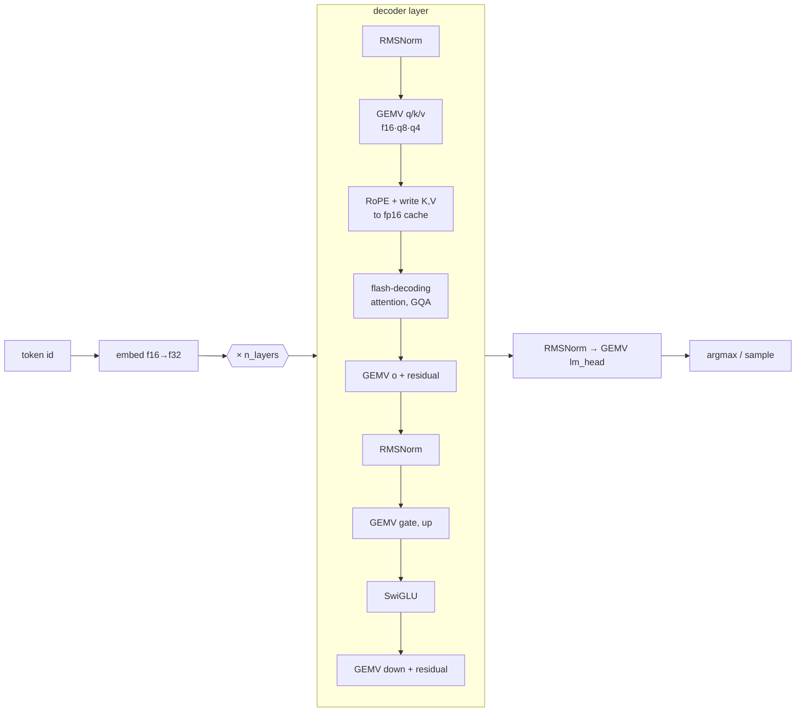

# Tinyinfer

**A from-scratch CUDA inference engine for Llama-family LLMs. Hand-written kernels, INT4/INT8 weight quantization, CUDA-graph decoding. No PyTorch, no cuBLAS, no dependencies.**

[](https://github.com/Aadithya-kl/tinyinfer/actions/workflows/ci.yml)
[](https://github.com/Aadithya-kl/tinyinfer/releases)


<p align="center">
  
  <br><sub>Real output recorded on an RTX 3050 6 GB Laptop GPU: <b>235 tok/s</b>, 77% of peak memory bandwidth, logits verified against the CPU reference.</sub>
</p>

Tinyinfer runs chat models such as TinyLlama-1.1B, Llama-2-7B and Vicuna on a laptop GPU. It is
small enough to read in an afternoon: the engine is about 2,200 lines of C++/CUDA. Every kernel on
the hot path is written by hand and checked against a CPU reference, and that reference is in turn
checked against HuggingFace `transformers`.

📝 **Read the story:** [How I built an LLM inference engine from scratch in CUDA](https://medium.com/@klaadithya/how-i-built-an-llm-inference-engine-from-scratch-in-cuda-235-tokens-s-on-a-6-gb-laptop-gpu-f5ac062950a6) (also on [dev.to](https://dev.to/ash_grey/how-i-built-an-llm-inference-engine-from-scratch-in-cuda-235-tokenss-on-a-6-gb-laptop-gpu-564p) and [Hashnode](https://aadithya.hashnode.dev/how-i-built-an-llm-inference-engine-from-scratch-in-cuda-235-tokens-s-on-a-6-gb-laptop-gpu)): the three optimization rounds from 200 to 235 tok/s, and the "optimization" that made things slower.

### Try it in 3 commands (Windows, NVIDIA RTX 30-series or newer)

Download `tinyinfer-windows-x64.zip` from [Releases](https://github.com/Aadithya-kl/tinyinfer/releases), unzip it, then:

```powershell
pip install numpy huggingface_hub
python convert_hf.py --hf TinyLlama/TinyLlama-1.1B-Chat-v1.0 --quant q4 --out tinyllama-q4.tinf
.\tinyinfer.exe -m tinyllama-q4.tinf
```

To build from source on other GPUs or on Linux, see [Quick start](#quick-start).

## Highlights

- **Hand-written CUDA kernels.** GEMV in f16/q8/q4, RMSNorm, fused RoPE + KV-cache write,
  single-pass flash-decoding attention with online softmax and GQA, SwiGLU, and on-device argmax.
- **Weight-only quantization.** Group-wise INT8 and INT4 (group 64, fp16 scales) are dequantized
  inside the GEMV, so 4-bit weights are never expanded in memory. TinyLlama-1.1B fits in about
  0.7 GB and Llama-2-7B in about 3.8 GB, so both run on a 6 GB laptop GPU.
- **Bandwidth-oriented GEMV.**
  - One warp per row with fully coalesced 128-bit weight loads.
  - The activation vector is staged in shared memory using a padded, bank-conflict-free layout.
  - int8/int4 values are turned into floats with the 2²³ exponent trick (a bitwise OR plus a
    float add) instead of slower `I2F` conversion instructions.
  - The residual add is fused into the epilogue.
- **CUDA Graphs.** A whole decode step (about 180 kernel launches) is captured once and replayed
  for every token. The token and position are read from device memory, so the graph never needs
  re-instantiating.
- **Verified correctness.**
  - Final logits match `transformers.LlamaForCausalLM` within 1e-3 relative error, with 100%
    argmax agreement, for f16, q8, q4 and bf16 checkpoints.
  - Tokenizer output is identical to HF `tokenizers`.
  - Every CUDA kernel is unit-tested against the CPU reference.
  - `--verify` compares the GPU and CPU engines on your own model.
- **One self-contained file format** (`.tinf`) holding config, tokenizer and weights, produced by a
  numpy-only converter that reads `.safetensors` directly.
- **Cross-platform.** Windows (MSVC) and Linux (GCC), CUDA 12 and 13, GPUs from sm_75 (Turing) up.

## How it works



During decoding each weight is read exactly once per generated token, so speed is limited by
memory bandwidth:

```
tokens/s  ≤  DRAM bandwidth / bytes of weights per token
```

The design goal is to get as close to that ceiling as possible. 4-bit weights cut the bytes per
token by about 3.8× compared with f16.

### Kernel notes

| kernel | technique |
|---|---|
| `gemv<f16/q8/q4, R>` | Each warp computes R rows (1, 2 or 4), so every lane keeps R independent 16-byte loads in flight (8 halves, 16 int8 or 32 int4 each). R is **autotuned per matrix shape when the model loads**. `x` is held in shared memory at index `i + i/32`, which makes the 8-, 16- and 32-float lane strides bank-conflict-free. Each group's dot product is multiplied by its fp16 scale once. `y += Wx` is fused for the residual connections. |
| `attention` | **GQA-aware split-K flash-decoding with a shared-memory tile.** There is one block per (KV head, 64-step chunk). The block copies its K/V tile into shared memory once, and that tile serves every query head sharing the KV head. Each head gets 8/G warps. A warp computes attention scores with **one lane per timestep**: padded K rows make this bank-conflict-free and need no shuffles, leaving just two warp reductions per tile for the softmax. P·V is computed with lanes spread over head dimensions, partial results are merged in shared memory, and a combine kernel merges the chunks. The grid is sized from the KV-cache capacity and the position is read on the GPU, so the whole step stays inside one CUDA graph. A simpler one-block-per-head kernel remains as a fallback. Used for GQA/MQA; plain MHA uses the per-head kernel, which measured faster. head_dim 64, 128 and 256. |
| `rope_kv` | Applies HF-style `rotate_half` RoPE to q in place and to k, and writes the rotated k and v straight into the fp16 KV cache, all in one kernel. |
| fused projections | `wq|wk|wv` and `w1|w3` are concatenated at load time, so each layer runs 2 large GEMVs instead of 5 small ones. This means fewer launches, a single staging of `x`, and no tiny 256-row matrices. |
| `rmsnorm`, `swiglu`, `embed`, `argmax` | Small fused element-wise and reduction kernels. `argmax` runs inside the CUDA graph, so greedy decoding copies back only 4 bytes per token. |

## Quick start

### Requirements

- An NVIDIA GPU, Turing or newer (GTX 16xx / RTX 20xx and up), with a recent driver
- CUDA Toolkit 12.x or 13.x
- CMake ≥ 3.24 and a C++17 compiler: Visual Studio 2022 Build Tools ("Desktop development with C++") on Windows, or GCC 11+ on Linux
- Python 3.10+ with `numpy` and `huggingface_hub`, for converting models

### Build

```powershell
git clone https://github.com/Aadithya-kl/tinyinfer
cd tinyinfer
cmake -S . -B build -DCMAKE_CUDA_ARCHITECTURES=86     # 86 = RTX 30xx; use 75/89/... for your GPU, or omit for "native"
cmake --build build --config Release -j
```

Binaries are placed in `build/bin/`.

> **Windows tip:** if CMake reports *"No CUDA toolset found"*, the CUDA installer did not add
> its Visual Studio integration. Re-run the CUDA installer after Visual Studio is installed, or
> build from the *x64 Native Tools Command Prompt for VS 2022* with `-G Ninja`.

### Test the kernels on your GPU

```powershell
.\build\bin\tinf_tests.exe          # every CUDA kernel vs the CPU reference
.\build\bin\tinf_cpu_tests.exe      # fp16, quantization, tokenizer, sampler
```

### Get a model

```powershell
pip install -r tools/requirements.txt
python tools/convert_hf.py --hf TinyLlama/TinyLlama-1.1B-Chat-v1.0 --quant q4 --out models/tinyllama-q4.tinf
```

| model | `--quant` | file size | notes |
|---|---|---|---|
| TinyLlama/TinyLlama-1.1B-Chat-v1.0 | f16 | 2.2 GB | reference quality |
| TinyLlama/TinyLlama-1.1B-Chat-v1.0 | q8 | 1.2 GB | |
| TinyLlama/TinyLlama-1.1B-Chat-v1.0 | q4 | 0.68 GB | fastest |
| NousResearch/Llama-2-7b-chat-hf | q4 | 3.8 GB | fits a 6 GB GPU with `--ctx 1024 --template llama2` |
| lmsys/vicuna-7b-v1.5 | q4 | 3.8 GB | |

The converter supports `LlamaForCausalLM` checkpoints that use a SentencePiece-BPE tokenizer
(the Llama-2 family) and are stored as F32, F16 or BF16 safetensors.

### Run

```powershell
# interactive chat (uses the chat template stored in the model file)
.\build\bin\tinyinfer.exe -m models/tinyllama-q4.tinf

# one-shot prompt, greedy
.\build\bin\tinyinfer.exe -m models/tinyllama-q4.tinf -p "Explain CUDA warps in two sentences." -t 0

# plain text completion
.\build\bin\tinyinfer.exe -m models/tinyllama-q4.tinf --raw -p "Once upon a time" -n 200

# benchmark decode speed and achieved memory bandwidth (add --json for a machine-readable result)
.\build\bin\tinyinfer.exe -m models/tinyllama-q4.tinf --bench 256

# compare GPU vs CPU-reference logits on your model
.\build\bin\tinyinfer.exe -m models/tinyllama-q4.tinf --verify 16

# kernel micro-benchmarks (GB/s per kernel and shape)
.\build\bin\tinf_bench_kernels.exe
```

Run `tinyinfer --help` for all options: sampling (`-t`, `--top-p`, `--min-p`, `--repeat-penalty`,
`--repeat-last-n`, `--seed`), `--ctx`,
`--system`, `--template`, `--no-graph`, `--cpu`, and the testing helpers `--tokenize`,
`--tokens` and `--dump-logits`.

## Benchmarks

Measured on an **RTX 3050 6 GB Laptop GPU** (sm_86, 20 SMs, 168 GB/s peak), Windows 11, CUDA 13.5.

**End-to-end decode**, TinyLlama-1.1B-Chat q4 (g64), greedy, batch 1, CUDA graph:

| version | change | `--bench 256` | `--bench 1900` (long context) |
|---|---|---|---|
| v0.1 | baseline kernels | 200.7 tok/s, 66% of peak | — |
| v0.2 | autotuned multi-row GEMV, split-K GQA attention | **212.3 tok/s**, 69% of peak | 205.8 tok/s |
| v0.3 | shared-memory-tiled attention, fused QKV and gate/up GEMVs | **235.2 tok/s**, 77% of peak | **224.7 tok/s** |

"% of peak" counts only weight bytes (0.55 GB per token for q4), so the ceiling on this GPU is
about 305 tok/s. For comparison, f16 weights are 2.07 GB per token, which caps f16 at about 81 tok/s.

**GEMV kernels**, `tinf_bench_kernels`: achieved bandwidth with the autotuned rows-per-warp
(v0.2), and the v0.1 figure in parentheses:

| matrix | f16 | q8 | q4 |
|---|---|---|---|
| TinyLlama 2048×2048 (wq, wo) | 152 GB/s · 90% (88%) | 140 GB/s · 83% (74%) | 119 GB/s · 71% (64%) |
| TinyLlama 5632×2048 (w1, w3) | 159 GB/s · 95% (93%) | 154 GB/s · 92% (87%) | 147 GB/s · 87% (84%) |
| TinyLlama 2048×5632 (w2) | 158 GB/s · 94% (83%) | 148 GB/s · 88% (69%) | 132 GB/s · **79% (54%)** |
| TinyLlama 32000×2048 (lm_head) | 163 GB/s · 97% | 161 GB/s · 96% | 160 GB/s · 95% |
| Llama-2-7B 4096×11008 (w2) | 159 GB/s · 94% (76%) | 149 GB/s · 88% (61%) | 136 GB/s · **81% (45%)** |

**Decode attention**, TinyLlama shape (32 query heads, 4 KV heads, head_dim 64), time per layer:

| context | v0.1 per-head | v0.2 split-K GQA | v0.3 tiled |
|---|---|---|---|
| 128 | 8.0 µs | 26.2 µs | 12.6 µs |
| 512 | 18.0 µs | 26.5 µs | 17.2 µs |
| 2048 | 124.6 µs | 57.7 µs | **34.2 µs (3.6×)** |

In v0.2, split-K stopped re-reading K/V for every head in a group, but each warp still did 8
dependent warp reductions per timestep, so short contexts got slower. v0.3 removes that cost by
scoring with one lane per timestep from a shared-memory tile.

Models without grouped-query attention, such as Llama-2-7B (one KV head per query head), get no
benefit from sharing the K/V tile. On this GPU the per-head kernel is faster for them (219 µs vs
269 µs at 2048 context), so the engine uses split-K only when the group size is at least 2.

Overall, v0.1 → v0.3 gives **+17% decode throughput**, and the gap grows at long context.

## Correctness

| check | how |
|---|---|
| model math vs HuggingFace | `tests/test_e2e.py` builds a random GQA Llama in `transformers`, converts it, and compares the logits at all 64 positions. Max relative error is about 8e-4 with 100% argmax agreement (f16, q8, q4, bf16). |
| tokenizer vs HF | byte-identical token ids on Unicode, emoji, whitespace runs and byte-fallback cases |
| CUDA kernels vs CPU | `tinf_tests`: gemv (3 formats × 3 rows-per-warp × 7 shapes, including 32000×2048 and 333×11008), rmsnorm, swiglu, embed, argmax (with ties), RoPE + KV-cache writes, and both attention paths up to 600 positions (MHA, GQA with group sizes 3, 4 and 8, head_dim 64/128/256, contexts that cross chunk boundaries) |
| whole engine, GPU vs CPU | `tinyinfer --verify N` on any model |
| CI | GitHub Actions: CPU build + unit tests + end-to-end vs `transformers`, and a CUDA 13 compile for sm_75/86/89 |

The fp16 KV cache is the main source of the remaining 1e-3 difference from the fp32 HF
reference. It is also used on the CPU reference path, so the GPU and CPU engines agree much more
tightly than either agrees with HF.

## Project layout

```
include/tinf/        public headers (engine, model file, tokenizer, sampler, quantization, CPU ops)
src/cuda/            CUDA kernels + GPU engine (CUDA graphs)
src/                 file loader, tokenizer, sampler, quantizer, CPU reference engine, CLI
tools/convert_hf.py  HF safetensors -> .tinf (numpy only)
tests/               CPU unit tests, CUDA kernel tests, end-to-end test vs transformers
bench/               kernel micro-benchmarks
docs/FORMAT.md       file format specification
```

## Roadmap

- [ ] Batched prefill: a tiled tensor-core GEMM plus causal flash-attention, so prompts are processed in parallel
- [x] Split-K flash-decoding for long contexts, GQA-aware (v0.2)
- [x] GEMV rows-per-warp autotuning (v0.2)
- [ ] Byte-level BPE tokenizer (Llama-3, Qwen2, Mistral-Nemo) and Llama-3 RoPE scaling
- [ ] INT8 KV cache
- [x] Fused QKV and gate/up GEMVs (v0.3)
- [ ] SwiGLU fused into the gate/up GEMV epilogue; RMSNorm fused into the next GEMV prologue
- [ ] Continuous batching and an OpenAI-compatible HTTP server

## License

MIT, see [LICENSE](LICENSE).
