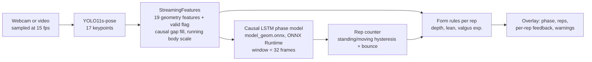

# MotionIQ — squat phase recognition, rep counting and form feedback

MotionIQ watches a person doing squats, detects body keypoints, recognises the movement phase on every frame
(standing / descent / bottom / ascent), counts reps, and flags possible form errors with simple geometric rules: too shallow, forward lean (not reliable;
see [limitations](docs/LIMITATIONS.md)) and an experimental, unvalidated knee-valgus check. It runs in real time on a MacBook (Apple Silicon). The only GPU step, training
the phase model, ran once on Google Colab.

> **Status, plainly:** the accuracy numbers come from **recorded video**: the dataset's held-out subjects and three
> external clips, replayed through the same code path as the webcam. Live use was tested in a short scripted session
> with **one person, side view only** ([live test](docs/LIVE_TEST.md)). Squat counting and shallow-depth flags behaved as intended on its 13 squats. The
> forward-lean flag did not, and non-squat movements (knee dips, bending to pick something up) were counted as reps.
> Nothing is validated on other people, views or rooms, and knee valgus is unvalidated.

## How it works



- **Pose:** pretrained YOLO11s-pose (CNN), 17 keypoints per frame.
- **Geometry features:** joint angles, trunk lean, hip height, widths and velocities, divided by a body scale (the median torso length), plus a per-frame `valid` flag.
- **Phase model:** a unidirectional (causal) 2-layer LSTM over the last 32 frames (2.1 s), exported to ONNX.
- **Rep counter:** decides only from past frames; a segment counts when it contains descent … ascent in order.
- **Form rules:** pure thresholds on per-rep geometry statistics, run only where the fault is visible in 2D (depth and lean: side and diagonal; valgus: front and diagonal).

## Results

Headline numbers on the **5 held-out subjects (30 clips)**; nothing was tuned on them. Full tables: [docs/RESULTS.md](docs/RESULTS.md).

| what | result |
|---|---|
| phase classifier, held-out macro-F1 (geometry model) | 0.891 ± 0.002 offline; 0.889 streaming on the Mac |
| rep counting vs the auto-generated reference | 381 / 387 reps; exact on 25 / 30 clips (MAE 0.2) |
| shallow depth, precision / recall | 0.82 / 0.87 |
| forward lean, precision / recall (**provisional**, 2 subjects) | 0.74 / 0.84 |
| end-to-end latency per frame (replay, Apple Silicon Mac) | 20.55 ms median of per-clip medians; worst-clip p95 26.3 ms (budget 66.7 ms) |

Next to the validation subjects and the one-person live test ([docs/LIVE_TEST.md](docs/LIVE_TEST.md)):

| | held-out subjects (5) | validation subjects (4) | live test (1 person) |
|---|---|---|---|
| rep counting | 381/387, 25/30 clips exact | 283/284 | 13/13 squats; but 12 non-squat "reps" (4 dips + 8 from one pick-up) |
| shallow depth P / R | 0.82 / 0.87 | 0.48 / 1.00 | 3/3 shallow flagged, 0/10 deep flagged |
| forward lean P / R | 0.74 / 0.84 (2 subjects) | 0.08 / 0.20 | 0/5 intended lean flagged; 0 false flags on the 5 good run-1 squats |
| knee valgus | false alarms 1/253 | false alarms 2/178 | not tested (side view) |

## Key limitations

- **Live use is tested on one person only** (side view, one room, ~2.3 min of scripted test runs). Nothing is validated on other people, front or diagonal live views, other rooms or cameras. [More](docs/LIMITATIONS.md#known-limitations)
- **Non-squat movements are counted as reps:** 4 small knee dips → 4 reps; one held forward bend to pick something up → 8 reps; kettlebell pick-up/put-down hinges in an external clip. [More](docs/LIMITATIONS.md#known-limitations)
- **The forward-lean flag is not reliable:** 0 of 5 intended leaning squats were flagged live, and on the validation subjects it reaches only P 0.08 / R 0.20. [More](docs/LIMITATIONS.md#known-limitations)
- **Knee valgus is unvalidated:** 0 positive examples in the dataset, and not tested live. [More](docs/LIMITATIONS.md#known-limitations)
- **Labels are pose-derived or self-annotated:** phase labels and the rep-count reference are auto-generated from pose; fault tags are my own, on top of the dataset's good/bad labels. [More](docs/LIMITATIONS.md#known-limitations)

## Quick start

```bash
python3.11 -m venv .venv && .venv/bin/pip install -r requirements.txt
```

`yolo11s-pose.pt` downloads automatically on first use. The trained models and configs are in `artifacts/`.

Replay a recorded clip through the full pipeline (same code path as the webcam):

```bash
.venv/bin/python scripts/run_demo.py --view side --video path/to/squats.mp4 --record out.mp4
```

Live webcam (`--view` decides which rules run; `--camera 1` for an external camera):

```bash
.venv/bin/python scripts/run_demo.py --view side
```

Tests (tests that need local data are skipped on a fresh clone):

```bash
.venv/bin/python -m pytest -q tests
```

Camera self-test, session debugging and the full pipeline: [docs/REPRODUCE.md](docs/REPRODUCE.md).

## Data credit

**Primary dataset:** Duddela Sai Prashanth, Priya Kamath, Rakshith Bhandary, S Ashlesh Pai, Pratham PN, Advith P,
Abhishek Mashetty. *A Multi-View Raw Video Dataset of Seven Fitness Exercises with Good/Bad Form Labels.*
Mendeley Data, **v3** (10 Aug 2026). DOI [10.17632/kgbb3yn47p.3](https://doi.org/10.17632/kgbb3yn47p.3).
License: [CC BY 4.0](https://creativecommons.org/licenses/by/4.0/). Squat videos only; no videos are redistributed.

**External test clips** (Wikimedia Commons; used only for testing; not committed):
- "Kettlebell Racked Squats (side view)" by Taco fleur, CC BY-SA 4.0. [Commons page](https://commons.wikimedia.org/wiki/File:Kettlebell_Racked_Squats_(side_view).webm)
- "Squats Wikipedia" by CRiles23, CC BY-SA 3.0. [Commons page](https://commons.wikimedia.org/wiki/File:Squats_Wikipedia.webm)
- "Muscle Strengthening at Home - Half squat" by the US Centers for Disease Control and Prevention, public domain. [Commons page](https://commons.wikimedia.org/wiki/File:Muscle_Strengthening_at_Home_-_Half_squat.webm)

What was used and changed, the subject-wise split and the annotations: [docs/DATA.md](docs/DATA.md).

## Repository layout

```
MotionIQ-Squat-analysis/
├── README.md
├── LICENSE                   MIT (code only; dataset licenses above stay with their owners)
├── requirements.txt          (includes pytest for the tests)
├── docs/                     results, live test, data, limitations, reproduce
├── tests/                    pytest regression tests
├── colab_training.ipynb      the only Colab artifact (training + ONNX export)
├── scripts/                  everything that runs on the Mac (see docs/REPRODUCE.md)
├── artifacts/                model_geom.onnx, model_best.onnx, metrics.json, pipeline_config.json,
│                             form_metrics.json, replay_metrics.json  (train_data.npz not committed)
└── data/labels.csv           per-rep phase boundaries + my fault tags (videos/features not committed)
```

## More detail

- [docs/RESULTS.md](docs/RESULTS.md): phase classifier, rep counting, form rules, latency, robustness checks
- [docs/LIVE_TEST.md](docs/LIVE_TEST.md): first live session (debugging) and the scripted live test
- [docs/DATA.md](docs/DATA.md): dataset use and changes, split, annotations, external clips
- [docs/LIMITATIONS.md](docs/LIMITATIONS.md): known limitations, descoped items, next steps
- [docs/REPRODUCE.md](docs/REPRODUCE.md): pipeline details, tech stack, pipeline reproduction, camera self-test, debugging and tests

## License

Code: MIT (see `LICENSE`). The Mendeley dataset is CC BY 4.0, and the external clips carry their own licenses
(listed above). None of them is redistributed here.
