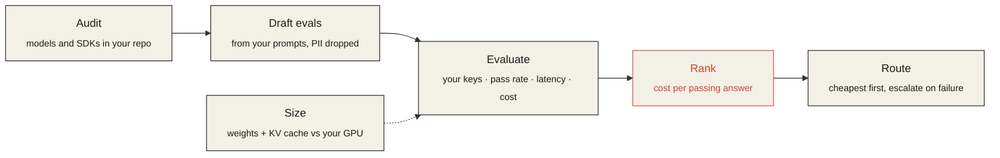

<p align="center">
  <picture>
    <source media="(prefers-color-scheme: dark)" srcset="https://raw.githubusercontent.com/Abhiindigloo/EvalHarness/main/assets/readme-hero-dark.png">
    
  </picture>
</p>

<p align="center">
  <a href="https://github.com/Abhiindigloo/EvalHarness/actions/workflows/test.yml"></a>
  
  
  
  <a href="LICENSE"></a>
</p>

<p align="center">
  <b>Find the cheapest AI model that passes your own tests, and keep it that way.</b><br>
  <sub>Claude · Gemini · OpenAI · Bedrock · Vertex AI · local models — published by Indigloo</sub>
</p>

<p align="center">
  <a href="#install">Install</a> &nbsp;·&nbsp;
  <a href="#how-it-works">How it works</a> &nbsp;·&nbsp;
  <a href="#mcp-tools">MCP tools</a> &nbsp;·&nbsp;
  <a href="#quick-start">Quick start</a> &nbsp;·&nbsp;
  <a href="PRIVACY.md">Privacy</a> &nbsp;·&nbsp;
  <a href="SECURITY.md">Security</a>
</p>

<!-- mcp-name: co.indigloo/model-finder -->

> [!NOTE]
> **Runs locally.** Model Finder is a set of four Agent Skills plus a local MCP server (`mcp/server.py`, Python 3.9+ standard library, no dependencies). The server makes no network calls, needs no API keys, never writes files and never sends anything to Indigloo. Only the eval script and the router it generates call model providers, with your own keys, when you run them.

## How it works



| Skill | What it does |
|---|---|
| `find-model` | Recommends models across Claude, Gemini, OpenAI, cloud, and local options for your task, budget, and route, including coding subtasks in an IDE. |
| `eval-models` | Runs your examples against shortlisted models and measures pass rate, latency, and billed cost with your own keys. |
| `route-models` | Builds a cheapest-first routing setup: a standalone router with quality guards plus a LiteLLM config. |
| `size-local-model` | Estimates memory for weights and KV cache and compares it with your hardware. |

Advisory only: nothing is deployed, your active model is never changed, and data goes only to providers you configure and approve. Personal data and secrets are blocked before sending by default; see [DATA-PROTECTION.md](DATA-PROTECTION.md) for how this maps to India's DPDP Act.

## Install

Requires Python 3.9+ on your PATH as `python3` (see [Windows](#windows)). Nothing to `pip install`.

| Client | Command | Skills | MCP tools |
|---|---|:-:|---|
| **Claude Code** | `/plugin marketplace add Abhiindigloo/EvalHarness` then `/plugin install model-finder@model-finder` | ✅ | ✅ via `.mcp.json` |
| **OpenAI Codex CLI** | `codex plugin marketplace add Abhiindigloo/EvalHarness` then `codex plugin add model-finder@model-finder` | ✅ | ✅ via `mcp.json` (Agent Plugins format, runs `./mcp/server.py`). Codex gives the server no workspace, so the agent passes the project path |
| **GitHub Copilot CLI** | `copilot plugin marketplace add Abhiindigloo/EvalHarness` then `copilot plugin install model-finder@model-finder` | ✅ | ✅ via `mcp.json` |
| **Gemini CLI** | `gemini extensions install https://github.com/Abhiindigloo/EvalHarness` | ✅ | ✅ via `gemini-extension.json` |
| **Cursor** | Plugin with skills: [cursor.directory/plugins/model-finder](https://cursor.directory/plugins/model-finder), or clone into `~/.cursor/plugins/local/model-finder` and reload the window | ✅ | ✅ via `mcp.json` or `.cursor-plugin/plugin.json` → `.mcp.json` |
| **Cursor, MCP only** | [](https://cursor.com/en/install-mcp?name=model-finder&config=eyJjb21tYW5kIjoidXZ4IiwiYXJncyI6WyJtb2RlbC1maW5kZXItbWNwPT0xLjMuNSJdLCJlbnYiOnsiTU9ERUxfRklOREVSX1JPT1QiOiIke3dvcmtzcGFjZUZvbGRlcn0ifX0%3D) (one click; runs `uvx model-finder-mcp==1.3.5`, needs [uv](https://docs.astral.sh/uv/)) | — | ✅ |
| **Any MCP client, from PyPI** | `uvx model-finder-mcp==1.3.5` ([PyPI](https://pypi.org/project/model-finder-mcp/), [MCP Registry](https://registry.modelcontextprotocol.io/v0/servers?search=co.indigloo): `co.indigloo/model-finder`) | — | ✅ |
| **VS Code, JetBrains, Windsurf, others** | Add the server to the client's MCP settings ([manual setup](#manual-mcp-setup)) | — | ✅ |
| **Other Agent Skills clients** | Copy `skills/<name>/` into the client's skills directory | ✅ | — |

Gemini CLI only starts extension MCP servers in folders you have trusted; it asks the first time you open a project.

### Manual MCP setup

<details>
<summary><b>VS Code</b> — <code>.vscode/mcp.json</code> (top-level key is <code>servers</code>)</summary>

```json
{
  "servers": {
    "model-finder": {
      "type": "stdio",
      "command": "python3",
      "args": ["/absolute/path/to/EvalHarness/mcp/server.py"],
      "env": { "MODEL_FINDER_ROOT": "${workspaceFolder}" }
    }
  }
}
```
</details>

<details>
<summary><b>Cursor</b> — <code>.cursor/mcp.json</code> in your project, or <code>~/.cursor/mcp.json</code></summary>

```json
{
  "mcpServers": {
    "model-finder": {
      "command": "python3",
      "args": ["/absolute/path/to/EvalHarness/mcp/server.py"],
      "env": { "MODEL_FINDER_ROOT": "${workspaceFolder}" }
    }
  }
}
```
</details>

<details>
<summary><b>JetBrains, Windsurf, Claude Desktop and others</b> — <code>mcpServers</code></summary>

If the client has no workspace variable, write the project path:

```json
{
  "mcpServers": {
    "model-finder": {
      "command": "python3",
      "args": ["/absolute/path/to/EvalHarness/mcp/server.py"],
      "env": { "MODEL_FINDER_ROOT": "/absolute/path/to/your/project" }
    }
  }
}
```
</details>

Clone the repo once and replace `/absolute/path/to/EvalHarness`. Repository tools read only inside the workspace: the roots your client shares over MCP, else `MODEL_FINDER_ROOT`, else the server's working directory. A filesystem root or home directory is refused.

### Windows

Codex, Copilot CLI and Cursor start the server as `./mcp/server.py`, which relies on its `#!/usr/bin/env python3` line; on Windows use the manual setup or `uvx model-finder-mcp`. If `python3` is not on your PATH, the MCP server will not start. Install Python from python.org (tick "Add python.exe to PATH") and either create a `python3` alias or use the manual setup with `"command": "py"` and `"args": ["-3", "C:/path/to/EvalHarness/mcp/server.py"]`.

## MCP tools

Ten read-only tools, so the same features work as tools in every supported IDE:

| Tool | What it does |
|---|---|
| `modelfinder_audit_models` | Lists AI model IDs and SDKs in your repo with file:line locations, routes and hard-coded IDs |
| `modelfinder_draft_eval_examples` | Drafts eval examples from prompt files and fixtures, dropping anything with personal data or secrets |
| `modelfinder_create_eval_config` · `modelfinder_validate_eval_config` | Builds and checks an eval config: call count, env var names, unpriced models, guard verdict |
| `modelfinder_check_output` | Tests a reply against eval checks or routing guards |
| `modelfinder_rank_eval_results` | Ranks results by cost per passing answer, with the cost/reliability cascade |
| `modelfinder_generate_routing` | Returns routing.json and a LiteLLM config from eval results |
| `modelfinder_estimate_cost` | Monthly token cost and cost per accepted result |
| `modelfinder_estimate_memory` | Local memory for weights and KV cache |
| `modelfinder_scan_sensitive_data` | Personal-data and secrets scan (categories and counts only) |

Every tool returns a readable markdown summary by default and the full result as structured JSON (`response_format: "json"` puts the JSON in the text too). Large results are paginated (`limit`, `offset`, `has_more`, `next_offset`), `modelfinder_audit_models` can filter by provider family or hard-coded IDs, and unknown arguments are rejected with the list of valid ones. The server never opens a network connection, never reads API keys and never writes files. Only `eval_models.py` and the generated `router.py` call model providers, with your keys, when you run them.

## Quick start

In your IDE, ask: *"Audit which AI models this repo uses, then draft evals from our prompts and test whether a cheaper model passes."* The assistant uses the MCP tools to audit and draft, agrees checks with you, and asks before the paid run.

From a terminal:

```bash
cp skills/eval-models/assets/example-config.json my-eval.json   # fill in verified model IDs and prices
export ANTHROPIC_API_KEY=... GEMINI_API_KEY=... OPENAI_API_KEY=...
python3 skills/eval-models/scripts/repo_scan.py audit .            # what the repo uses
python3 skills/eval-models/scripts/repo_scan.py examples .         # draft examples from prompt files
python3 skills/eval-models/scripts/eval_models.py my-eval.json --dry-run
python3 skills/eval-models/scripts/eval_models.py my-eval.json --out results
python3 skills/route-models/scripts/make_routing.py --results results/results.json --guards guards.json --out routing
python3 routing/router.py routing/routing.json "your prompt"
```

**Size a local model:**

```bash
python3 skills/size-local-model/scripts/estimate_memory.py --params-b 8.03 --bits 16 \
  --layers 32 --kv-heads 8 --head-dim 128 --context 8192 --available-gib 24
```

## Tests

```bash
python3 -m unittest discover -s tests -v
```

End-to-end tests run against a local mock of the OpenAI-compatible, Anthropic, and Gemini APIs, and drive the MCP server over stdio; no key or network access is needed. [`evaluations/`](evaluations/) holds a 10-question agent evaluation of the MCP tools.

## Releases

1. Bump the version everywhere (`python3 tests/check_release_version.py` lists any field that differs) and add a CHANGELOG entry.
2. Push a tag `vX.Y.Z`. `release.yml` runs the tests, checks the versions, builds the package, publishes it to PyPI with trusted publishing, then publishes `server.json` to the official MCP Registry.
3. One-time setup:
   - **PyPI**: add a pending trusted publisher for project `model-finder-mcp` (owner `Abhiindigloo`, repository `EvalHarness`, workflow `release.yml`, environment `pypi`), ideally from the Indigloo PyPI organization, and create the `pypi` environment in the repository settings.
   - **MCP Registry** (`co.indigloo/model-finder`, verified through the indigloo.co domain). On your own machine, with OpenSSL 3:
     ```bash
     openssl genpkey -algorithm Ed25519 -out mcp-registry-key.pem
     echo "TXT record for indigloo.co: v=MCPv1; k=ed25519; p=$(openssl pkey -in mcp-registry-key.pem -pubout -outform DER | tail -c 32 | base64)"
     echo "GitHub secret MCP_REGISTRY_PRIVATE_KEY: $(openssl pkey -in mcp-registry-key.pem -noout -text | grep -A3 'priv:' | tail -n +2 | tr -d ' :\n')"
     ```
     Add the TXT record at the apex of indigloo.co, create a repository environment `mcp-registry`, store the hex key as its secret `MCP_REGISTRY_PRIVATE_KEY`, then delete `mcp-registry-key.pem` or keep it in a password manager.

<details>
<summary><b>Repository layout</b></summary>

```
skills/                      shared Agent Skills (single source of truth)
mcp/server.py                local MCP server (stdio, standard library only)
.mcp.json                    MCP launch config for Claude Code and Cursor (${CLAUDE_PLUGIN_ROOT}); disabled as a
                             project config inside this repo by .claude/settings.json
mcp.json                     Agent Plugins MCP launch config (Codex, Copilot CLI, Cursor): runs ./mcp/server.py
server.json, pyproject.toml  MCP Registry entry and PyPI package (model-finder-mcp); pypi/ holds the package marker
glama.json                   Glama directory ownership
.github/workflows/           tests on every push; release.yml publishes tags to PyPI and the MCP Registry
.claude-plugin/              Claude Code (and Copilot CLI) plugin + marketplace manifests
.codex-plugin/               Codex plugin manifest
.agents/plugins/             Codex repository marketplace
.cursor-plugin/              Cursor plugin + marketplace manifests
gemini-extension.json        Gemini CLI extension (context: GEMINI.md)
plugin.json                  Agent Plugins manifest with OpenAI listing metadata
AGENTS.md, GEMINI.md         skill index for agents that read root instructions
PRIVACY.md, TERMS.md, SUPPORT.md  pages the marketplace listings link to
assets/                      logo, README plates, and DESIGN.md (the visual language)
```

`skills/eval-models/scripts/mf_core.py` is duplicated in `skills/route-models/scripts/` so each skill works on its own. The test suite fails if the copies differ.
</details>

---

<p align="center">
  <sub>
    <a href="SUPPORT.md">Support</a> · <a href="PRIVACY.md">Privacy</a> · <a href="TERMS.md">Terms</a> · <a href="SECURITY.md">Security</a> · <a href="DATA-PROTECTION.md">Data protection</a><br>
    MIT License · © 2026 Indigloo Softwares Private Limited
  </sub>
</p>
