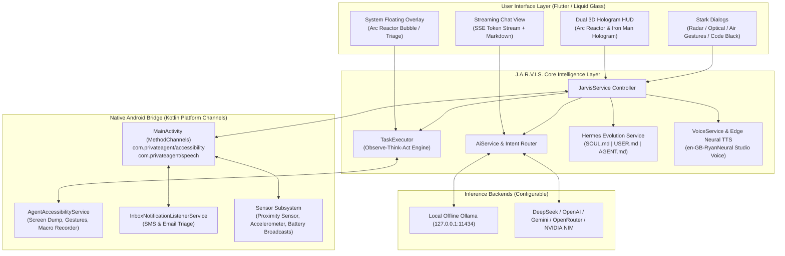

<div align="center">

# ⚡ J.A.R.V.I.S. (PrivateAgent)

### **Autonomous, Self-Evolving On-Device AI Assistant & Android UI Automation Agent**
*Architected and Engineered with Precision by **Abuzar***

---

[](https://flutter.dev)
[](https://dart.dev)
[-3DDC84?style=for-the-badge&logo=android&logoColor=white)](https://developer.android.com)
[](https://github.com/AbuZar-Ansarii/Jarvis/releases)
[](LICENSE)
[](https://ollama.com)
[](https://nousresearch.com)
[](https://flutter.dev)
[](https://azure.microsoft.com)

<p align="center">
  <b><i>"Your keys. Your data. Your device. Nothing leaves your phone except the LLM calls you authorize."</i></b>
</p>

</div>

---

## 🌟 System Overview

**J.A.R.V.I.S.** (PrivateAgent) is an autonomous, on-device AI assistant, system automation framework, and cybernetic operating HUD for Android, architected and built by **Abuzar**. 

Unlike conventional voice assistants that merely return web searches or canned voice responses, J.A.R.V.I.S. acts as a true autonomous operator on your smartphone. By coupling on-device accessibility inspection, native sensor hardware access, multimodal machine vision, and OpenAI-compatible LLM backends (cloud or 100% offline via Ollama), J.A.R.V.I.S. can:

- **Operate Any Application Hands-Free**: Read screen hierarchies, synthesize user intentions, and execute multi-step touch interactions (tap, type, scroll, swipe) autonomously.
- **Project Dual Cinematic 3D Holograms**: Render an interactive gyroscopic Arc Reactor consciousness core or a translucent 3D Iron Man hologram suit bust with dynamic audio-reactive aura colors.
- **Sense Your Physical Environment**: Detect mid-air hand gestures using optical proximity hardware, monitor room movement using accelerometer watchdog sentries, and calculate aircraft overhead via ADS-B telemetry.
- **Evolve and Self-Improve (Hermes Engine)**: Distill repetitive app interactions into executable macro skills and persist learned operator preferences across `SOUL.md`, `USER.md`, and `AGENT.md` context files.
- **Guarantee Complete Privacy**: Built with a strict **Local-First Privacy Architecture** with zero embedded trackers, zero telemetry analytics, and complete compatibility with fully offline, on-device Ollama instances.

---

## 🚀 What's New in v1.1.0 — The Autonomous Triad

Release **v1.1.0** introduces **The Autonomous Triad** upgrade:

1. 🧠 **Multi-Task Decoupler & Parallel Execution Engine**:
   - **Chaotic Brain Dump UI**: New interactive glass HUD dialog (`BrainDumpDialog`) and Navigation Drawer entry.
   - **Multi-Vector Parallel Execution**: Dictate or type complex compound requests (e.g., *"Set a reminder for 5 PM, text Sarah I'm 10 mins late, add eggs to my todo, calculate 25% of 600, and turn on the flashlight"*). Deconstructs intents into parallel async futures with consolidated vocal executive briefings.
   - **Expanded Directives**: Added direct hardware execution for device actions (torch/flashlight, volume up/down, mute, screenshots) alongside reminders, drafts, todos, notes, and calculations.

2. 🎙️ **Always-On Hands-Free Continuous Listening**:
   - **Live HUD Receptor Toggle**: Directly switch between Always-On continuous listening and Standby mode right from the HUD action dock with a glowing status ring.
   - **Ambient Noise Filtering**: Uses acoustic RMS silence boundary detection and low-power passive listening for wake words (`"Hey Jarvis"`, `"Jarvis"`, `"Hello Jarvis"`).
   - **Conversational Continuation Window**: Automatically keeps audio receptors open for 7.5 seconds after speaking for frictionless follow-up queries without repeating the wake word.
   - **Full Voice Control**: Hands-free voice toggles anytime with *"Always on"*, *"Hands free"*, or *"Turn off always on"*.

3. 🧬 **Hermes Self-Evolution Engine**:
   - **Tri-Partite Context Architecture**: Synthesizes and maintains `SOUL.md` (Constitution & Identity), `USER.md` (Operator Habits & Facts), and `AGENT.md` (Protocols & Tool Capabilities).
   - **Voice-Triggered Evolution**: Say *"Hey Jarvis, self evolve"*, *"Evolve context"*, or *"Update your memory"* to immediately synthesize new user facts and active device workflows.
   - **Live Memory-to-Soul Hook**: Automatically synchronizes whenever new facts or preferences are extracted from conversations.
   - **HUD One-Tap Action**: One-tap "SELF EVOLVE" pod in the 3D Hologram HUD with immediate vocal status briefing.

---

The following architecture diagram illustrates how J.A.R.V.I.S. coordinates Flutter UI, native Android platform channels, hardware sensors, accessibility services, and local/cloud LLMs:



---

## 🔮 Dual Holographic Visual Screens

J.A.R.V.I.S. features two switchable, cinema-grade visual HUD engines. Users can toggle between them in **Settings > JARVIS Screen Mode** or directly from the live HUD switcher pill:

```
┌────────────────────────────────────────────────────────────────────────┐
│                        CINEMATIC HUD PROJECTIONS                       │
├──────────────────────────────────┬─────────────────────────────────────┤
│ ⚡ Arc Reactor Core (Default)    │ 🤖 Jarvis Hologram Suit Bust        │
│ • 3D spherical consciousness core│ • Translucent cybernetic avatar     │
│ • Gyroscopic armillary rings     │ • Elliptical emitter pedestal       │
│ • Triple-ring orbital rotation   │ • Horizontal raster scanlines       │
│ • 360° radial audio spectrum     │ • Audio-reactive chest reactor pulse│
└──────────────────────────────────┴─────────────────────────────────────┘
```

### Dynamic Reactive Color Aura

Both HUD modes continuously monitor acoustic volume and processing phases, smoothly shifting interface shaders between 5 operational states:

| State | Color Code | Visual Aura | System Meaning |
|---|---|---|---|
| **Standby / Idle** | `#00E5FF` | Electric Arc Cyan | Standing by, awaiting wake word or prompt |
| **Active Listening** | `#00E676` | Emerald Neon Green | Continuous microphone stream active; reactive sound waves |
| **Computing / Thinking** | `#BA68C8` | Quantum Violet Purple | LLM inference in progress; neural cognition cycle |
| **Speaking / Vocalizing** | `#FFB300` | Radiant Solar Gold | Ultra-realistic neural speech synthesis active |
| **Tactical Alert / Lockdown** | `#FF1744` | Emergency Crimson Red | Sentry breach triggered or "Code Black" active |

---

## 📱 The Three Operational Modes

```
               ┌────────────────────────────────────────────────────────┐
               │                        J.A.R.V.I.S.                    │
               └────────────────────────────────────────────────────────┘
                                           │
         ┌─────────────────────────────────┼────────────────────────────────┐
         ▼                                 ▼                                ▼
┌───────────────────────┐       ┌───────────────────────┐       ┌───────────────────────┐
│     J.A.R.V.I.S.      │       │      Agent Mode       │       │       Chat Mode       │
│  Hands-Free Voice HUD │       │  Observe-Think-Act    │       │  Real-Time Streaming  │
│  3D Hologram Core     │       │  Full UI Automation   │       │  Typewriter Markdown  │
│  Air Gestures & Radar │       │  Macro Skill Memory   │       │  Zero Device Actions  │
└───────────────────────┘       └───────────────────────┘       └───────────────────────┘
```

### 1. ⚡ J.A.R.V.I.S. Mode (Hands-Free Voice & Cyber HUD)
- **Wake Word Listening**: Responds instantly to *"Hey Jarvis"*, *"Jarvis"*, *"Hello Jarvis"*, or *"OK Jarvis"*.
- **Continuous Desk Assistant**: Keep your phone on your desk or wireless dock; issue commands fluidly without pressing a button.
- **Acoustic Focus Protection**: Intelligently suspends voice recognition when playing music or videos, preventing media audio from interrupting itself.

### 2. 🤖 Agent Mode (Autonomous UI Automation)
- **Observe → Think → Act Loop**: Inspects Android view trees via `AgentAccessibilityService.kt`, serializes visible interactive elements into compact syntax, determines next best action via LLM, and dispatches native clicks, text input, scrolls, and swipes.
- **Fail-Safe & Self-Healing**: Powered by `RecoveryEngine.dart` to detect repeat loops, dismiss unexpected system dialogs, and auto-recover stuck sessions.
- **Macro Fast-Path**: Replays verified skill scripts locally before consuming LLM tokens.

### 3. 💬 Chat Mode (High-Speed Conversational Streaming)
- **Typewriter Token Streaming**: Server-Sent Events (SSE) stream responses character-by-character with near-zero latency.
- **Markdown & Code Highlighting**: Renders tables, LaTeX math formulas, quotes, and syntax-highlighted code snippets.
- **Zero-Action Sandbox**: A safe conversational playground where the assistant will never perform unintended device clicks.

---

## 🚀 The 9 Stark Superpowers Suite

J.A.R.V.I.S. is armed with an elite arsenal of 9 specialized cybernetic superpower capabilities built directly on top of Android hardware:

```
┌────────────────────────────────────────────────────────────────────────┐
│                        STARK SUPERPOWERS SUITE                         │
├──────────────────────────────────┬─────────────────────────────────────┤
│ 🖐️ Iron Man Air Gestures         │ Zero-touch mid-air proximity sensor │
│ ⚡ Arc Reactor Telemetry         │ Cinematic plug-in HUD & wattage     │
│ 🌐 Polyglot Diplomat             │ Real-time two-way voice translation │
│ 🎭 "Code Black" Lockout          │ Anti-prying kernel panic deception  │
│ 👁️ Holographic Floating Co-Pilot │ Universal on-screen context triage  │
│ 📡 Overhead Airspace Radar       │ ADS-B flights & ISS orbital pass    │
│ 🧠 Chaotic Brain Dump Decoupler  │ Disassembles multi-task voice dumps │
│ 👁️ Real-Time Optical HUD Solver  │ Math, stack trace & bill split AR   │
│ 🛡️ Network Security & Wi-Fi Scan │ Subnet sweep, ARP MACs & port audit │
└──────────────────────────────────┴─────────────────────────────────────┘
```

### 1. 🖐️ Iron Man Zero-Touch Air Gestures
Control your phone in mid-air without ever smudging the screen.
- **Hardware Integration**: Hooks into the physical optical proximity sensor via `Sensor.TYPE_PROXIMITY` in Android native Kotlin.
- **Gestures Supported**:
  - **👋 Quick Wave / Swipe Left**: Skips to the next media track (`KEYCODE_MEDIA_NEXT`).
  - **👉 Swipe Right**: Jumps back to previous track (`KEYCODE_MEDIA_PREVIOUS`).
  - **✋ Palm Hover (1–2s)**: Mid-air hold toggles play/pause on Spotify, YouTube, or music players.
  - **✌️ Double Wave**: Snaps an instant high-resolution system screenshot.
- **HUD Calibration**: Tap **`[🖐️ AIR GESTURES]`** on the HUD to launch the live proximity radar calibration dialog.

### 2. ⚡ Arc Reactor Charging Telemetry
Cinematic power coupling feedback whenever you connect your device.
- **Automated Detection**: Listens to Android system `ACTION_POWER_CONNECTED` broadcasts.
- **Cinematic Reactor Popup**: Renders a spinning tritium fusion core with magnetic stator rings and counter-rotating stabilization fields.
- **Stark Spoken Telemetry**:
  > *"Arc reactor coupled, sir. Energy intake active at 33.0 Watts. Power cells at 74 percent, core temperature steady at 31.4° Celsius."*
- **Real-Time Electrical Gauges**: Live calculation of wattage ($P = V \times I$), bus voltage ($mV$), thermal grade ($^\circ C$), and charging medium (*AC Turbo*, *Wireless Inductive Flux*, or *USB Bus*).

### 3. 🌐 Polyglot Diplomat (Live Two-Way Voice Translator)
Real-time, context-preserving voice translation between 14+ world languages.
- **Languages**: English, Spanish, French, German, Hindi, Arabic, Japanese, Mandarin Chinese, Russian, Portuguese, Italian, Urdu, Turkish, and Korean.
- **Diplomatic Conversational Intelligence**: Formulates polite, culturally nuanced idioms rather than robotic literal translations.
- **Spoken Dual-Audio**: Automatically speaks translations aloud using native neural voices.
- **Glass Split-View UI**: Features two-way speaker message cards, one-touch swap ($\rightleftharpoons$), and continuous listening.

### 4. 🎭 "Code Black" Tactical Deceptive Lockout
Cinema-grade simulated kernel panic designed to stop phone snoopers and prying friends.
- **Simulated Catastrophe**: Locks the entire screen behind an ominous military kernel panic terminal featuring CRT raster scanlines, memory address segmentation dumps (`SIGSEGV at 0xDEADBEEF`), and siren alerts.
- **Intruder Tamper Alarm**: Any touch attempt on the screen triggers aggressive haptic vibrations and increments an escalating warning counter:
  > *"TAMPER VIOLATIONS: [N] — TRANSMITTING INTRUDER BIOMETRICS TO DEFENSE COMMAND"*
- **Disarm Methods**:
  - **Voice Passphrase**: Say *"override alpha"*, *"stand down jarvis"*, *"abuzar protocol"*, or *"disarm"* (speech recognizer runs in background).
  - **Hidden Gesture**: 4 rapid taps in the top-right corner.
  - **Emergency Override**: Double-tap or long-press the emergency override slider bar.

### 5. 👁️ Holographic Floating Co-Pilot
An omnipresent system-wide assistant hovering over third-party applications.
- **Universal Floating Bubble**: A glassmorphic Arc Reactor bubble hovering above WhatsApp, Chrome, Slack, Amazon, or Telegram.
- **On-Screen Context Triage**:
  - **Chat Apps**: Inspects foreground accessibility nodes and drafts 3 witty, professional, or casual replies in your voice.
  - **E-Commerce Apps**: Analyzes product descriptions, reviews, and evaluates pricing authenticity.
  - **Security Watch**: Flags phishing attempts, malicious URLs, and suspicious OTP requests.

### 6. 📡 Overhead Airspace & Orbital Satellite Radar
Scan the skies directly above your physical location.
- **Live ADS-B Aviation Feed**: Sweeps a 40-nautical-mile sector around your coordinates using OpenSky Network REST endpoints.
- **Aircraft Telemetry**: Identifies callsigns (e.g., `UAE203`, `BAW117`), aircraft country of origin, true altitude in feet, velocity in knots, and compass heading.
- **ISS Orbital Pass**: Calculates real-time distance and trajectory of the International Space Station.
- **Spoken Radar Briefing**:
  > *"Airspace radar sweep complete, sir. 3 aircraft identified within our regional sector. Closest traffic is Flight Emirates EK203 at 36,000 feet heading East at 520 knots. The International Space Station is currently 2,840 kilometers away."*

### 7. 🧠 "Chaotic Brain Dump" Multi-Task Decoupler
Speak 4 or 5 disparate tasks in a single breath; J.A.R.V.I.S. decouples and executes them in parallel.
- **Input Example**:
  > *"Jarvis, remind me to call Jack at 4pm, draft a WhatsApp to Sarah saying I'll be 15 minutes late, calculate 25 percent tip on 140 dollars, and add milk and eggs to my grocery list."*
- **Concurrent Dispatch**:
  1. `CalendarReminderService.addItem("Call Jack", 16:00)`
  2. `MessageDraftingService.prepareDraft("Sarah", "whatsapp", "I'll be 15 minutes late")`
  3. Math Solver evaluates: $25\% \times \$140 = \$35$ ($\text{Total } \$175$)
  4. `TodoService.addTask("Buy milk and eggs")`
- **Synthesized Voice Summary**: Confirms execution of all 4 intents in a single executive briefing.

### 8. 👁️ Real-Time Optical HUD Solver
Point your device camera at physical objects, papers, or computer screens.
- **Targeting AR Viewport**: Displays glowing cyan corner brackets, laser scanlines, and step-by-step solutions.
- **Modes Supported**:
  - **📐 Math & Physics**: Resolves algebra, calculus, matrices, and equations with full step-by-step derivation.
  - **💻 Code Debugger**: Point at terminal stack traces or IDE compiler errors to diagnose root causes and output patched code.
  - **🧾 Bill & Receipt Splitter**: Parses itemized lines, taxes, customizable tips, and divides totals per person.
  - **⚡ Electronics & Hardware**: Identifies resistor color bands, SMD codes, IC pinouts, and development boards (ESP32, Arduino, Raspberry Pi).

### 9. 🛡️ Stark Network Auditing & Wi-Fi Vulnerability Scan
Full cyber defense and IoT reconnaissance sweep on your local Wi-Fi network.
- **Subnet Sweeper**: Concurrently pings the entire local subnet (`192.168.x.0/24` or `10.x.x.0/24`).
- **Hardware ARP Inspection**: Reads `/proc/net/arp` natively to resolve MAC addresses and determine device manufacturers (Apple, Samsung, Google, Espressif IoT, Raspberry Pi).
- **Vulnerability Port Audit**: Probes critical security ports: `21` (FTP), `22` (SSH), `23` (Telnet), `80/443` (Web), `554` (RTSP IP Video Camera), and `8080` (HTTP Proxy).
- **Surveillance Camera Detector**: Automatically flags unencrypted RTSP video streams from IP security cameras and generates an overall network security score ($0–100\%$).

---

## 🛡️ Tactical Sentry Mode & Telegram Remote Control

### 🚨 Sentry Mode (Anti-Theft Watchdog)
Transform your phone into an armed security station when you step away from your desk:
1. **Arming**: Say *"Jarvis, activate sentry protocol"* or tap the Sentry switch.
2. **Motion Detection**: Employs continuous accelerometer monitoring via native Kotlin sensor listeners.
3. **Silent Capture**: The instant the phone is moved or picked up, J.A.R.V.I.S. silently captures a front-camera snapshot of the intruder via the Camera2 API.
4. **Vocal Deterrence**: Booms a loud, commanding security alert through the speakers:
   > *"Security violation detected. Spatial coordinates and facial telemetry logged and dispatched."*
5. **Telegram Dispatch**: Automatically uploads the intruder's photo, breach timestamp, and coordinates to your private Telegram chat.

### ✈️ Telegram Bot Remote Terminal
Full remote control of your smartphone from any other device running Telegram:
- **Long-Polling Engine**: Connects via `telegram_service.dart` with zero webhook setup required.
- **Remote Commands**:
  - `/status`: Checks device battery, active task, and accessibility status.
  - `/screenshot`: Captures current phone screen and transmits high-res PNG back to Telegram.
  - `/cancel` or `/stop`: Terminates any running automation task immediately.
  - `<Any Task Prose>`: Type *"Open Uber and check price to airport"* — J.A.R.V.I.S. executes the task on your phone and sends back the final screenshot!

---

## 🧬 Hermes Self-Evolution Architecture

J.A.R.V.I.S. incorporates the **Hermes Tri-Partite Context Architecture**, allowing the assistant to learn, adapt, and evolve its operating rules over time:

```
┌────────────────────────────────────────────────────────────────────────┐
│                        HERMES CONTEXT ENGINE                           │
├───────────────────┬───────────────────┬────────────────────────────────┤
│ 1. SOUL.md        │ 2. USER.md        │ 3. AGENT.md                    │
│ Core identity,    │ Operator profile, │ Operational protocols,         │
│ ethos, loyalty,   │ habits, personal  │ distilled skills, and          │
│ and behavioral    │ preferences, and  │ autonomous macro               │
│ guardrails.       │ learned facts.    │ replay scripts.                │
└───────────────────┴───────────────────┴────────────────────────────────┘
```

### Autonomous Macro Recorder
Record manual screen workflows and codify them into permanent, self-executable skills:
1. Tap **Start Macro Recording** in Settings or via voice.
2. Perform the desired multi-step actions across your apps (e.g., ordering coffee, toggling a specific hotspot setting, opening a playlist).
3. Tap **Stop Macro Recording**.
4. The Hermes engine distills the recorded accessibility events into an optimized JSON skill template, automatically registered into `AGENT.md` for zero-token local replay!

---

## 🎙️ Studio Neural Voice & Audio Engine

J.A.R.V.I.S. bypasses standard robotic Android TTS engines by integrating **Microsoft Studio Neural Voices** through a low-latency Edge-TTS pipeline:

- **Zero API Keys Required**: Streams high-fidelity MP3 neural audio directly without requiring an Azure subscription.
- **Intelligent Local Caching**: MD5-hashes spoken responses to disk; recurring phrases speak instantaneously with zero bandwidth usage.
- **Voice Preset Catalog**:
  - **`en-GB-RyanNeural`** *(Default)*: Authentic Paul Bettany British JARVIS style — warm, articulate, and poised.
  - **`en-IE-EmilyNeural`**: Authentic F.R.I.D.A.Y. — charming, crisp Irish female cadence.
  - **`en-GB-ThomasNeural`**: Natural UK conversational tone.
  - **`en-US-GuyNeural`**: Polished, authoritative US broadcaster tone.
  - **`en-US-ChristopherNeural`**: Direct, crisp, and focused corporate voice.
- **Offline Fallback**: Automatically falls back to high-quality on-device Android TTS (`flutter_tts`) when internet connectivity is unavailable.

---

## 🌐 Supported AI Providers & Vision Models

J.A.R.V.I.S. is provider-agnostic and connects to any OpenAI-compatible API endpoint:

| Provider | Preset Base URL | Recommended Models | Modality |
|---|---|---|---|
| **Ollama (Local-First)** | `http://127.0.0.1:11434/v1` | `llama3.2`, `qwen2.5`, `llava` | Text & Vision |
| **DeepSeek** | `https://api.deepseek.com/v1` | `deepseek-chat`, `deepseek-reasoner` | Text / Reasoning |
| **Google Gemini** | `https://generativelanguage.googleapis.com/v1beta/openai` | `gemini-2.0-flash`, `gemini-1.5-pro` | Multimodal Vision |
| **OpenAI** | `https://api.openai.com/v1` | `gpt-4o-mini`, `gpt-4o` | Multimodal Vision |
| **OpenRouter** | `https://openrouter.ai/api/v1` | `anthropic/claude-3.5-sonnet`, `meta/llama-3.3-70b` | Text & Vision |
| **NVIDIA NIM** | `https://integrate.api.nvidia.com/v1` | `meta/llama-3.3-70b-instruct` | Text & Reasoning |
| **Custom Endpoint** | User Defined | Any OpenAI-compatible model | Configurable |

---

## ⚙️ Device Diagnostics, Local Storage & Smart Home

### 📊 Direct System Diagnostics (Zero UI Taps)
Inspect device performance metrics natively in real-time without leaving your conversation:
- **RAM**: Active memory usage ($MB$) and free buffer capacity.
- **Storage**: Total internal ROM ($GB$), available space, and filesystem health.
- **Thermals & Battery**: Core battery temperature in $^\circ C$, capacity percentage, and charging state.
- **Voice Query**: *"Jarvis, system diagnostics"* or *"How much RAM is free?"*

### 📁 Direct Phone Storage File Manager
Create, read, append, and delete files directly in public phone directories (`Download`, `Documents`, `Pictures`, `DCIM`):
- **Voice Command**: *"Jarvis, save notes from my meeting to a file called notes.txt in Downloads"*
- **Media Scanner**: Automatically broadcasts `ACTION_MEDIA_SCANNER_SCAN_FILE` to make created files instantly visible in Android file managers.

### 🏠 Smart Home IoT Integration (Home Assistant)
Control smart lights, relays, switches, and scenes over your local Wi-Fi:
- **Voice Commands**: *"Turn on the living room light"*, *"Dim office lights to 40%"*, *"Activate movie night"*.
- Configurable via **Settings > Smart Home & IoT Automation**.

---

## 📋 Master Voice Commands Reference Guide

| Category | Example Voice Command | Autonomous Action Taken |
|---|---|---|
| **Air Gestures** | *"Activate air gestures"*, *"Turn off air gestures"* | Arms/disarms optical proximity sensor for mid-air track skipping, pausing, and screenshots |
| **Arc Reactor** | *"Charging telemetry"*, *"Arc reactor status"* | Speaks electrical wattage, core voltage, temperature, and launches the Arc Reactor HUD |
| **Translator** | *"Translate between English and Spanish"*, *"Translate 'where is the station' to French"* | Engages two-way Polyglot Diplomat interpreter with native vocal output |
| **Code Black** | *"Jarvis, activate Code Black"*, *"Initiate lockdown protocol"* | Simulates critical kernel panic screen; unlock via 4-tap top-right corner or *"override alpha"* |
| **Floating Co-Pilot** | *"Activate floating copilot"*, *"Dismiss floating assistant"* | Launches floating Arc Reactor bubble assistant over active apps with screen triage |
| **Airspace Radar** | *"What's flying above me?"*, *"Scan airspace"*, *"Where is the ISS?"* | Sweeps local airspace for flights and ISS orbital passes with altitude, speed, and heading |
| **Brain Dump** | *"Remind me to call Jack at 4pm and draft a WhatsApp to Sarah saying I am late"* | Decouples chaotic stream-of-consciousness dump into parallel executions |
| **Optical Solver** | *"Jarvis, solve this"*, *"Inspect this error"*, *"Split this bill"* | Point camera to solve math equations, debug stack traces, and calculate split receipts |
| **Network Audit** | *"Audit my network"*, *"Who is on my Wi-Fi?"*, *"Check network security"* | Scans subnet, identifies connected device MACs/vendors, and audits open ports & IP cameras |
| **Sentry Mode** | *"Jarvis, activate sentry protocol"*, *"Disarm sentry"* | Accelerometer motion anti-theft watchdog with silent intruder camera capture & Telegram dispatch |
| **Hardware Specs** | *"System specs"*, *"How much RAM do I have?"*, *"Free storage space"* | Speaks device model, manufacturer, RAM, ROM, and thermals without opening settings |
| **Smart Home** | *"Turn on the living room light"*, *"Dim lights to 20%"*, *"Night mode"* | Controls Home Assistant lights, relays, and scenes over local LAN |
| **Commute** | *"How is traffic to work?"*, *"When should I leave for my meeting?"* | Checks OSRM route, evaluates rush hour delay, and alerts departure time |
| **Proactive Voice** | *"It's night time, sir. Should I turn on the night mode?"* → *"Yes"* / *"No"* | Autonomous prompt followed by hands-free voice confirmation window |
| **Inbox & SMS** | *"Read my inbox"*, *"Check my recent messages"*, *"Read my SMS"* | Triage recent emails and text messages aloud |
| **News & Web** | *"What are today's top headlines?"*, *"Search who built the Pyramids"* | Fetches live RSS news feeds or queries Google/DuckDuckGo |
| **App Automation** | *"Open YouTube and play Interstellar soundtrack"*, *"Install WhatsApp"* | Complete autonomous Observe-Think-Act on-device UI automation |
| **Device Controls** | *"Volume up"*, *"Set brightness to 50%"*, *"Turn on flashlight"*, *"Set alarm for 7 AM"* | Native hardware device controls via Android platform services |

---

## 🔐 Android Permissions & Setup Guide

J.A.R.V.I.S. provides a dedicated **Permissions Hub** in **Settings > App Permissions** that audits and requests all required permissions:

```
┌────────────────────────────────────────────────────────────────────────┐
│                        PERMISSIONS MATRIX                              │
├──────────────────────┬─────────────┬───────────────────────────────────┤
│ Permission           │ Level       │ Purpose                           │
├──────────────────────┼─────────────┼───────────────────────────────────┤
│ 🎙️ Microphone        │ Runtime     │ Hands-free voice recognition      │
│ 🦾 Accessibility Svc │ Special     │ On-screen node dump & UI gestures │
│ 🪟 System Alert Win  │ Special     │ System-wide floating Arc HUD      │
│ 🔔 Notification Svc  │ Special     │ Live email & SMS inbox triage     │
│ 💬 SMS & Contacts    │ Runtime     │ Reading SMS & dialing contacts    │
│ 📁 Manage Storage    │ Special     │ Direct file read/write operations │
│ 🔋 Battery Exemption │ Special     │ Uninterrupted background services │
│ ⚡ Shizuku (Optional)│ Privileged  │ Elevated shell commands (no root) │
└──────────────────────┴─────────────┴───────────────────────────────────┘
```

> [!TIP]
> **Battery Optimization Exemption**: For seamless hands-free wake word recognition while your screen is off, grant **"Unrestricted Battery Usage"** to J.A.R.V.I.S. in Android Settings.

---

## 🛠️ Build & Installation Instructions

### Prerequisites
- **Flutter SDK**: `^3.12.2` or newer
- **Android SDK**: Compile SDK `35`, Min SDK `26` (Android 8.0+)
- **Java / JDK**: OpenJDK 17 or newer

### 1. Clone the Repository
```bash
git clone https://github.com/your-username/jarvis-android.git
cd jarvis-android
```

### 2. Install Flutter Dependencies
```bash
flutter pub get
```

### 3. Verify Static Analysis & Tests
```bash
flutter analyze
flutter test test/jarvis_features_test.dart
```

### 4. Build Release APK
```bash
flutter build apk --release
```
The compiled APK will be output to:
```
build/app/outputs/flutter-apk/app-release.apk
```

### 5. Install via ADB
```bash
adb install -r build/app/outputs/flutter-apk/app-release.apk
```

---

## 📂 Codebase Architecture & Directory Map

```
Jarvis/
├── android/                                    # Native Android host layer
│   └── app/src/main/
│       ├── AndroidManifest.xml                 # Services, receivers & permission manifest
│       └── kotlin/com/privateagent/private_agent/
│           ├── MainActivity.kt                 # Platform channels, sensor dispatch, camera
│           ├── AgentAccessibilityService.kt    # Screen hierarchy dump & UI touch injection
│           └── InboxNotificationListenerService.kt # Email & SMS listener
├── assets/
│   ├── icon/                                   # Arc Reactor & J.A.R.V.I.S. obsidian logos
│   └── images/                                 # 3D Hologram assets (Arc core, suit avatars)
├── lib/
│   ├── main.dart                               # App entry point, services & overlay isolate
│   ├── app.dart                                # MaterialApp, theme routing & telemetry modals
│   ├── models/                                 # Chat, screen nodes, skills, tasks
│   ├── overlay/
│   │   └── overlay_app.dart                    # System-wide floating Arc Reactor overlay
│   ├── screens/
│   │   ├── home/home_screen.dart               # Mode switcher & primary container
│   │   ├── onboarding/onboarding_screen.dart   # Interactive feature walkthrough
│   │   ├── security/code_black_screen.dart     # Deceptive kernel panic lockout UI
│   │   └── settings/                           # J.A.R.V.I.S. settings & permissions hub
│   ├── services/                               # 40+ modular business logic services
│   │   ├── ai_service.dart                     # LLM integration, vision & intent routing
│   │   ├── jarvis_service.dart                 # Master conversational & hands-free coordinator
│   │   ├── task_executor.dart                  # Observe-Think-Act autonomous agent loop
│   │   ├── hermes_evolution_service.dart       # SOUL.md / USER.md / AGENT.md memory
│   │   ├── edge_tts_service.dart               # Microsoft Studio Neural voice synthesis
│   │   ├── air_gesture_service.dart            # Mid-air proximity gesture handler
│   │   ├── sentry_service.dart                 # Accelerometer anti-theft watchdog
│   │   └── ...                                 # Telemetry, Radar, Polyglot, Storage, etc.
│   ├── theme/
│   │   └── app_theme.dart                      # Frosted glass colors, gradients & typography
│   └── widgets/                                # 3D Hologram HUD, radar dialogs, glass cards
│       ├── jarvis_hud_widget.dart              # Interactive 3D Arc & Hologram suit canvas
│       └── ...
└── test/
    └── jarvis_features_test.dart               # Comprehensive unit & integration test suite
```

---

## ❓ Troubleshooting & Edge Cases

### 1. Hands-Free Speech Recognition on Motorola / Android 12+
- **Symptom**: `InterruptedIOException` in `PipedOutputStream`.
- **Cause**: Android 12+ on some devices delegates `createOnDeviceSpeechRecognizer` to buggy OEM speech recognizers.
- **Solution**: J.A.R.V.I.S. explicitly routes through Google's robust Speech Services via `SpeechRecognizer.createSpeechRecognizer(this)`. Ensure the Google app has microphone permissions.

### 2. Floating Overlay Doesn't Render
- **Solution**: Navigate to **Settings > App Permissions > Floating Overlay** and ensure "Appear on top" permission is toggled ON.

### 3. Screen Automation Clicks Miss Target
- **Solution**: Ensure your screen orientation matches standard portrait mode. If an app utilizes secure flags (`FLAG_SECURE`, e.g., banking apps), Android prevents accessibility services from inspecting node coordinates.

---

## 📄 License & Attribution

This project is licensed under the **MIT License** — see the [LICENSE](LICENSE) file for details.

Architected, designed, and engineered by **Abuzar**. All rights reserved.

*Built for privacy enthusiasts, power users, and anyone who ever dreamed of carrying a genuine, autonomous J.A.R.V.I.S. in their pocket.*
