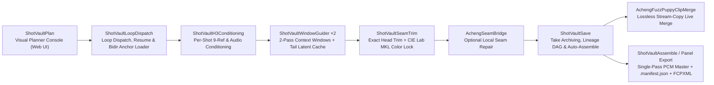

<div align="center">

# ComfyUI-Acheng-ShotVault (v5.8)

**Production-Grade ComfyUI Suite for MiniMax H3 Multi-Shot Planning, Lossless Context Continuation, Bidirectional Bridge Single-Shot Reroll, Local Seam Repair, and Manifest-Verified Master Assembly**

<p>
  <strong>English</strong> | <a href="README_ZH.md">简体中文</a>
</p>

[](LICENSE)
[](https://github.com/AharaOoO/ComfyUI-Acheng-ShotVault/releases)
[](https://github.com/comfyanonymous/ComfyUI)
[](https://www.python.org/)

</div>

---

## Table of Contents

1. [Architecture & v5.8 Capabilities](#1-architecture--v58-capabilities)
2. [Included Nodes (10-in-1 Suite)](#2-included-nodes-10-in-1-suite)
3. [Installation](#3-installation)
4. [Example Workflow & External Companion Nodes](#4-example-workflow--external-companion-nodes)
5. [Quick-Start Walkthrough](#5-quick-start-walkthrough)
6. [Technical Deep-Dive](#6-technical-deep-dive)
7. [Troubleshooting & Production FAQ](#7-troubleshooting--production-faq)
8. [License, Copyright Protection & Legal Disclaimer](#8-license-copyright-protection--legal-disclaimer)

---

## 1. Architecture & v5.8 Capabilities



### Key Engineering Highlights (v5.8)

| Subsystem | Production Bottleneck Solved | v5.8 Implementation |
| :--- | :--- | :--- |
| **Visual Shot Planner (`ShotVaultPlan`)** | Managing long multi-shot scripts, mixing action & drama LoRA chains, or rerolling a single shot without rebuilding the graph | Interactive in-node console supporting `&duration&` + `===` auto-splitting, explicit `@cut@` / `@continue@` lineage markers, per-shot Action/Drama routing, 9-slot image references & 3-slot voice references (`<Audio 1..3>`) with inline audio preview and one-click forward/global reuse, clamped fluid node resizing (`Compact / Standard / Wide`), full-screen Focus Prompt Editor (`Ctrl+Enter` to save), and live `EN / 中文` UI toggle |
| **Bidirectional Bridge Single-Shot Reroll (`0 / 1 / 5 / 22f`)** | Rerolling a middle shot breaks continuity with the next shot and invalidates the entire downstream chain | Anchors **both** the previous shot's tail context and the next shot's clean delivered head frames (decoded directly from post-trim `shots/*.mp4`, zero chroma-noise contamination), aligned to H3's `17k+5` latent grid & `cycle_pos == 0`; optional `22f` reverse-taper noise (`alpha=0.0` at seam `pos=0`); automatically restores downstream `VALID` lineage |
| **Manifest-Verified Master Export Sync** | Switching takes, rerolling a shot, or restarting ComfyUI leaves `master.mp4` silently stale | Every master export atomically writes a sidecar `.manifest.json` snapshot; supports optional **auto-reassemble after reroll**; header CTA highlights outdated status and the Export Modal guards against accidentally downloading stale MP4s |
| **Fixed-Camera Anti-Degradation** | Static-camera / talking-head scenes suffer generation loss and chroma noise buildup across repeated `@continue@` chains | Three configurable anti-degradation modes (Standard / Gentle / Strong Static-BG Preserve) plus periodic `@cut@` reset tooling to refresh clean reference anchors |
| **Bundled Local Seam Repair & Lossless Merge** | Micro exposure jumps at joins, accidental hard-cut blending, or quality loss from repeated full-clip re-encoding | Integrated `AchengSeamBridge` & `AchengFuzzPuppyClipMerge`: dual-gate hard-cut protection, dense optical-flow local alignment, optional local RIFE bridging, and zero-reencode stream-copy concatenation for already-merged history |
| **Safe Local-First Vault Management** | Accidental permanent take deletion or cross-project directory pollution | Isolated per-project archiving (`project.json` + `.h3ctx.safetensors`), strict root-confinement path validation (`ensure_inside_root`), and OS recycle-bin cleanup via `send2trash` |

---

## 2. Included Nodes (10-in-1 Suite)

> [!NOTE]
> **🧪 Experimental Feature Notice (Seam Repair)**: Built-in seam repair (Tab ② per-shot repair, `AchengSeamBridge`, and the `enable_repair` toggle in `AchengFuzzPuppyClipMerge`) is currently **Experimental**. It is **only effective for correcting sudden visual artifacts caused by continuation when camera angle and framing remain unchanged**. For standard multi-cut workflows, leave it **OFF** by default — you rarely need to enable it.

A single `git clone` into `ComfyUI/custom_nodes/` registers all **10 author-owned nodes** (`8` ShotVault core nodes + `2` bundled local SeamBridge nodes):

| Node Class | Display Name | Role |
| :--- | :--- | :--- |
| `ShotVaultPlan` | **ShotVault Plan** | Interactive storyboard planner & audio/shot orchestrator; outputs `shot_pipe`, `total_shots`, `plan_summary_json` |
| `ShotVaultLoopDispatch` | **ShotVault Loop Dispatch** | Drives `forLoop` per-shot prompt/seed/reference dispatch, skips already-`VALID` shots on resume, handles single-shot reroll locking & clean next-head loading |
| `ShotVaultH3Conditioning` | **ShotVault H3 Conditioning** | Builds per-shot MiniMax H3 multimodal conditioning from active 9-slot image & audio references |
| `ShotVaultWindowGuider` | **ShotVault Window Guider** | Manages 1st/2nd-pass shared context caches, bidirectional tail keyframe injection, reverse-taper noise, and optional sliding context windows (`window_mode=off` by default for native 15s/25s/30s+ single-window generation; global RoPE offset + high-sigma anchor gating when enabled) |
| `ShotVaultSeamTrim` | **ShotVault Seam Trim** | Trims exact overlap lead-in (`22f / 39f / 56f`), performs CIE Lab MKL linear color lock, and runs seam QC diagnostics |
| `ShotVaultSave` | **ShotVault Save** | Atomically saves each shot MP4 (single H.264 encode), outputs a zero-reencode `VIDEO` handle (`VideoFromFile`), thumbnail, seam comparison preview, and `.h3ctx.safetensors`; updates lineage DAG and optionally auto-refreshes `master.mp4` |
| `ShotVaultAssemble` | **ShotVault Assemble** | Zero-drift single-pass PCM/AAC master assembly (with `< 0.05s` single-shot zero-reencode copy fast-path) exporting `master.mp4`, `.manifest.json`, DaVinci `FCPXML`, and `master_video` |
| `ShotVaultLoad` | **ShotVault Load** | Loads an archived shot take and context directly by project name and shot index |
| `AchengSeamBridge` | **Acheng Seam Bridge** | Post-decode / pre-encode local single-seam repair (`off / auto / align_color / flow / rife`) with hard-cut protection |
| `AchengFuzzPuppyClipMerge` | **Acheng FuzzPuppy Clip Merge** | Drop-in `ConcatenateVideo` replacement: decodes only the active join boundary while stream-copying prior history losslessly |

---

## 3. Installation

### Option 1: Git Clone (Recommended)

```bash
cd ComfyUI/custom_nodes
git clone https://github.com/AharaOoO/ComfyUI-Acheng-ShotVault.git
```

Install dependencies (standard ComfyUI portable builds already ship most packages; run once to fill any gaps):

```bash
# Windows Portable example (run inside ComfyUI_windows_portable):
.\python_embeded\python.exe -m pip install -r .\ComfyUI\custom_nodes\ComfyUI-Acheng-ShotVault\requirements.txt

# Standard Python / venv example:
pip install -r ComfyUI/custom_nodes/ComfyUI-Acheng-ShotVault/requirements.txt
```

### Option 2: Download Release Archive

1. Download the archive from [Releases](https://github.com/AharaOoO/ComfyUI-Acheng-ShotVault/releases) or click **Code → Download ZIP**.
2. Extract to `ComfyUI/custom_nodes/ComfyUI-Acheng-ShotVault` (ensure `__init__.py` sits directly inside that folder).
3. Install `requirements.txt`, **restart ComfyUI**, and hard-refresh the browser (**`Ctrl + F5`** / **`Cmd + Shift + R`**).

### Bundled ONNX RIFE Backend for Seam Repair

This repository bundles the MIT-licensed lightweight `seam_bridge/models/rife422lite_fp32.onnx` (~18.5 MB, based on [Practical-RIFE](https://github.com/hzwer/ECCV2022-RIFE)) so `AchengSeamBridge` and `AchengFuzzPuppyClipMerge` work out of the box once `onnxruntime` (or `onnxruntime-gpu`) is installed in your ComfyUI Python environment.

Lookup order:
- `ComfyUI/custom_nodes/ComfyUI-Acheng-ShotVault/seam_bridge/models/rife422lite_fp32.onnx` (bundled)
- `ComfyUI/models/rife/rife422lite_fp32.onnx` (optional shared override)
- Locally installed `ComfyUI-Frame-Interpolation` RIFE VFI `.pth` weights (fallback)

---

## 4. Example Workflow & External Companion Nodes

A fully sanitized, zero-prompt / zero-reference **H3 Tri-Mode (Action · Drama · Dance) 6-Route Dual-Pass Example Workflow** (reset to Regular 22f mode by default, with full bilingual ZH/EN canvas notes) is included:

- [`example_workflows/ShotVault_v5.8_H3_DualCore_Clean_Template.json`](example_workflows/ShotVault_v5.8_H3_DualCore_Clean_Template.json)

### Built-In 6-Route LoRA & 5-Tier Step-Split Architecture

The template includes a **5-tier SplitSigmas dual-pass matrix** and **6 independent LoRA chains** controlled by per-shot Action/Drama flags plus a global **Dance Mode** boolean switch (`#332`, **OFF by default** for zero interference to Action/Drama):

| Mode | Total Steps & Split | Handover Sigma | 1st / 2nd Sampler | LoRA Chain Summary |
| :--- | :--- | :--- | :--- | :--- |
| **⚔️ Action (Default)** | `14` (`8 + 6`) | `0.815` (`#129`) | `er_sde` → `lcm` | 1st: Ref2V 8s `0.85` + FL2V 8s `0.50` + Combat V2 `0.65` + Motion Repair `0.50` + Hit-React `0.35` + Speed Slider (`#27`)<br/>2nd: T8 DMAD 4s r39 `0.80` + Combat V2 `0.65` + Motion Repair `0.35` + Hit-React `0.35` + Speed Slider (`#27`) |
| **⚡ Action (Fast)** | `12` (`6 + 6`) | `0.885` (`#131`) | `er_sde` → `lcm` | Same Action dual-pass chain; enable `武戏_12步档` (`#28`) |
| **🎭 Drama (Default)** | `12` (`6 + 6`) | `0.885` (`#133`) | `er_sde` → `lcm` | 1st: DMAD 8s Critic `1.00` + Combat V2 `0.60` + ActorPerformance `0.35` + Licon-VBVR `0.45`<br/>2nd: DMAD 4s r39 `1.00` + Combat V2 `0.35` + Licon-VBVR `0.35` |
| **🚀 Drama (Ultra-Fast)** | `10` (`4 + 6`) | `0.923` (`#135`) | `er_sde` → `lcm` | Same Drama dual-pass chain; enable `文戏_10步档` (`#29`) |
| **💃 Dance Mode (Optional)** | `14` (`10 + 4`) | `0.690` (`#358`) | `er_sde` → **`er_sde`** | Enable `#332` Dance Mode (OFF by default): 1st Ref2V 8s `0.85` + FL2V 8s `0.50` + DANCE `0.65` + BeatSlider `1.35` + Motion Repair `0.30` + MysticXXX `0.35`; 2nd FL2V 4s v1.2 r64 `1.00` + DANCE `0.65` + BeatSlider `0.35` + Motion Repair `0.30` + MysticXXX `0.35` |

### External Community Nodes Used by the Example Workflow

All external community extensions remain independent and should be installed from their respective upstream repositories (or via **ComfyUI Manager → Install Missing Custom Nodes**):

| Companion Extension | Role in Example Workflow | License / Upstream |
| :--- | :--- | :--- |
| **[ComfyUI-H3-Context-Noise](https://github.com/beijinren/ComfyUI-H3-Context-Noise)** | `#106 MiniMaxH3ContextTaperNoise` (tapered chroma noise for continuation anti-bleed) | MIT (Copyright © 2026 beijinren) — install separately |
| **[ComfyUI-KJNodes](https://github.com/kijai/ComfyUI-KJNodes)** | `GetNode / SetNode / MiniMaxLowVRAMAttention / VRAM_Debug` | GPL-3.0 |
| **[ComfyUI-Easy-Use](https://github.com/yolain/ComfyUI-Easy-Use)** | `easy forLoopStart / forLoopEnd / ifElse / convertAnything` | GPL-3.0 |
| **[ComfyUI-Custom-Scripts](https://github.com/pysssss/ComfyUI-Custom-Scripts)** | `ShowText\|pysssss` status displays | MIT |
| **[Goohaitools-comfyui](https://github.com/goohai/Goohaitools-comfyui)** | `GoohaiUniversalSlider` preset toggles | See upstream |
| **comfyui-minimax-h3-audio-T8** | `MiniMaxH3LoRACompatibilityLoaderT8Advanced / SemanticBridge` | See upstream |

> **Model Notice**: UNET / CLIP / VAE / LoRA filenames inside the template JSON are placeholders only. Select your local MiniMax H3 checkpoints and LoRAs after loading the graph.

---

## 5. Quick-Start Walkthrough

1. **Load Template**: Drag `example_workflows/ShotVault_v5.8_H3_DualCore_Clean_Template.json` into ComfyUI and select your local H3 models.
2. **Create Project**: Set a unique project name in the **`ShotVault Plan v5.8`** header (e.g., `MyShortFilm_01`). All shots, takes, contexts, and masters are stored cleanly under `ComfyUI/output/ShotVault/<project_name>/`.
3. **Plan Shots & References (Tab ①)**:
   - Expand the collapsible Master Script box and paste segmented prompts using `&duration&` + `===`:
     ```text
     & 8 &
     @cut@
     Shot 1 visual & action description...
     ===
     & 8 &
     @continue@
     Shot 2 seamless continuation description...
     ```
   - Or add/edit shots individually on the filmstrip. Click **`⛶ Expand`** on any prompt box to open the viewport-level Focus Prompt Editor (`Ctrl+Enter` to save, `Esc` to close), or drag the bottom resize handle.
   - Assign up to 9 reference images per shot (or inherit from **Tab ③ Global 9-Image Pool**) and toggle per-shot **Action / Drama** LoRA routing (or flip the canvas **Dance Mode** boolean switch `#332` for 10+4-step beat-synced dance MVs).
4. **Generate & Resume**: Click **Run**. Each shot archives immediately upon completion; if interrupted, running again automatically skips `VALID` shots and resumes from the exact breakpoint.
5. **Select Takes & Bidirectional Reroll (Tab ②)**:
   - Compare historical takes per shot, switch active takes, or send rejected takes safely to the OS recycle bin.
   - To reroll a single shot cleanly, enable **Single-Shot Reroll Lock**, choose seed mode & optional prompt override, pick **Tail Bridge to Next Shot (`Off / 1f / 5f / 22f`)**, keep **Auto-Reassemble Master** enabled, and click **Run**.
6. **Export Verified Master**: Click **`Export Master`** in the header (highlights **`Update Needed`** whenever any shot changes) to assemble or download the latest `master.mp4` and DaVinci Resolve `FCPXML`.

---

## 6. Technical Deep-Dive

### Bidirectional Bridge Reroll (`0 / 1 / 5 / 22f`)
- **Zero Chroma-Noise Contamination**: Unlike raw tail latents from prior sampling passes, `load_next_shot_head_ref` decodes the next shot's anchor frames directly from its **post-trim, delivered `shots/shot_xxxx_take_yyy.mp4`**, guaranteeing clean pixels free of historical `#106` chroma noise.
- **Mode Guidelines**:
  - `Off (0f)`: Standard forward continuation (best for the final shot or before an explicit `@cut@`).
  - `1f / 5f` *(Recommended default)*: Locks ending framing, lighting, and character pose into the next shot while preserving full motion freedom.
  - `22f`: For strong continuous physical motion across the boundary; optionally enable **Reverse-Taper Noise** (`alpha = 0.0` strictly at seam frame `pos = 0`, tapering mildly up to `0.25` away from the seam to prevent stiffness) alongside a 32 kHz tail audio anchor with a 2-frame left guard band.

### Fixed-Camera Anti-Degradation
- When chaining many `@continue@` segments without camera cuts (e.g., digital human / talking-head shots), repeated VAE round-trips and strong chroma noise degrade static backgrounds.
- Use **Tab ④ Anti-Degradation** presets or the strip toolbar's **Periodic `@cut@` Reset** tool to refresh clean reference anchors at natural phrasing/musical pauses.

### Ergonomic Panel Sizing & Bilingual UI
- Resize the `ShotVaultPlan` node freely within a clamped safe envelope (`980–1860 × 660–1400 px`); widths `≥ 1380 px` automatically unlock a side-by-side Tab ① layout. Use footer presets (`Compact / Standard / Wide`) and the top **`EN / 中文`** toggle anytime.

---

## 7. Troubleshooting & Production FAQ

<details>
<summary><b>Q1: Crash during multi-shot sampling under ComfyUI Dynamic VRAM with <code>tiny_vae.py ... Windows fatal exception: access violation</code>?</b></summary>

- **Root Cause**: This crash originates inside `ComfyUI-KJNodes` (`#43 ModelPreviewOverrideKJ` running full-clip `taeh3.safetensors` live preview decode on step 0 while Dynamic VRAM stages ~45 GB of H3 TE + UNET weights), **not** inside ShotVault.
- **Fix**: Bypass (`Ctrl + B`) node **`#43 ModelPreviewOverrideKJ`** or clear its `taeh3.safetensors` field. Final rendered quality is 100% unaffected, and both memory pressure and step overhead drop significantly. On Windows systems with ≤ 64 GB RAM, set the paging file to `64–96 GB`.
</details>

<details>
<summary><b>Q2: Why did a previously downloaded <code>master.mp4</code> not reflect a newly rerolled take after restarting ComfyUI?</b></summary>

- Solved in v5.8 via `.manifest.json` snapshots + file `mtime` fallback. Any take change immediately marks the header button as **`Export Master · Update Needed`**, prevents accidental stale downloads in the Export Modal, and can automatically reassemble `master.mp4` upon single-shot reroll completion.
</details>

<details>
<summary><b>Q3: UI changes do not appear after pulling a new version?</b></summary>

- Always **restart ComfyUI** after updating backend Python code and perform a browser hard refresh (**`Ctrl + F5`** / **`Cmd + Shift + R`**) to bust cached ES modules.
</details>

<details>
<summary><b>Q4: Why does Master Song Audio-Drive mode lock overlap to 39 frames?</b></summary>

- Maintaining zero audio/video cumulative drift across long segments requires aligning both H3's `17k+5` video latent grid and 32 kHz/40 Hz audio latent framing; 39 frames is the verified lock point for audio-driven continuations. Switching back to standard mode unlocks 22-frame overlap.
</details>

---

## 8. License, Copyright Protection & Legal Disclaimer

### 1. Open-Source License (GNU GPL v3.0)

All original source code in this repository is licensed under the **[GNU General Public License v3.0 (`GPL-3.0-only`)](LICENSE)** — matching ComfyUI's core license.

> **Copyright © 2026 AchengOoO ([AharaOoO](https://github.com/AharaOoO)). All rights reserved.**

### 2. Attribution, Anti-Plagiarism & Author Rights Protection

Personal use, film production, academic research, and GPL-3.0-compliant community forks are warmly welcomed. However, **copyright stripping, rebranding resale ("换皮倒卖"), and closed-source repackaging are strictly prohibited**. Under GPL-3.0 Sections 4, 5, 6, and 8 and the repository [`NOTICE`](NOTICE) file:

1. **Mandatory Attribution**: Every redistribution, fork, integrated launcher pack, cloud image, or derivative node suite must prominently retain `Copyright (C) 2026 AchengOoO (AharaOoO)` and the original repository URL (`https://github.com/AharaOoO/ComfyUI-Acheng-ShotVault`).
2. **Strong Copyleft Enforcement**: Any distributed modification or derivative bundle (including paid installers, encrypted plugins, or bundled commercial tools) **must** be licensed under **GPL-3.0** with complete corresponding source code made available to all recipients and clear modification notices.
3. **No Official Endorsement / Impersonation**: Do not use "ShotVault Official", "AchengOoO", or "AharaOoO" to imply official endorsement or pass off third-party packs as official releases.
4. **Automatic License Termination**: Any violation of GPL-3.0 automatically terminates your rights under Section 8. The author reserves all legal remedies, including DMCA takedowns and copyright enforcement.

### 3. Third-Party Compliance & Independence

- This repository contains original author-owned source code plus the MIT-licensed `seam_bridge/models/rife422lite_fp32.onnx` weight for offline seam repair, and includes **no** copied third-party node repositories and **no** private media assets.
- All companion community extensions and libraries remain the property of their respective authors; see [`THIRD_PARTY_NOTICES.md`](THIRD_PARTY_NOTICES.md) for full attributions.
- This project is an independent open-source tool with no affiliation, sponsorship, or endorsement from MiniMax, Comfy Org, or any external online video platform.

### 4. Disclaimer

THIS SOFTWARE IS PROVIDED "AS IS", WITHOUT WARRANTY OF ANY KIND. Users are solely responsible for ensuring that their base models, LoRAs, reference media, prompts, and generated outputs comply with all applicable laws and third-party model licenses.

---

<div align="center">

If ShotVault saves you hours of rerolls and continuity headaches, consider giving it a ⭐ **Star**!

</div>
