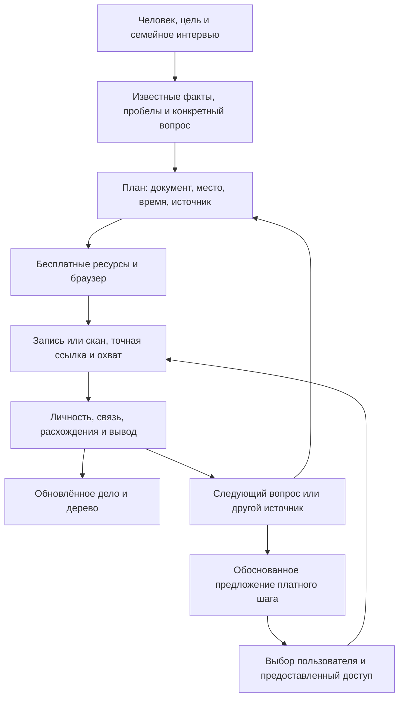

# Древо

**Генеалогический поиск с ИИ: от семейного рассказа к проверяемой истории и наглядному дереву.**

[Открыть интерактивное демо](https://alekseiul.github.io/drevo/) · [Начать своё исследование](#начать-исследование-своей-семьи) · [Профессиональная методика](docs/professional-practice.md)


Древо помогает агенту сначала разобраться в человеке и его семье, затем выбрать документы, выполнить поиск в браузере, проверить находки и показать связи. Основной фокус версии 0.3 — Россия, бывший СССР и Грузия, с международными маршрутами для миграции и зарубежных ветвей.

Это локальный набор навыков, инструментов и источников для вашего ИИ-агента. Веб-поиск выполняет агент через доступный ему браузер. Сам планировщик ничего не ищет, а наличие сайта в реестре не означает готовую API-интеграцию.

## Что внутри

- **Исследовательский навык:** интервью, конкретный вопрос, историческая география, бесплатные источники, поиск через родственников, журнал и следующий шаг.
- **Навык визуализации:** интерактивное родословное дерево с поиском, масштабом и явно обозначенными предположениями.
- **40 маршрутов поиска:** мемориальные базы, фотографии могил, военные документы, метрические книги, газеты, библиотеки, учреждения и архивы.
- **Отдельный платный резерв:** 8 маршрутов с объяснением, что проверить до покупки и когда она имеет смысл.
- **Карточки свидетельств:** первоисточник, прочтение, вывод, происхождение информации и противоречия хранятся раздельно.
- **Досье человека:** описание жизни и деятельности, фотографии, PDF, расшифровки, аудио/видео, архивные ссылки и все связанные находки в одной карточке. В локальном деле можно редактировать текст и прикреплять файлы из браузера.
- **Дело → дерево:** предпросмотр изменений, сборка из выбранных утверждений и откат предыдущей версии. У каждой связи — кнопка «Почему эта связь?» с конкретными основаниями.
- **Короткая очередь:** три следующих действия с учётом контекста вопроса и уже выполненных проверок.
- **Три проверенных браузерных маршрута:** две мемориальные базы до карточки/фото и архивный каталог до дела, с явно указанными границами доступа.
- **Локальные команды:** без npm-зависимостей и обязательных платных API.

## Попробовать дерево

Нужен **Node.js 22 или новее**. Установка npm-пакетов не требуется.

```bash
git clone https://github.com/AlekseiUL/drevo.git
cd drevo
npm run demo
```

Откройте адрес, который напечатает команда. Демо показывает **полностью вымышленную семью**. Сервер доступен только локально. Для другого порта: `npm run demo -- --port 4175`.

```bash
npm run build        # готовый сайт: viewer/dist/
npm run verify       # реестр, тесты и сборка
```

## Начать исследование своей семьи

Создайте новую папку **вне репозитория**:

```bash
node bin/drevo.mjs init ../my-family-case
```

Появятся пустое дело `case.json`, `evidence.json`, интервью, журнал, шаблоны плана и выводов, папки оригиналов и отчётов. Программа не добавляет вымышленных родственников и не перезаписывает существующую папку.

Откройте репозиторий в Codex или другом агенте, умеющем читать файлы, работать с браузером и сохранять результаты. Передайте ему:

> Прочитай skills/genealogy-research/SKILL.md. Моё дело — ../my-family-case. Начни с уже известных сведений, помоги заполнить интервью, выбери один конкретный вопрос и составь план. Используй бесплатные источники. Сохраняй находки и проверенный охват. Предположения отмечай отдельно.

Навыки можно читать прямо из репозитория. Глобальная установка не обязательна: исследовательский навык использует соседние `registry/`, `docs/` и `templates/`, поэтому сохраняйте структуру проекта. Требования к браузеру и авторизации описаны в [порядке работы](docs/research-workflow.md).

После заполнения дела:

```bash
node bin/drevo.mjs plan ../my-family-case/case.json
node bin/drevo.mjs plan ../my-family-case/case.json --all
node bin/drevo.mjs plan ../my-family-case/case.json --json
node bin/drevo.mjs audit ../my-family-case/evidence.json --case ../my-family-case/case.json
node bin/drevo.mjs sources --paid
```

Учебный пример очереди: `npm run plan`. [Описание полей и шаблонов](templates/README.md).

Для выбранных утверждений добавьте явную `assertion` и `tree.include: true`, затем:

```bash
node bin/drevo.mjs tree-preview ../my-family-case
node bin/drevo.mjs tree-apply ../my-family-case
```

Команда напечатает папку готового viewer. Запустите в ней `npm run dev`. Нажатие **«Почему эта связь?»** показывает источник, локатор, прочтение и объяснение именно этой связи. `tree-undo` возвращает прежнее отображение, сохраняя исследовательские материалы. [Формат утверждений, предпросмотр и публичная проекция](docs/case-to-tree.md).

Кандидаты остаются в деле до идентификации. Гипотезы включаются отдельным флагом и сохраняют свою метку. Публикация семейного сайта требует отдельно выбрать разрешённые сведения; команды сами ничего не размещают в интернете.

## Всё найденное — в карточке человека


Чтобы вести досье в браузере, откройте заполненное частное дело:

```bash
node bin/drevo.mjs dossier ../my-family-case
```

В карточке есть **«Обзор», «Материалы», «Находки»**. Редактируйте описание жизни и деятельности, прикрепляйте файлы или ссылки, указывайте источник и архивный шифр. Изображения, PDF, текст и поддерживаемые записи можно просматривать; оригиналы доступны для скачивания. Текст сохраняется в `case.json`, файлы — в `originals/dossier/`. Размер одного вложения — до 20 МиБ. При удалении из карточки оригинал остаётся в деле.

Публичное демо доступно для просмотра: откройте **Глеба Листова** — у него есть вымышленные биографические сведения, учебные изображение, PDF и расшифровка. [Как вести досье и выбирать материалы для публикации](docs/person-dossier.md).

## Как идёт поиск



Порядок гибкий: точный шифр нужного дела полезнее механического обхода всех сайтов. Планировщик предлагает три следующих действия по вопросу, географии, виду записи и известному временному охвату. Выполненные проверки учитываются в пределах конкретных запросов и коллекций; один пустой поиск не закрывает целый сайт. Историческую юрисдикцию и охват конкретной коллекции проверяет агент. [Как составляется короткий план](docs/planning.md). Смена фамилии, соседние населённые пункты, документы супруга, ребёнка или сестры часто дают новый ход.

### Фотографии могил — отдельный маршрут

Именно фотографии памятников могут дать даты, населённый пункт и соседние имена, которых нет в обычном поиске. В Древе выделен путь **фотография → надпись → проверка личности → учёт захоронения → дальнейшая запись**.

Один из важных региональных источников — [«Карта захоронений»](https://memorial-map.ru/). Дополняют его «Помним Онлайн», Find a Grave и BillionGraves. Покрытие кладбищ различается; однофамильцы и соседние могилы не доказывают родство. [Как искать и проверять](docs/cemetery-search.md). Для «Карты захоронений», «Помним Онлайн» и каталога ГААО доступны [пошаговые браузерные инструкции с результатами живой проверки](docs/browser-routes.md). В ГААО проверена карточка дела; образы требуют входа и не были просмотрены.

### Когда предлагать оплату

Сначала агент объясняет, **какая запись нужна и почему она может быть доступна именно там**. Затем указывает уже проверенные бесплатные варианты, фактический доступ к нужной коллекции, текущую цену, срок, условия продления и ожидаемую пользу. Факт оплаты не гарантирует находку. Пароль, CAPTCHA и платёж пользователь вводит в интерфейсе сервиса; после предоставления доступа агент проверяет открывшийся материал. [Платный реестр](docs/paid-resources.md).

## На чём основано качество

Рабочие ориентиры — Genealogical Proof Standard BCG, профессиональная практика APG, исследовательский цикл FamilySearch, анализ свидетельств NGS и прозрачность использования ИИ AAGRA. [Разбор первоисточников и соответствие функциям продукта](docs/professional-practice.md).

Практически это означает:

1. Искать ответ на определённый вопрос и описывать реальный охват.
2. Сохранять ссылки и координаты записи, чтобы её мог найти другой исследователь.
3. Разделять оригинал, копию, рассказ, прочтение и вывод.
4. Разбирать противоречия и зависимость публикаций друг от друга.
5. Писать объяснение вывода вместе с ограничениями.

`audit` ловит недостающие поля, разорванные ссылки и открытые противоречия при статусе завершённого вывода. Он **не определяет истинность родства и не сертифицирует исследование**. Проверка человеком и чтение первоисточников остаются необходимыми. [Учебные проверочные ситуации](docs/validation-scenarios.md).

## Существующие инструменты и переносимость

Браузер агента, локальные файлы и viewer покрывают первый рабочий цикл. OCRmyPDF/Tesseract полезны для сканов; Gramps/Gramps Web — для зрелого генеалогического хранилища. Они не обязательны и не встроены скрыто. [Выбор инструментов, GEDCOM и ограничения обмена](docs/interoperability.md).

Версия 0.3 не содержит универсального парсера GEDCOM, автоскрейпера архивов, платёжного модуля или генетического анализа. Поиск может закончиться полезным промежуточным отчётом без нового доказанного родства.

## Документы и лицензия

- [От дела к дереву и откат](docs/case-to-tree.md)
- [План следующих действий](docs/planning.md)
- [Проверенные браузерные маршруты](docs/browser-routes.md)
- [Изменения версий](CHANGELOG.md)
- [Порядок исследования](docs/research-workflow.md)
- [Бесплатные источники и ступени поиска](docs/sources.md)
- [Машиночитаемый реестр](registry/resources.json)
- [Профессиональные практики](docs/professional-practice.md)
- [Авторы и сторонние компоненты](THIRD_PARTY_NOTICES.md)
- [Как улучшать проект](CONTRIBUTING.md)

Собственная реализация — [MIT](LICENSE). Шрифт Golos Text и Lucide сохраняют свои лицензии. Продукт создан с помощью ИИ. Реальные семейные документы и фотографии в репозиторий не включены; все примеры вымышлены.
