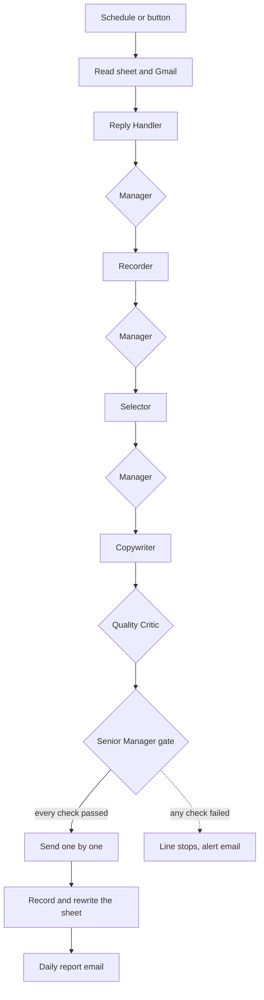

# AI Outreach Team for n8n: multi agent email outreach automation

    

A team of AI agents built in **n8n** that runs **email outreach** end to end: it picks who to contact
from a **Google Sheet**, writes each email, sends it through **Gmail**, reads the replies with a free
**LLM**, pulls out prices, Telegram and phone numbers, drafts the answers and keeps the sheet up to date.
Every agent has a **manager** that checks its work, and nothing is sent unless every manager passes.

I built it for my own **influencer marketing** work and run it every day on an 8,000 creator database.
This repository is a cleaned copy of that live system: no data, no keys, personal details replaced.


## What one run does

1. **Reads** both tabs of the Google Sheet (human edits are always kept) and the last days of Gmail.
2. **Reply Handler** reads every new reply with a free AI model, sorts it (rates sent, interested,
   question, not interested, auto reply, bounce) and drafts an answer for you to send.
3. **Recorder** updates the team memory: who was emailed, who is talking, who declined.
4. **Selector** picks today's people: nobody already emailed, talking, declined or with a number,
   max 25 new a day, max 2 per company domain.
5. **Copywriter** writes each email; the **Quality Critic** blocks risky phrases, links and rule breaks.
6. **Senior Manager** opens the gate only if every manager passed. Emails go out one by one, about 5 a
   minute, both sheet tabs are rewritten and a daily report arrives by email.



## Real output

| Daily report (first live run) | Error alert (tested end to end) |
|---|---|
|  |  |

Replies become structured rows. Real rows from the "Ready to work" tab, every person masked:


## Why it is built this way

- **Managers, not one long flow.** Each agent is a small program with one job. Its manager checks the
  result and stops the line on any problem, so a bad selection or a broken email never reaches a person.
- **Facts are never invented.** A price is kept only if every number in it is literally in the reply.
  Replies with screenshots are flagged for a human instead of guessed.
- **Humans win.** Anything typed into the sheet by hand survives every run.
- **Free models only.** Reply reading and the second opinion on drafts run on free tiers (Groq,
  Gemini, Cerebras). No paid model, no monthly AI bill.
- **Safe to click often.** One run at a time, the daily limit counts across runs, and a busy Gmail
  never stops the day: replies are picked up on the next run and follow ups wait.
- **You hear when it stops.** A separate n8n error workflow emails which step stopped and why.

More detail: [docs/ARCHITECTURE.md](docs/ARCHITECTURE.md)

## Results from my own use

- 8,028 creator records from 4 messy sources cleaned, merged and deduplicated into one sheet.
- 25 personalised first emails a day, sent automatically, never to someone already in touch.
- 13 replies read on the first live day, 11 negotiation drafts ready, every manager passed.
- 47 node n8n workflow validated with 0 errors, plus an error alert workflow tested end to end.

## The team

| Agent | Job | Its manager checks |
|---|---|---|
| 1 Selector | who gets an email today | limit, nobody twice, no one talking or declined |
| 2 Copywriter | writes each email | rule breaks, risky phrases, missing questions, links |
| 3 Reply Handler | reads replies, drafts answers | prices really in the email, contacts real |
| 4 Recorder | team memory and the sheet | no row lost, edits kept, talking people in Ready |
| 5 Senior Manager | final gate and daily report | every manager passed |

Each agent folder has an `AGENT.md` (job description and rules), `agent.py` (the work) and `manager.py`
(the check). Shared policy and playbooks live in `knowledge/`.

## Folder map

```
agents/      5 agents, each with AGENT.md, agent.py, manager.py
scripts/     shared toolbox, n8n workflow builder, n8n API helper, utilities
knowledge/   policy, email rules, negotiation playbook, team ethics
llm/         free model adapter (any OpenAI compatible endpoint)
config/      example settings
docs/        architecture notes and the images on this page
examples/    fictional sample rows
```

## Setup in short

1. Run n8n (desktop, Docker or cloud) and create an API key. Add Gmail and Google Sheets credentials in n8n.
2. Copy `config/outreach_settings.example.json` to `config/outreach_settings.json` and fill it in.
3. Create `secrets.env` with `N8N_API_URL`, `N8N_API_KEY`, `GROQ_API_KEY`, `N8N_CRED_SHEETS_ID`,
   `N8N_CRED_GMAIL_ID` (it is in `.gitignore`).
4. Put your sheet ids in `data/sheets.json`, then build the workflow:
   `python -I scripts/build_team_workflow.py build`
5. Click Execute workflow in n8n, or let the daily schedule run it.

Start in `send_mode: draft` and read the first drafts before switching to automatic sending.

## Want it set up for your team?

I install and tune this for **influencer marketing agencies**, brand teams and anyone doing **cold email
outreach from a sheet**: your sources, your rules, your voice, on your own n8n, Gmail and Google account,
with support after launch.

- Portfolio and contact: [shahmuhammadali.com](https://shahmuhammadali.com)
- Fiverr and Upwork: links on my [GitHub profile](https://github.com/Ali45504)

If this is useful to you, a star helps other people find it.

Keywords: n8n workflow, n8n AI agent, multi agent system, email outreach automation, cold email
automation, Gmail automation, Google Sheets automation, influencer outreach, creator outreach, lead
generation, reply classification, LLM, Groq, AI automation, no code automation.

Shown as a portfolio sample. All rights reserved. Contact me for a build or a license.
