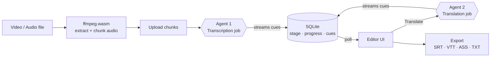

<div align="center">

# LiTranslate

### AI-powered video subtitling & localization studio

Extract audio in the browser, transcribe it with a Whisper-class model, translate it into any
language, and fine-tune every cue in a full timeline editor — all from a single page.

<br/>


<br/>

<a href="#getting-started"><b>Getting started</b></a> ·
<a href="#the-agent-system"><b>Agent system</b></a> ·
<a href="#architecture"><b>Architecture</b></a> ·
<a href="ROADMAP.md"><b>Roadmap</b></a>

</div>

---

## Overview

LiTranslate turns any video or audio file into clean, time-aligned subtitles and then localizes
them into other languages. The heavy lifting is split between two focused AI agents — one that
listens, one that writes.

The audio is separated from the video **in the browser**, then streamed to the server where the
agents run as a **background job**. Because progress and results are persisted continuously, you
can close the tab or refresh mid-run and the project keeps building — reopen it and it resumes
exactly where it was.

The workflow on a single page: **drop a file → generate subtitles → translate → edit → export**.

## Highlights

- **In-browser audio extraction** — `ffmpeg.wasm` (self-hosted, no CDN) demuxes and resamples
  audio to 16 kHz mono locally, then splits long media into chunks for accurate long-form timing.
- **Two-agent pipeline** — a transcription agent and a translation agent, each with a narrow
  contract and its own configurable model.
- **Background processing that survives refresh** — jobs run server-side and stream their state
  into SQLite; the UI polls and resumes an in-progress project automatically on reload.
- **Real-time streaming** — cues appear one by one as each audio chunk is transcribed, and each
  translation batch lands as it completes.
- **Smart, readable timing** — long transcription segments are split into sentence-sized lines
  with proportionally distributed timing; silent stretches get no captions.
- **Smart intro branding** — an optional brand line is placed as its own caption when the intro is
  silent, or merged with the first spoken line when speech starts immediately.
- **Full subtitle editor** — video player with live caption overlay, timeline, on-video timing
  controls, per-cue nudging / set-to-playhead / split / merge, and caption styling.
- **Multi-language tracks** — keep the source transcript and any number of translations side by
  side and switch between them instantly.
- **Export anywhere** — SRT, VTT, ASS, and TXT.

## The Agent System

LiTranslate is built around two independent, single-purpose agents. Each owns one stage of the
pipeline, exposes a narrow HTTP contract, runs inside a resumable background job, and can be
pointed at a different model. Keeping them decoupled means transcription quality and translation
quality can be tuned — or swapped — without touching the rest of the app.

### Agent 1 — Transcription Agent (Speech → Text)

**Responsibility:** convert spoken audio into readable, time-aligned subtitle lines.

| | |
| --- | --- |
| **Endpoint** | `POST /api/jobs/transcribe` (multipart: audio chunks + metadata) |
| **Model** | Whisper-class model, configurable via `TRANSCRIPTION_MODEL` |
| **Input** | 16 kHz mono audio chunks + optional source-language hint + chunk offsets |
| **Output** | Sentence-sized cues `{ start, end, text }` streamed into SQLite |

How it works:

1. The client extracts audio and splits long media into fixed-length chunks (`CHUNK_SECONDS`).
2. The job sends each chunk to the model requesting `verbose_json` with **segment-level
   granularity**, so it gets start/end times for every spoken segment rather than a flat blob.
3. Every segment is shifted by its chunk offset so timestamps stay globally correct once merged.
   Because Whisper only emits segments where there is speech, silent stretches naturally receive
   no captions.
4. Segments are re-segmented into readable lines: split on sentence boundaries, capped by
   characters and duration, with the original timing distributed proportionally across the lines.
5. Cues are written to the database after every chunk, so the UI streams them in live and the
   result survives a refresh.

### Agent 2 — Translation Agent (Subtitle Localization)

**Responsibility:** localize source cues into a target language **without disturbing timing**.

| | |
| --- | --- |
| **Endpoint** | `POST /api/jobs/translate` (`{ projectId, targetLang }`) |
| **Model** | Instruction-following LLM, configurable via `TRANSLATION_MODEL` |
| **Input** | The stored source cues + target language |
| **Output** | A translated track, streamed batch-by-batch |

How it works:

1. Source cues are processed in **batches** to balance context and latency.
2. Each batch is sent with a strict contract: return exactly one line per input line, in order, as
   structured JSON. The agent never merges, splits, adds, or drops lines — this **1:1 mapping**
   means the original timestamps are reused verbatim.
3. The prompt steers the model toward natural, idiomatic, on-screen phrasing (not literal
   word-for-word translation) while preserving names, numbers, and proper nouns.
4. Each finished batch is written to the database immediately, so translated lines stream into the
   editor instead of appearing all at once. Missing lines fall back to the source text.

### Orchestration

The client extracts audio and hands it to the server, which owns the rest. Each job updates a
`stage / progress / message` record and its cues in SQLite as it works. The UI polls the project
and reflects live progress; on load it looks for an in-progress project and resumes polling, so
work continues in the background regardless of the browser.

## Architecture



## Tech stack

| Layer | Choice |
| --- | --- |
| Framework | Nuxt 3 / Vue 3 (SSR) |
| Styling | Tailwind CSS |
| Audio | `ffmpeg.wasm`, self-hosted core (client-side extraction) |
| AI gateway | OpenRouter (OpenAI-compatible API) |
| Jobs & storage | Server-side background jobs + embedded SQLite (`node:sqlite`, no native build) |

## Getting started

> Requires **Node 22.5+** (uses the built-in `node:sqlite`) and a Chromium-based browser
> (audio extraction relies on cross-origin isolation).

```bash
git clone https://github.com/AliAkrami1375/Li-Translate.git
cd Li-Translate
cp .env.example .env      # add your OpenRouter key and pick models
npm install
npm run dev               # http://localhost:3000
```

### Run with Docker (self-hosted)

LiTranslate is **fully self-hosted** — it runs entirely on your own machine or server and talks
only to your configured model provider. No data goes anywhere else.

```bash
cp .env.example .env      # add your OpenRouter key and pick models
docker compose up -d      # build + run, then open http://localhost:3000
```

Or with plain Docker:

```bash
docker build -t litranslate .
docker run -d -p 3000:3000 --env-file .env -v litranslate-data:/app/.data litranslate
```

The SQLite database lives in the `litranslate-data` volume (`/app/.data`), so your projects,
tracks, and in-progress jobs survive container restarts. Set `SITE_URL` in `.env` to your public
URL so SEO/social tags and the sitemap resolve correctly.

### Configuration

All configuration lives in `.env`:

| Variable | Description | Default |
| --- | --- | --- |
| `OPENROUTER_API_KEY` | Your OpenRouter API key | — |
| `OPENROUTER_BASE_URL` | API base URL | `https://openrouter.ai/api/v1` |
| `TRANSCRIPTION_MODEL` | Model used by the transcription agent | `openai/whisper-1` |
| `TRANSLATION_MODEL` | Model used by the translation agent | `anthropic/claude-sonnet-5` |
| `CHUNK_SECONDS` | Audio chunk length before transcription | `480` |
| `MAX_FILE_SIZE_GB` | Upload size guard | `10` |
| `SITE_URL` | Public URL, used for SEO/social tags & sitemap | `http://localhost:3000` |

Transient network errors to the model provider are retried automatically with exponential
backoff, so a flaky connection self-heals instead of failing the job.

> **Transcription endpoint:** Agent 1 posts audio to the OpenAI-compatible
> `/audio/transcriptions` route with `verbose_json` to obtain segment timestamps. Point
> `OPENROUTER_BASE_URL` at any provider that serves that endpoint for your chosen Whisper model.
> Translation uses the standard `/chat/completions` route and works with any chat model.

## Usage

1. Drop a video or audio file onto the page — it previews immediately, top-left.
2. Pick the source language (or leave **Auto Detect**), an optional target language, and an
   optional intro branding line.
3. Press **Generate Subtitles**. Audio is extracted locally, then transcribed in the background;
   cues stream into the editor as they are produced.
4. Use **Translate** to localize the track into any language — translated lines stream in too.
5. Refine cues in the editor — timing (nudge / set-to-playhead, on-video or in the list),
   splits/merges, text, and caption styling.
6. **Export** to SRT, VTT, ASS, or TXT.

Projects save automatically, show live progress under **Recent Projects**, and resume on refresh.

## Try it with the sample

A ready-made sample lives in the [`test/`](test/) folder so you can see the whole pipeline
end to end:

| File | What it is |
| --- | --- |
| `test/test-video.mp4` | Sample source video (English) |
| `test/orginal.srt` | Reference source transcription |
| `test/test-persian.srt` | Reference Persian translation |
| `test/test-chiness.srt` | Reference Chinese translation |

Drop `test/test-video.mp4` onto the app, generate subtitles, then translate to Persian or Chinese
and compare your output against the reference `.srt` files.

## Project structure

```
├── server/
│   ├── api/jobs/        Background job endpoints — transcribe, translate
│   ├── api/projects/    Persistence + polling (status, cues)
│   └── utils/           Job runner, OpenRouter client, transcription, translation,
│                        segmentation, SQLite layer
├── composables/         Pipeline orchestration, ffmpeg, player, languages
├── components/          Upload, settings, editor, video stage, timeline, cue list, styling
├── shared/              Subtitle model + SRT/VTT/ASS/TXT serializers
├── public/ffmpeg/       Self-hosted ffmpeg.wasm core
└── pages/index.vue      The single-page workflow
```

## License

MIT
