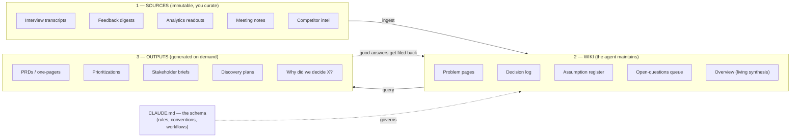
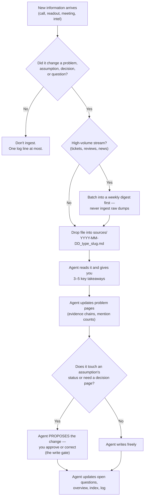
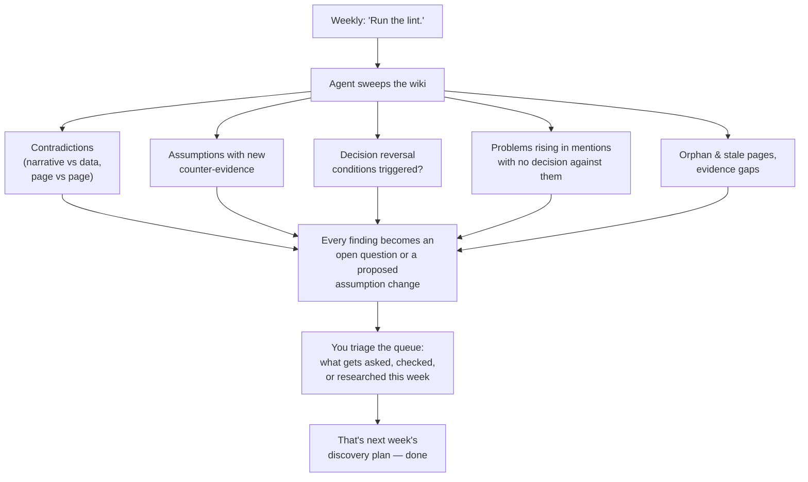
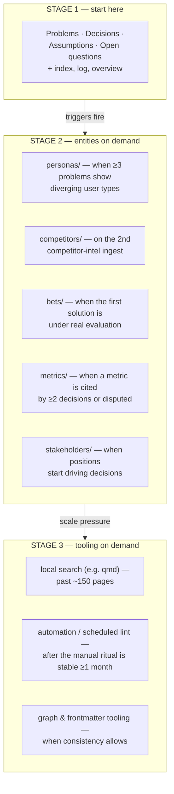

# The PM Wiki — an LLM-maintained knowledge base for product managers

**Stop re-deriving your product knowledge. Start compounding it.**

This is [Karpathy's LLM Wiki pattern](https://gist.github.com/karpathy/442a6bf555914893e9891c11519de94f)
adapted for product management: an AI agent (Claude Code, Codex, or any coding agent) maintains a
wiki of your product's **problems, decisions, assumptions, and open questions** — fed by your
customer interviews, feedback, analytics, competitor intel, and meetings. You curate what goes in
and make the calls; the agent does all the filing, cross-referencing, and maintenance.

The payoff: your PRDs, prioritizations, stakeholder briefs, and *"why did we decide X?"* answers
are **generated from accumulated, source-cited evidence** — not rewritten from memory and vibes
every time.

To the best of our knowledge, **this is the first open-source instantiation of the LLM Wiki
pattern purpose-built for product management** — Karpathy published the pattern as an abstract
idea file in April 2026, a rich ecosystem grew around it for engineers and researchers, but no
one had built the PM version: the schema, the entity model, the rituals, and a worked example.
That matters because PM work is arguably the *best* fit for this pattern anywhere:

- **Deliverables become queries.** A PRD or stakeholder brief that used to take days of
  re-gathering context is generated in minutes from evidence that's already synthesized,
  cross-referenced, and cited.
- **Every claim becomes defensible.** "Users need X" links to who said it, when, and in what
  words — the difference between a PRD that survives a leadership review and one that doesn't.
- **Decision amnesia ends.** "Why did we choose X over Y?" is answered in seconds, forever, with
  the original options, evidence, and reversal conditions.
- **Discovery runs itself into your backlog.** Every contradiction and evidence gap the weekly
  health check finds becomes a tagged research question — your next interview script generates
  itself.
- **The cost is ~30 focused minutes a week.** The agent does the bookkeeping that kills every
  Confluence wiki; you keep the judgment.

Everything here is free and open source (MIT): **clone it, fork it, run it on your product, and
send back what you learn.**

---

## Contents

1. [The problem this solves](#the-problem-this-solves)
2. [How it works — the architecture](#how-it-works--the-architecture)
3. [What you need](#what-you-need)
4. [Quick start (15 minutes)](#quick-start-15-minutes)
5. [The four things the wiki tracks](#the-four-things-the-wiki-tracks)
6. [The three rituals](#the-three-rituals)
7. [What flows in — source cheat sheet](#what-flows-in--source-cheat-sheet)
8. [The rules that keep it honest](#the-rules-that-keep-it-honest)
9. [Generating deliverables](#generating-deliverables)
10. [Growing the system — the three stages](#growing-the-system--the-three-stages)
11. [Worked example — the FitLoop pilot](#worked-example--the-fitloop-pilot)
12. [Tips, pitfalls, and FAQ](#tips-pitfalls-and-faq)
13. [Contributing](#contributing)
14. [Roots, credits & thanks](#roots-credits--thanks)
15. [Get help](#get-help)

---

## The problem this solves

Every PM runs the same loop: a customer says something in a call, a metric moves, a stakeholder
takes a position, a competitor ships. Six weeks later you're writing a PRD or defending a roadmap
and you're **reconstructing all of it from memory, Slack scrollback, and half-remembered decks.**

Three specific failures:

- **Nothing compounds.** Every document starts from scratch. The synthesis you did for last
  quarter's review is buried in a deck nobody will open again.
- **Evidence and claims get separated.** "Users want X" survives; *which* users, *how many*,
  and *what they actually said* doesn't. PRDs become plausible-sounding instead of defensible.
- **Decision amnesia.** "Why did we choose X over Y?" gets asked forever, and the rationale —
  the options weighed, the evidence, what would change our mind — lives nowhere.

Traditional wikis (Confluence, Notion) die because maintenance grows faster than value. RAG-style
"chat with your docs" tools don't accumulate — they re-retrieve fragments per question. The fix
is an agent that **maintains** the knowledge base, because for an LLM the cost of updating 15
cross-referenced pages is near zero.

## How it works — the architecture

Three layers. You own the first, the agent owns the second, you co-evolve the third.



Key properties:

- **Sources are read-only.** The agent reads them, never edits them. Your ground truth.
- **The wiki is the compounding artifact.** Every ingest updates cross-references, bumps
  evidence counts, flags contradictions. Thursday's synthesis includes Tuesday's interview.
- **The schema is the real product.** One file (`CLAUDE.md`) turns a generic chatbot into a
  disciplined wiki maintainer. Ours is [template/SCHEMA.md](template/SCHEMA.md) — battle-tested
  conventions, copy and go.

## What you need

- **An agentic LLM tool that can read/write local files.** Claude Code is the reference tooling;
  OpenAI Codex or similar coding agents work too (rename `CLAUDE.md` to `AGENTS.md`).
- **A folder.** That's the whole infrastructure. No database, no vector store, no plugin.
- **Optional but recommended:** [Obsidian](https://obsidian.md) as your reading UI (the graph
  view shows the shape of your knowledge), and `git init` for free version history.
- **~30 minutes/week of discipline.** The agent does the bookkeeping; you still have to feed it
  and run the weekly health check. This is the real cost — see [pitfalls](#tips-pitfalls-and-faq).

No code is involved anywhere. If you can use a chat tool and a folder, you can run this.

## Quick start (15 minutes)

**Step 1 — Create the skeleton:**

```
my-product-wiki/
├── CLAUDE.md          ← copy template/SCHEMA.md here, add 5 lines of product context on top
├── index.md           ← create empty
├── log.md             ← create empty
├── sources/           ← empty folder
└── wiki/
    ├── problems/
    └── decisions/
```

**Step 2 — Add product context** at the top of `CLAUDE.md`: what the product is, the current
top-level goal, who the key people are. Five lines is enough — see the
[pilot's version](pilot/CLAUDE.md) for the shape.

**Step 3 — Drop in your first source.** Best first source: your most recent customer interview
transcript or meeting notes from a decision-heavy meeting. Name it
`YYYY-MM-DD_interview_<slug>.md` (naming convention is in the schema).

**Step 4 — Open your agent in the folder and say:**

> Read CLAUDE.md. Then ingest sources/2026-07-03_interview_jane.md.

The agent will read the source, discuss key takeaways with you, create/update problem pages,
propose assumption entries, update the index, and log the ingest. Stay in the loop the first few
times — correct it freely; it learns your domain through the pages it writes.

**Step 5 — Ask your first question:**

> What do we currently know about why users churn? Cite sources.

From here it's just the [three rituals](#the-three-rituals).

## The four things the wiki tracks

Deliberately minimal — four entity types. (More get added later, but only when
[triggers fire](#growing-the-system--the-three-stages).)

| Entity | One per… | The point |
|---|---|---|
| **Problem page** | pain point | Statement in the user's language, who has it, severity, a running mention count, and the **evidence chain** — every source that supports (or contradicts) it. Status: `emerging → confirmed → addressed`. |
| **Decision page** | decision | Context, options considered *with the evidence for each*, rationale, decider, and **reversal conditions** — the observable facts that would reopen it. Never deleted; superseded decisions link forward. |
| **Assumption register** | load-bearing belief | Status: `untested / validated / weakening / invalidated`, evidence for and against, and a dated history of every status flip with the source that caused it. |
| **Open-questions queue** | gap or contradiction | Your discovery backlog. Each question tagged with its resolution path: `ask-users / check-data / ask-stakeholder / desk-research / run-experiment`. Interview scripts get generated *from this queue*. |

Plus three plumbing files: `overview.md` (living synthesis the agent keeps current), `index.md`
(catalog — the agent reads it first on every task), `log.md` (append-only journal of everything
that happened).

Why these four? Because they're the PM-shaped ones. Problems ↔ evidence is what makes PRDs
defensible. Decisions ↔ rationale kills decision amnesia. Assumptions ↔ status is your risk
register. Questions ↔ tags is your discovery pipeline. Personas, competitors, metrics, and bets
emerge later — from evidence, not from an empty template.

## The three rituals

### Ritual 1 — Ingest (after anything that changed something)



Rhythm: interviews and decision-meetings same day, one at a time, you in the loop. Feedback
streams and competitor news weekly as digests. Ten minutes per ingest once you're in rhythm.

### Ritual 2 — Query (whenever you need a deliverable or an answer)

Ask questions against the wiki; the agent reads `index.md`, drills into relevant pages, and
answers **with citations**. The compounding trick: *good answers get filed back.* A comparison
you asked for, a prioritization, an analysis — the agent offers to save it as a wiki page, so
your explorations accumulate exactly like sources do.

### Ritual 3 — Lint (weekly, 15 minutes — the "product truth check")



This is the ritual that makes the system smarter than a filing cabinet: contradictions and gaps
don't get papered over — they become your discovery backlog automatically.

## What flows in — source cheat sheet

| Source | Examples | Ingest mode | Cadence |
|---|---|---|---|
| **User interviews** | discovery calls, churn interviews, sales calls | one at a time, you in the loop | same day, per call |
| **Feedback streams** | support tickets, store reviews, NPS verbatims | **weekly digest only** — never raw dumps | weekly |
| **Analytics** | cohort readouts, A/B results, funnel analyses | the *finding*, not the data export | per readout |
| **Competitor / market intel** | releases, pricing moves, analyst notes | short intel note with your read | as it happens |
| **Research artifacts** | usability tests, surveys | per study | per study |
| **Meetings** | leadership steers, roadmap reviews | only meetings that *changed* something | per such meeting |
| **Delivery signals** | postmortems, estimate-vs-actual, tech-debt | per sprint / incident | per sprint |
| **Strategy docs** | OKRs, financial model, board updates | context pages | quarterly + on change |
| **Your own LLM explorations** | analyses, prioritizations | filed back as first-class sources | when worth keeping |

The single most important rule is in the flowchart above: **if it didn't change a problem, bet,
assumption, decision, or question — it doesn't get ingested.** The pattern dies by indiscriminate
dumping, not by missing a source.

## The rules that keep it honest

These five rules are what separate this from "AI notes." They're encoded in the schema; the
agent enforces them on itself.

1. **Evidence chains, always.** Every factual claim on every page cites its source inline:
   `(source: 2026-06-22_interview_maria.md)`. A claim with no source is labeled `[unsupported]`
   — never silently asserted. Generated PRDs inherit this.
2. **The write gate.** The agent writes problem pages and questions freely, but **proposes** —
   and you approve — anything touching the decision log or an assumption's status. Your judgment
   stays the source of record; the agent can't silently rewrite what you believe.
3. **Decisions are never deleted.** A changed decision means a *new* page; the old one is marked
   superseded and links forward. You keep the full reasoning trail, including the wrong turns.
4. **Contradictions become questions, never casualties.** When sales's story conflicts with the
   data, the agent doesn't pick a winner — it files an open question tagged with how to resolve
   it. Contradictions are research opportunities.
5. **No fake precision.** No "confidence: 0.85" scores. A claim's credibility is its visible
   evidence chain — and correlation is always labeled as such (`validated (correlational only)`),
   never allowed to masquerade as causation.

## Generating deliverables

Once the wiki has a few weeks of evidence, deliverables become queries:

| Ask the agent… | It generates from… |
|---|---|
| "Draft a one-pager PRD for ‹bet›" | problem pages + evidence chains + related decisions — every "users need X" cites who said it |
| "Prioritize our open problems" | mention counts, severity, evidence quality — scores you can defend, not vibes |
| "Brief for ‹stakeholder› ahead of the roadmap review" | filtered to what that stakeholder cares about and has said |
| "Build me an interview script for next week" | the open-questions queue, tagged `ask-users` |
| "Why did we decide X?" | the decision page: options, evidence, rationale, reversal conditions — answered in seconds, forever |

And per Ritual 2: file the good ones back into the wiki so they compound.

## Growing the system — the three stages

Start minimal. Upgrades are **trigger-based** — the agent watches for the trigger, tells you,
and proposes the upgrade. Never build ahead of need; an over-templated wiki on day 1 is the same
failure as an over-templated Confluence space.



Each stage upgrade is itself logged and written into the schema — the system documents its own
evolution.

## Worked example — the FitLoop pilot

[pilot/](pilot/) is a complete, fictional instance you can explore (and the fastest way to *get*
the pattern): **FitLoop**, a €9.99/mo B2C fitness app with 8.5% monthly churn and a CEO who needs
<6% for a Series A. Six fictional sources have been ingested; the wiki shows every mechanic live:

- Evidence from two interviews, a survey, and a feedback digest **converging** on one confirmed
  problem — [plans-dont-adapt.md](pilot/wiki/problems/plans-dont-adapt.md)
- A **contradiction handled correctly**: price is 18% of survey reasons but disclaimed by both
  interviewees → filed as open question Q2, not resolved by fiat
  ([price-value-gap.md](pilot/wiki/problems/price-value-gap.md))
- An **assumption flipping status** with its citing source
  ([assumptions.md](pilot/wiki/assumptions.md), A1)
- A **decision with reversal conditions** the weekly lint checks against
  ([2026-06-30_q3-retention-focus.md](pilot/wiki/decisions/2026-06-30_q3-retention-focus.md))
- A **lint pass** surfacing the classic blind spot — all evidence is from churned users, none
  from retained ones ([log.md](pilot/log.md), last entry)

Reading path: [pilot/log.md](pilot/log.md) → [pilot/index.md](pilot/index.md) → the decision
page → the open-questions queue.

## Tips, pitfalls, and FAQ

**The #1 failure mode is ingest indiscipline** — in both directions. Dump everything and the
wiki becomes a landfill; ingest nothing for three weeks and it goes stale and you stop trusting
it. The fixes: the skip rule (above), weekly digests for high-volume streams, and attaching
ingest to existing habits (post-call debrief, Friday review).

**Privacy:** interview transcripts contain PII. Decide your line before source #1: strip names
on ingest (the agent can do this as a standing rule in the schema), or keep `sources/` local-only
and out of any shared repo. If your company has data-handling rules, they apply here.

**"Can my whole team use it?"** Start solo — the pattern needs one disciplined owner. For teams:
the wiki is just markdown in git, so review-by-PR works naturally; keep the write gate with the
owning PM.

**"Do I need Obsidian?"** No — it's a pleasant reader (graph view, backlinks), nothing more. The
agent needs only the folder. Obsidian's Web Clipper is handy for getting articles into
`sources/` as markdown.

**"What about my existing Notion/Confluence?"** Don't migrate. Start the wiki fresh from live
signal (this week's calls and meetings); export an old doc into `sources/` only when you
actually need its content.

**"How is this different from ChatGPT/NotebookLM with my files?"** Those retrieve; this
*maintains*. Upload-and-chat tools re-derive answers from raw fragments per question. Here the
synthesis, cross-references, and contradiction flags are persistent files that get richer with
every ingest — and you can read, diff, and version them.

**"What does it cost?"** Whatever your agent subscription costs, plus ~30 focused minutes a
week. There is no other infrastructure.

---

## Contributing

Clone it, fork it, commit to it — contributions are open and wanted. The most valuable
contribution of all is a **field report**: run the schema on your real product for a few weeks
and send back what held and what broke. Schema improvements, pilot additions, and adaptations
for adjacent roles are all welcome too — see [CONTRIBUTING.md](CONTRIBUTING.md) for the ground
rules (short version: keep the honesty rules intact, keep Stage 1 minimal, never add real
customer data, and test schema changes on a fresh agent before opening a PR).

```bash
git clone https://github.com/AliMahmoud15486/pm-llm-wiki.git
```

## Roots, credits & thanks

This project stands on the shoulders of others, gratefully:

- **[Andrej Karpathy](https://karpathy.ai)** — the
  [LLM Wiki pattern](https://gist.github.com/karpathy/442a6bf555914893e9891c11519de94f)
  (April 2026) is his idea, published as an idea file explicitly meant to be copied and
  instantiated per domain. This repo is one such instantiation; the original is preserved
  verbatim, with attribution, in [reference/](reference/). Thank you for publishing the pattern
  — and for the Memex-to-LLM framing that makes it click.
- **The community around the pattern** — in particular the
  ["LLM Wiki v2" discussion](https://gist.github.com/rohitg00/2067ab416f7bbe447c1977edaaa681e2),
  whose sharpest critiques (evidence chains over confidence scores, a human write gate, explicit
  supersession, contradictions-as-questions) are adopted here as core rules. Notes in
  [reference/llm-wiki-v2-notes.md](reference/llm-wiki-v2-notes.md).
- **Vannevar Bush** — the 1945 [Memex](https://en.wikipedia.org/wiki/Memex) vision this whole
  lineage traces back to: a personal, curated knowledge store where the connections are as
  valuable as the documents. The LLM finally solved the part he couldn't: who does the
  maintenance.

The PM adaptation — the schema, entity model, rituals, FitLoop pilot, and this guide — was
built by [Ali Mahmoud (TheGlocalPM)](https://github.com/AliMahmoud15486) working with Claude,
and pressure-tested end-to-end with a fresh agent before publication. Design rationale in
[PM-Wiki-Content-Model.md](PM-Wiki-Content-Model.md). Licensed [MIT](LICENSE).

## Get help

Stuck setting it up, adapting the schema to your product, or deciding what belongs in your
first ingest? Open a [GitHub issue](../../issues), or contact Ali directly at
**[ali@theglocalpm.com](mailto:ali@theglocalpm.com)** — field questions from working PMs are
exactly the feedback this project wants.
