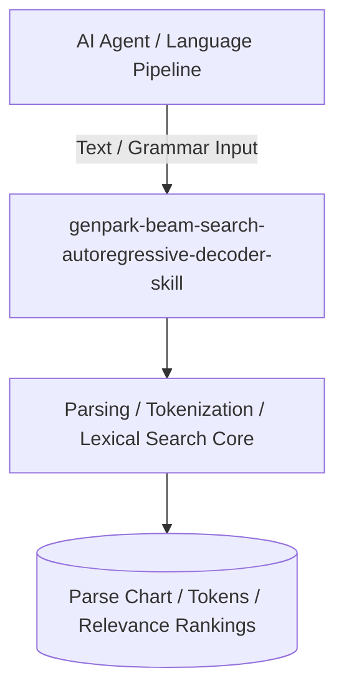

# genpark-beam-search-autoregressive-decoder-skill

[](https://github.com/alphaparkinc/genpark-beam-search-autoregressive-decoder-skill/actions)
[](https://opensource.org/licenses/MIT)
[](https://www.python.org/downloads/)

> Autoregressive beam search sequence decoder implementing hypothesis expansion, cumulative log-probability pruning, and length normalization.

## Architecture



## Features
- Pure standard library Python implementation with strictly zero pip dependencies.
- Fundamental computational linguistics and NLP algorithms (Earley, CKY, BPE, Beam Search, BM25).
- Native Model Context Protocol (MCP) server support for AI agent text intelligence.

## Installation

```bash
git clone https://github.com/alphaparkinc/genpark-beam-search-autoregressive-decoder-skill.git
cd genpark-beam-search-autoregressive-decoder-skill
```

## Quickstart

```bash
python example_usage.py
```
