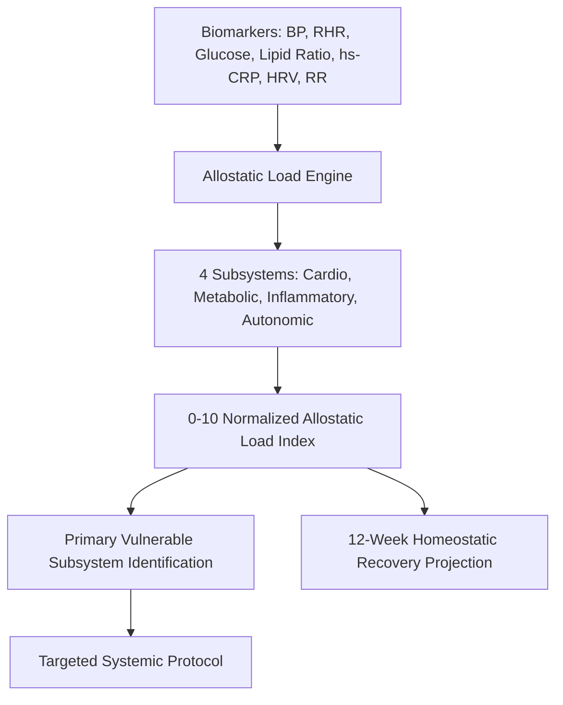

# Personal Agent Allostatic Load Index Biomarker Skill

[](https://github.com/Alpha-Park)
[](https://github.com/alphaparkinc)
[](https://www.python.org/)
[](https://modelcontextprotocol.io/)
[](https://github.com/Alpha-Park)

Zero-dependency Bruce McEwen multi-system physiological wear-and-tear indexer, cardiometabolic-neuroendocrine strain evaluator, and allostatic recovery modeler.

## Architecture



## Quickstart

```python
from client import PersonalAgentAllostaticLoadIndexBiomarker

agent = PersonalAgentAllostaticLoadIndexBiomarker()
res = agent.calculate_allostatic_load_index({
    "systolic_bp": 135.0, "fasting_glucose": 105.0, "hs_crp": 2.5, "rmssd_hrv": 22.0
})
print(f"AL Index: {res['allostatic_load_index_10']}/10 | Vulnerability: {res['primary_vulnerable_subsystem']}")
```
