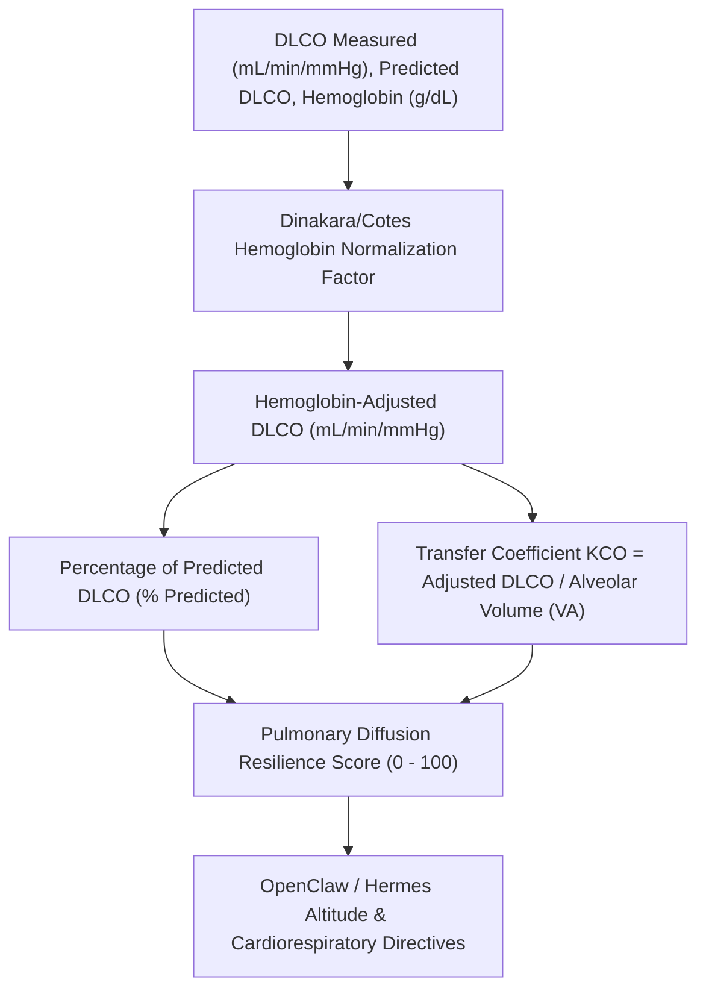

# Alveolar-Capillary Gas Diffusion (DLCO) Skill

[](https://opensource.org/licenses/MIT)
[](https://www.python.org/downloads/)
[](https://github.com/alphaparkinc/genpark-personal-agent-alveolar-capillary-diffusion-dlco-skill)
[](https://github.com/alphaparkinc/genpark-personal-agent-alveolar-capillary-diffusion-dlco-skill)
[](https://modelcontextprotocol.io/)

A sovereign personal agent capability for computational pulmonary physiology, evaluating single-breath diffusing capacity of the lung for carbon monoxide (DLCO), hemoglobin normalization, and transfer coefficient (KCO).

## Architecture



## Quickstart

```python
from client import AlveolarCapillaryDiffusionClient

client = AlveolarCapillaryDiffusionClient()

# Assess DLCO pulmonary gas exchange
res = client.evaluate_dlco_diffusion(
    measured_dlco_ml_min_mmhg=28.2,
    predicted_dlco_ml_min_mmhg=30.0,
    hemoglobin_g_dl=15.0,
    is_female=False,
    alveolar_volume_liters=6.2
)

print("Adjusted DLCO:", res["adjusted_dlco_ml_min_mmhg"], "mL/min/mmHg")
print("% Predicted:", res["pct_predicted_dlco"], "%")
print("Diffusion Score:", res["pulmonary_diffusion_score"], "/ 100")
print("Severity:", res["clinical_severity"])
```

## MCP Server Integration

Add to your `claude_desktop_config.json` or OpenClaw tool registry:

```json
{
  "mcpServers": {
    "alveolar-capillary-diffusion": {
      "command": "python",
      "args": ["/path/to/genpark-personal-agent-alveolar-capillary-diffusion-dlco-skill/mcp_server.py"]
    }
  }
}
```

## License
MIT License.
