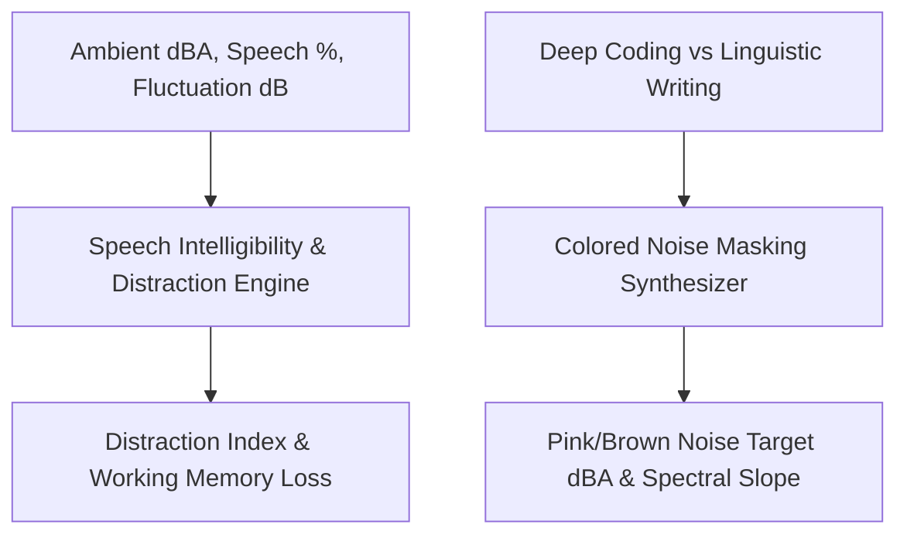

# Personal Agent Ambient Noise Auditory Focus Masker Skill

[](https://github.com/Alpha-Park)
[](https://github.com/alphaparkinc)
[](https://www.python.org/)
[](https://modelcontextprotocol.io/)
[](https://github.com/Alpha-Park)

Zero-dependency acoustical Speech Intelligibility Index (SII) distraction auditor, cognitive throughput degradation modeler, and colored noise masking soundscape synthesizer.

## Architecture



## Quickstart

```python
from client import PersonalAgentAmbientNoiseAuditoryFocusMasker

agent = PersonalAgentAmbientNoiseAuditoryFocusMasker()
res = agent.evaluate_acoustic_distraction_risk(ambient_dba=62.0, speech_presence_pct=40.0)
print(f"Distraction: {res['distraction_risk_score']} | Memory Penalty: {res['working_memory_throughput_penalty']}")
```
