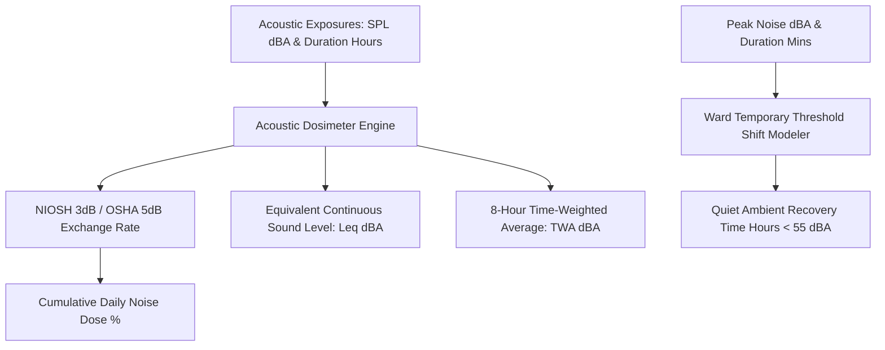

# Personal Agent Auditory Acoustic Decibel Dosimeter Skill

[](https://github.com/Alpha-Park)
[](https://github.com/alphaparkinc)
[](https://www.python.org/)
[](https://modelcontextprotocol.io/)
[](https://github.com/Alpha-Park)

Zero-dependency NIOSH/OSHA cumulative noise dose calculator, equivalent sound level (Leq) modeler, and Temporary Threshold Shift (TTS) cochlear recovery evaluator.

## Architecture



## Quickstart

```python
from client import PersonalAgentAuditoryAcousticDecibelDosimeter

agent = PersonalAgentAuditoryAcousticDecibelDosimeter()
res = agent.calculate_cumulative_noise_dose([{"sound_pressure_level_dba": 88.0, "duration_hours": 2.0}])
print(f"Dose: {res['cumulative_noise_dose_pct']}% | TWA: {res['eight_hour_time_weighted_average_twa_dba']} dBA")
```
