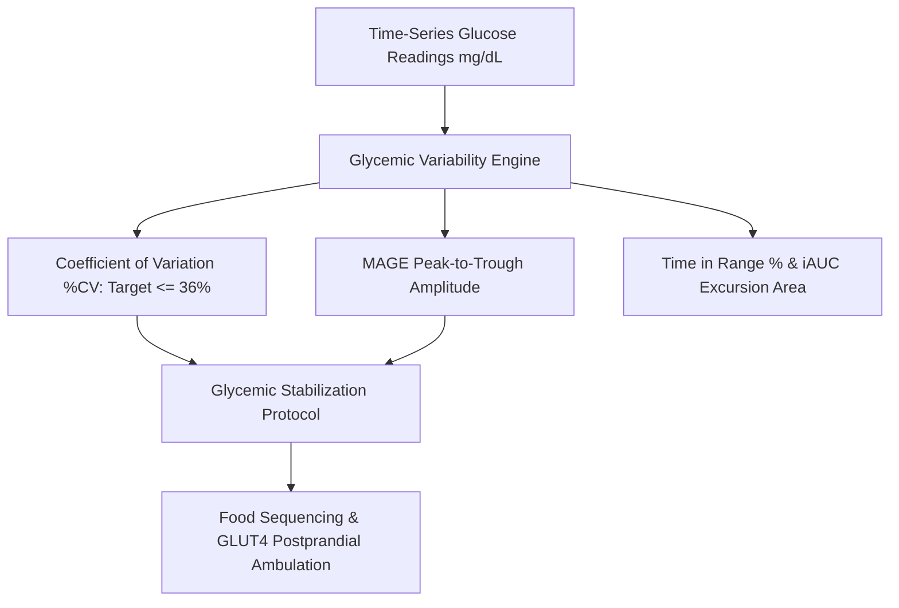

# Personal Agent Blood Glucose Variability AUC Skill

[](https://github.com/Alpha-Park)
[](https://github.com/alphaparkinc)
[](https://www.python.org/)
[](https://modelcontextprotocol.io/)
[](https://github.com/Alpha-Park)

Zero-dependency Continuous Glucose Monitoring (CGM) glycemic variability calculator, Mean Amplitude of Glycemic Excursions (MAGE) modeler, and postprandial iAUC stabilizer.

## Architecture



## Quickstart

```python
from client import PersonalAgentBloodGlucoseVariabilityAuc

agent = PersonalAgentBloodGlucoseVariabilityAuc()
res = agent.calculate_cgm_glycemic_variability([90.0, 110.0, 145.0, 160.0, 120.0, 95.0, 85.0])
print(f"CV: {res['coefficient_of_variation_pct']} | TIR: {res['time_in_range_70_140_pct']}")
```
