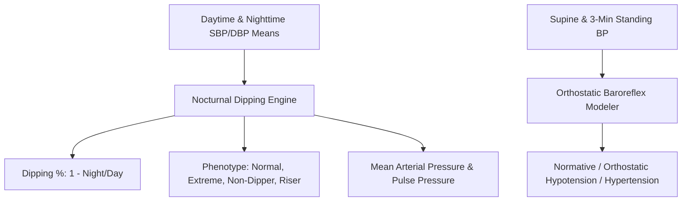

# Personal Agent Blood Pressure Dipping Hemodynamics Skill

[](https://github.com/Alpha-Park)
[](https://github.com/alphaparkinc)
[](https://www.python.org/)
[](https://modelcontextprotocol.io/)
[](https://github.com/Alpha-Park)

Zero-dependency Ambulatory Blood Pressure Monitoring (ABPM) nocturnal dipping modeler, mean arterial pressure (MAP) calculator, and orthostatic hemodynamic risk evaluator.

## Architecture



## Quickstart

```python
from client import PersonalAgentBloodPressureDippingHemodynamics

agent = PersonalAgentBloodPressureDippingHemodynamics()
res = agent.calculate_nocturnal_bp_dipping_profile(daytime_sbp_mean=125.0, nighttime_sbp_mean=105.0)
print(f"Dipping: {res['systolic_dipping_percentage']} | Phenotype: {res['dipping_phenotype']}")
```
