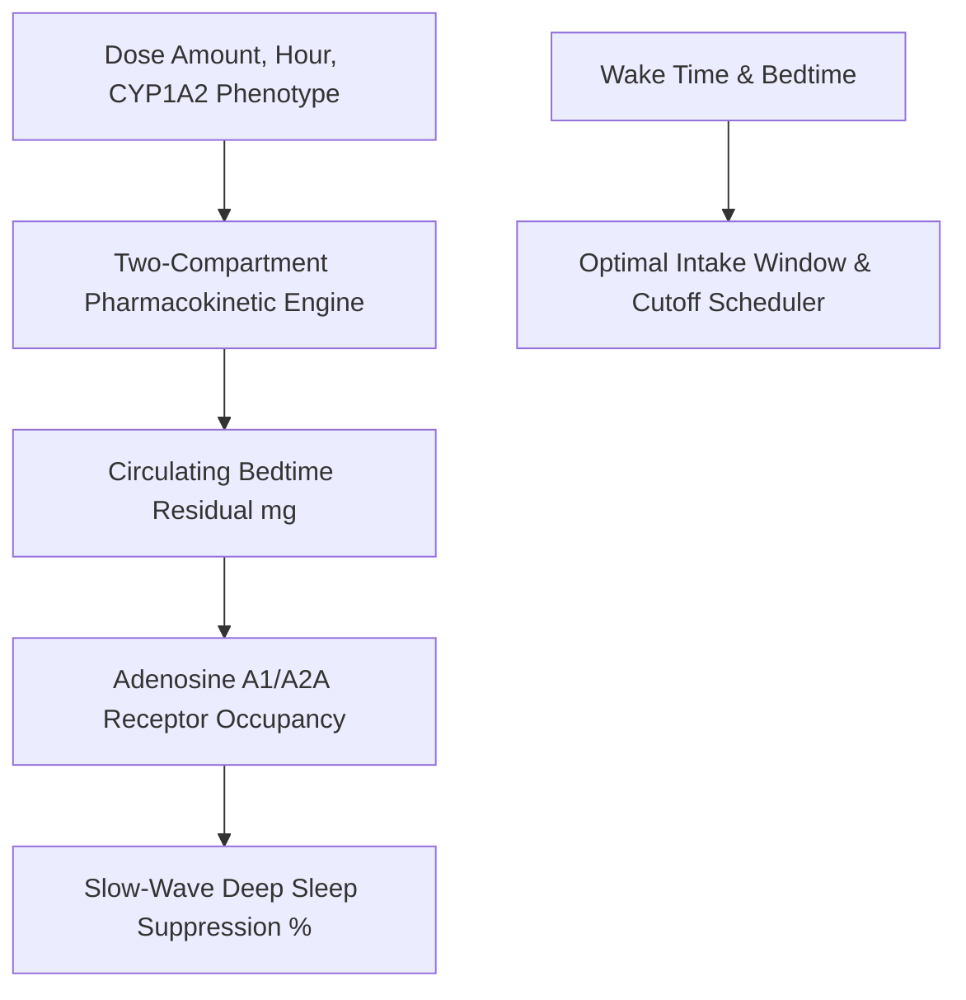

# Personal Agent Caffeine Adenosine Pharmacokinetics Skill

[](https://github.com/Alpha-Park)
[](https://github.com/alphaparkinc)
[](https://www.python.org/)
[](https://modelcontextprotocol.io/)
[](https://github.com/Alpha-Park)

Zero-dependency two-compartment caffeine elimination pharmacokinetic modeler, adenosine A1/A2A receptor occupancy calculator, and sleep-architecture-safe intake scheduler.

## Architecture



## Quickstart

```python
from client import PersonalAgentCaffeineAdenosinePharmacokinetics

agent = PersonalAgentCaffeineAdenosinePharmacokinetics()
res = agent.simulate_caffeine_clearance([{"hour": 8.0, "mg": 150.0}, {"hour": 14.0, "mg": 100.0}])
print(f"Bedtime Residual: {res['bedtime_circulating_residual_mg']} mg | SWS Penalty: {res['slow_wave_sleep_suppression_pct']}")
```
