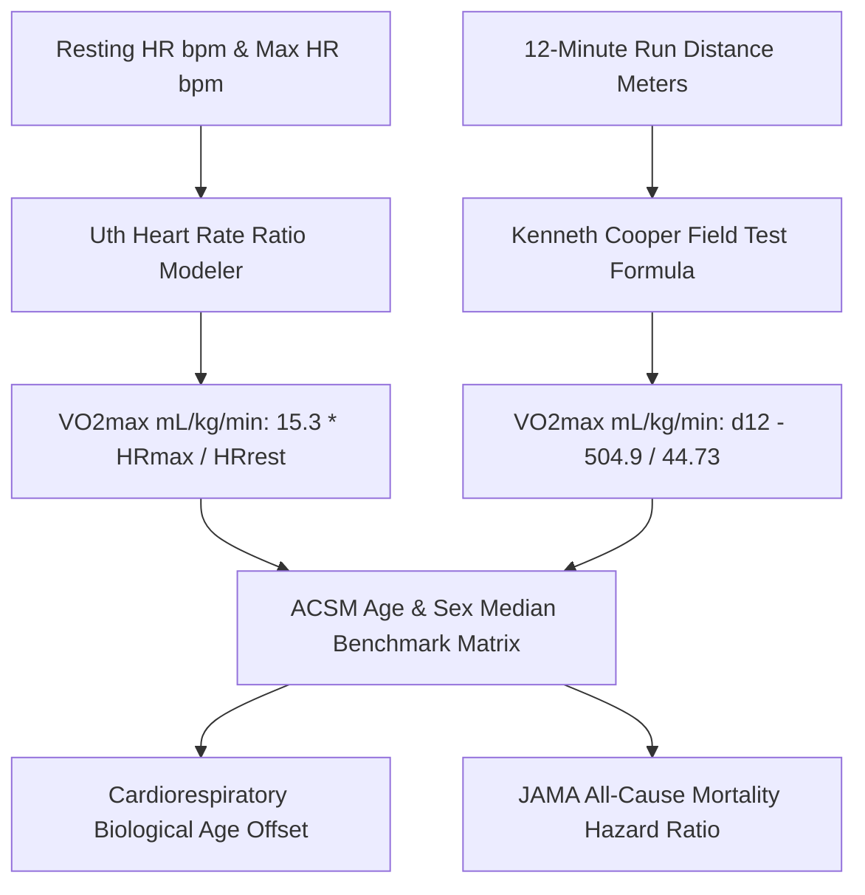

# Personal Agent Cardiorespiratory VO2Max Velocity Skill

[](https://github.com/Alpha-Park)
[](https://github.com/alphaparkinc)
[](https://www.python.org/)
[](https://modelcontextprotocol.io/)
[](https://github.com/Alpha-Park)

Zero-dependency Uth heart rate ratio VO2max estimator, Cooper 12-minute run converter, ACSM longevity hazard ratio indexer, and cardiorespiratory fitness biological age modeler.

## Architecture



## Quickstart

```python
from client import PersonalAgentCardiorespiratoryVo2MaxVelocity

agent = PersonalAgentCardiorespiratoryVo2MaxVelocity()
res = agent.estimate_vo2max_from_heart_rate_ratio(resting_hr_bpm=54.0, max_hr_bpm=185.0, age=42)
print(f"VO2max: {res['estimated_vo2max_ml_kg_min']} mL/kg/min | Fitness Age: {res['biological_cardiorespiratory_age']} yrs")
```
