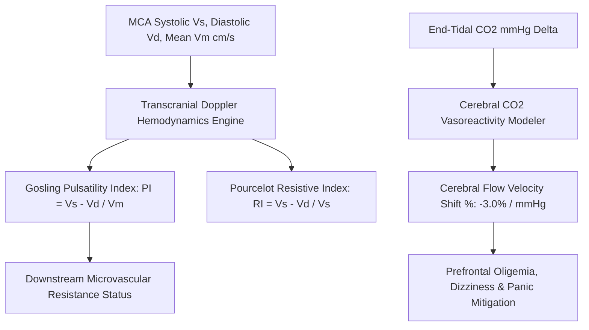

# Personal Agent Cerebral Blood Flow Orthostatic Perfusion Skill

[](https://github.com/Alpha-Park)
[](https://github.com/alphaparkinc)
[](https://www.python.org/)
[](https://modelcontextprotocol.io/)
[](https://github.com/Alpha-Park)

Zero-dependency Transcranial Doppler (TCD) Middle Cerebral Artery (MCA) velocity modeler, Gosling Pulsatility Index (PI) calculator, and hypocapnic hyperventilation vasoconstriction evaluator.

## Architecture



## Quickstart

```python
from client import PersonalAgentCerebralBloodFlowOrthostaticPerfusion

agent = PersonalAgentCerebralBloodFlowOrthostaticPerfusion()
res = agent.calculate_cerebral_perfusion_and_pulsatility(peak_systolic_velocity_cms=95.0, end_diastolic_velocity_cms=42.0, mean_flow_velocity_cms=60.0)
print(f"PI: {res['gosling_pulsatility_index_pi']} | Status: {res['pulsatility_status_tier']}")
```
