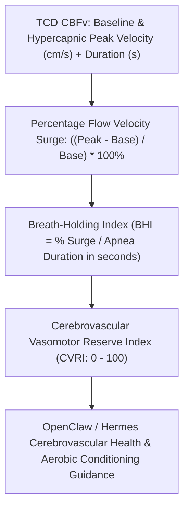

# Cerebrovascular CO2 Reactivity (CVR) & Breath-Holding Index Skill

[](https://opensource.org/licenses/MIT)
[](https://www.python.org/downloads/)
[](https://github.com/alphaparkinc/genpark-personal-agent-cerebrovascular-co2-reactivity-cvr-skill)
[](https://github.com/alphaparkinc/genpark-personal-agent-cerebrovascular-co2-reactivity-cvr-skill)
[](https://modelcontextprotocol.io/)

A sovereign personal agent capability for computational neurovascular hemodynamics, evaluating cerebrovascular CO2 reactivity (CVR), Transcranial Doppler Breath-Holding Index (BHI), and cerebral microvascular reserve.

## Architecture



## Quickstart

```python
from client import CerebrovascularReactivityClient

client = CerebrovascularReactivityClient()

# Assess 30-second breath-holding challenge
res = client.calculate_breath_holding_index(
    baseline_cbfv_cm_s=62.0,
    hypercapnia_peak_cbfv_cm_s=91.5,
    apnea_duration_sec=30.0
)

print("Velocity Increase:", res["percentage_velocity_increase"], "%")
print("BHI:", res["breath_holding_index_pct_s"], "%/s")
print("Reserve Index:", res["cerebrovascular_reserve_index"], "/ 100")
print("Classification:", res["classification"])
```

## MCP Server Integration

Add to your `claude_desktop_config.json` or OpenClaw tool registry:

```json
{
  "mcpServers": {
    "cerebrovascular-reactivity": {
      "command": "python",
      "args": ["/path/to/genpark-personal-agent-cerebrovascular-co2-reactivity-cvr-skill/mcp_server.py"]
    }
  }
}
```

## License
MIT License.
