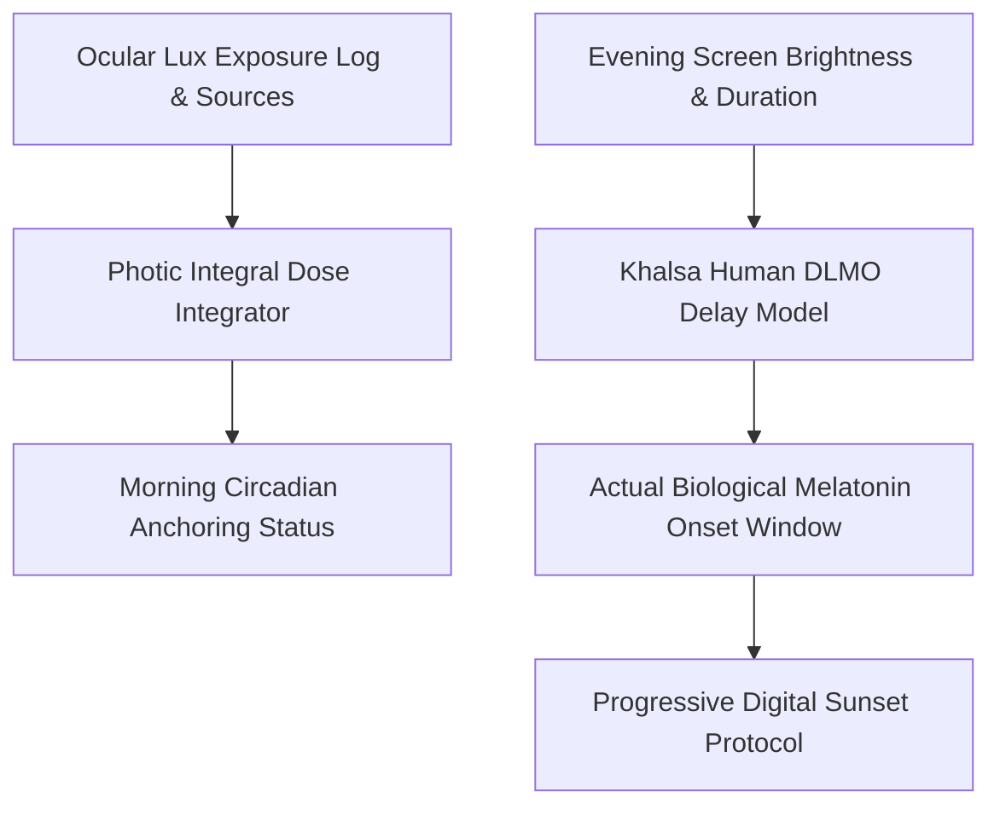

# genpark-personal-agent-circadian-lux-melatonin-onset-skill


GenPark Personal Agent Circadian Lux Melatonin Onset applies ocular photobiology and human circadian phase response curves to optimize personal light hygiene and sleep readiness.



## Features
- **Photic Dose Integration**: Tracks cumulative photon flux and verifies morning anchor thresholds.
- **DLMO Delay Forecaster**: Models pineal gland melatonin suppression from digital screens.
- **Digital Sunset Milestones**: Prescribes timed 120-min, 60-min, and 30-min lighting transitions.

## Quickstart

```python
from client import PersonalAgentCircadianLuxMelatoninOnset

chronobiology = PersonalAgentCircadianLuxMelatoninOnset()
res = chronobiology.recommend_digital_sunset_schedule("23:00")
print("First Sunset Action:", res["milestones"][0]["action"])
```

## FastMCP Integration

```bash
python -m genpark-personal-agent-circadian-lux-melatonin-onset-skill.mcp_server
```

## License
MIT
