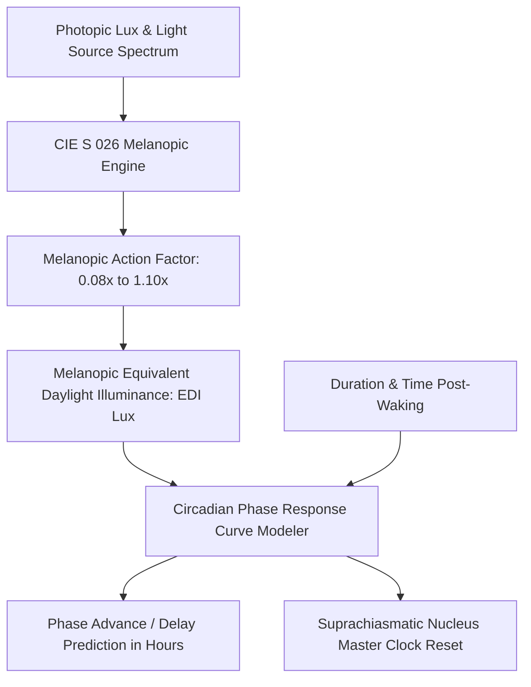

# Personal Agent Circadian Ocular Luxmeter Entrainment Skill

[](https://github.com/Alpha-Park)
[](https://github.com/alphaparkinc)
[](https://www.python.org/)
[](https://modelcontextprotocol.io/)
[](https://github.com/Alpha-Park)

Zero-dependency CIE S 026 melanopic equivalent daylight illuminance (melanopic EDI) quantifier, intrinsically photosensitive retinal ganglion cell (ipRGC) modeler, and solar zeitgeber scheduler.

## Architecture



## Quickstart

```python
from client import PersonalAgentCircadianOcularLuxLuxmeterEntrainment

agent = PersonalAgentCircadianOcularLuxLuxmeterEntrainment()
res = agent.calculate_melanopic_edi_and_circadian_drive(photopic_lux=15000.0, light_source_spectrum="direct_sunlight")
print(f"Melanopic EDI: {res['melanopic_equivalent_daylight_illuminance_edi']} lux | PRC: {res['circadian_phase_shift_trajectory']}")
```
