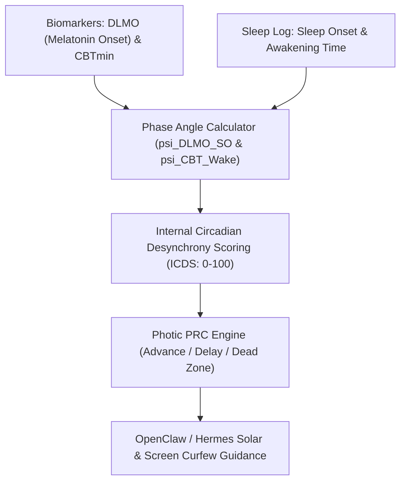

# Circadian Phase Angle of Entrainment & Internal Desynchrony Skill

[](https://opensource.org/licenses/MIT)
[](https://www.python.org/downloads/)
[](https://github.com/alphaparkinc/genpark-personal-agent-circadian-phase-angle-entrainment-skill)
[](https://github.com/alphaparkinc/genpark-personal-agent-circadian-phase-angle-entrainment-skill)
[](https://modelcontextprotocol.io/)

A sovereign personal agent capability for computational chronobiology, evaluating phase angles of entrainment ($\psi$), internal circadian desynchrony, and photic Phase Response Curve (PRC) adjustments.

## Architecture



## Quickstart

```python
from client import CircadianPhaseAngleClient

client = CircadianPhaseAngleClient()

# Calculate internal phase angle of entrainment
res = client.calculate_phase_angle_of_entrainment(
    dlmo_time_str="21:45",
    sleep_onset_time_str="23:30",
    wake_time_str="07:15"
)

print("psi (DLMO -> Sleep Onset):", res["psi_dlmo_to_sleep_onset_hours"], "h")
print("Desynchrony Score:", res["internal_circadian_desynchrony_score"], "/ 100")
print("Status:", res["status"])
```

## MCP Server Integration

Add to your `claude_desktop_config.json` or OpenClaw tool registry:

```json
{
  "mcpServers": {
    "circadian-phase-angle": {
      "command": "python",
      "args": ["/path/to/genpark-personal-agent-circadian-phase-angle-entrainment-skill/mcp_server.py"]
    }
  }
}
```

## License
MIT License.
