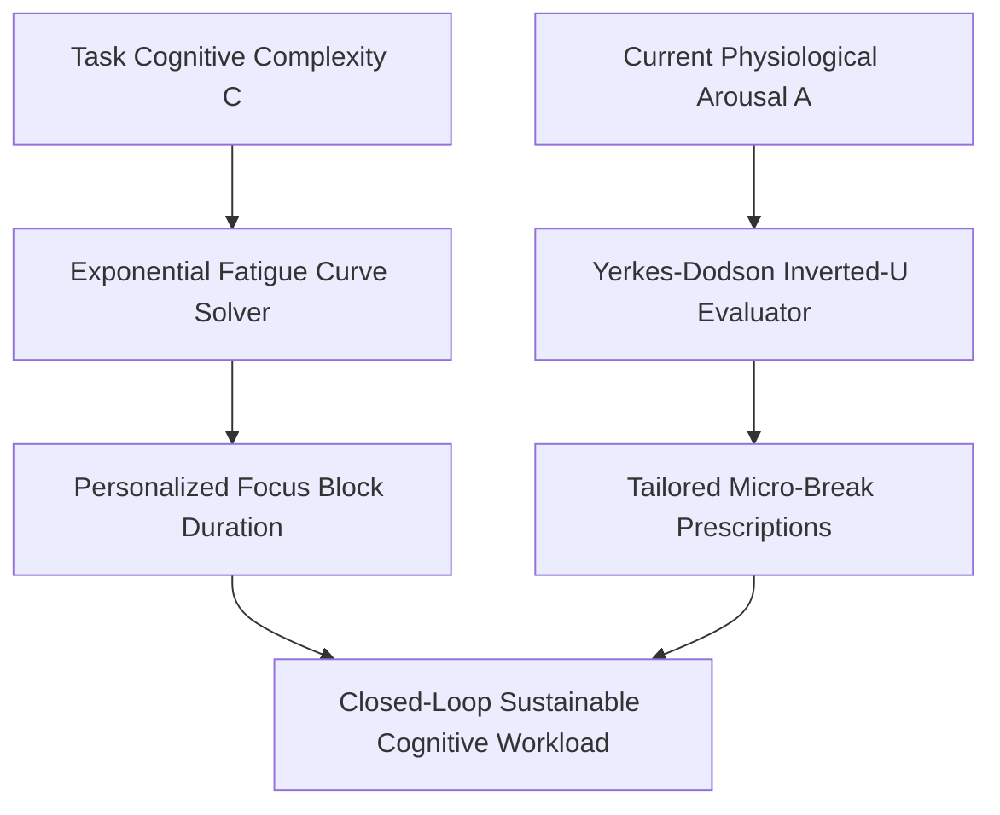

# genpark-personal-agent-cognitive-load-pomodoro-balancer-skill


GenPark Personal Agent Cognitive Load Pomodoro Balancer is a zero-dependency personal intelligence skill that calculates physiologically adaptive focus windows and restorative micro-break modalities using exponential fatigue kinetics and Yerkes-Dodson arousal optimization.



## Features
- **Dynamic Focus Duration**: Adjusts session lengths between 15 and 60 minutes based on mathematical cognitive strain.
- **Yerkes-Dodson Arousal Matching**: Prescribes targeted autonomic down-regulation or physical up-regulation based on arousal state.
- **Work-Rest Cycle Simulation**: Computes net residual fatigue and clearance efficiency across successive blocks.

## Quickstart

```python
from client import PersonalAgentCognitiveLoadBalancer

balancer = PersonalAgentCognitiveLoadBalancer()
res = balancer.compute_dynamic_pomodoro_interval(0.85)
print("Focus Session Length:", res["recommended_focus_duration_minutes"], "minutes")
```

## FastMCP Integration

```bash
python -m genpark-personal-agent-cognitive-load-pomodoro-balancer-skill.mcp_server
```

## License
MIT
