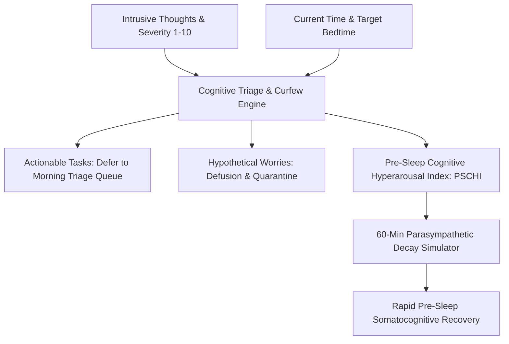

# Personal Agent Cognitive Rumination Worry Curfew Skill

[](https://github.com/Alpha-Park)
[](https://github.com/alphaparkinc)
[](https://www.python.org/)
[](https://modelcontextprotocol.io/)
[](https://github.com/Alpha-Park)

Zero-dependency Borkovec stimulus control worry containment scheduler, pre-sleep cognitive arousal indexer, and intrusive rumination decay modeler.

## Architecture



## Quickstart

```python
from client import PersonalAgentCognitiveRuminationWorryCurfew

agent = PersonalAgentCognitiveRuminationWorryCurfew()
res = agent.process_worry_inventory_and_curfew(
    intrusive_thoughts=[{"thought": "Quarterly taxes due", "severity_1_to_10": 8.0, "is_actionable": True}],
    current_time_24h=22.8, bedtime_24h=23.5
)
print(f"PSCHI: {res['pschi_hyperarousal_index']} | Curfew Active: {res['curfew_active']}")
```
