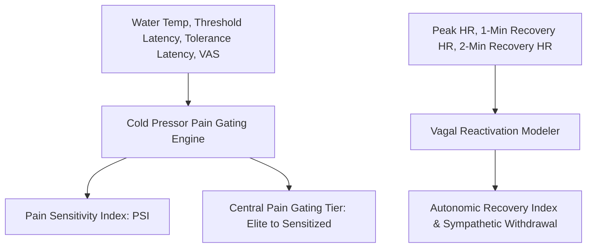

# Personal Agent Cold Pressor Pain Endurance Skill

[](https://github.com/Alpha-Park)
[](https://github.com/alphaparkinc)
[](https://www.python.org/)
[](https://modelcontextprotocol.io/)
[](https://github.com/Alpha-Park)

Zero-dependency Cold Pressor Test (CPT) pain threshold and tolerance modeler, central autonomic pain gating quantifier, and sympathetic withdrawal recovery evaluator.

## Architecture



## Quickstart

```python
from client import PersonalAgentColdPressorPainEndurance

agent = PersonalAgentColdPressorPainEndurance()
res = agent.evaluate_cpt_pain_tolerance(water_temp_celsius=3.0, pain_threshold_seconds=20.0, pain_tolerance_seconds=80.0)
print(f"PSI: {res['pain_sensitivity_index_psi']} | Gating: {res['central_pain_gating_tier']}")
```
