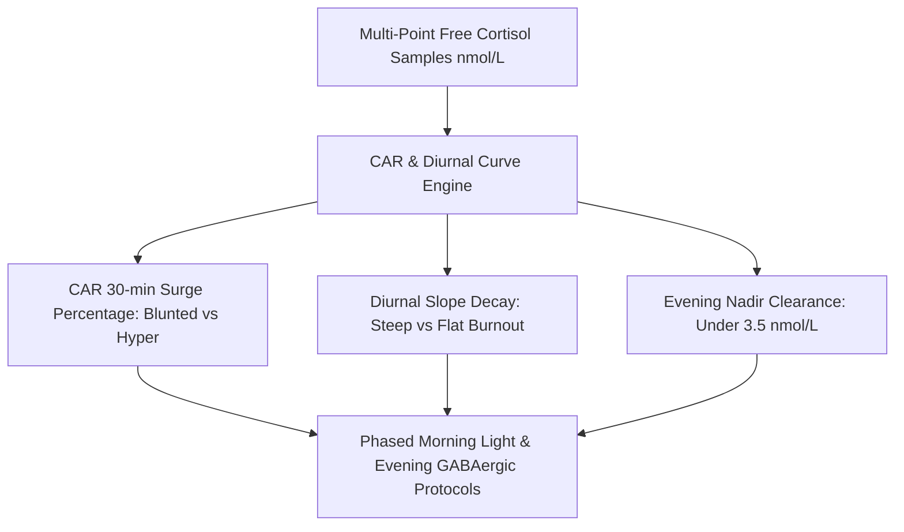

# Personal Agent Cortisol Circadian CAR Curve Skill

[](https://github.com/Alpha-Park)
[](https://github.com/alphaparkinc)
[](https://www.python.org/)
[](https://modelcontextprotocol.io/)
[](https://github.com/Alpha-Park)

Zero-dependency Cortisol Awakening Response (CAR) area-under-curve modeler, Diurnal Cortisol Slope (DCS) flattener detector, and hypothalamic-pituitary-adrenal (HPA) axis stabilizer.

## Architecture



## Quickstart

```python
from client import PersonalAgentCortisolCircadianCarCurve

agent = PersonalAgentCortisolCircadianCarCurve()
res = agent.evaluate_diurnal_cortisol_curve([{"minutes_post_wake": 0, "nmol_l": 12.0}, {"minutes_post_wake": 30, "nmol_l": 22.0}])
print(f"CAR Rise: {res['car_magnitude_rise_pct']} | Status: {res['car_functional_status']}")
```
