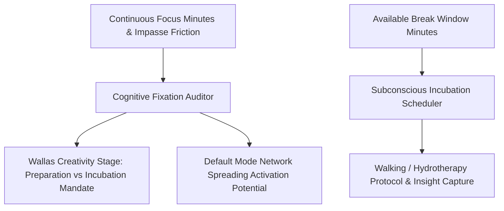

# Personal Agent Creative Divergent Incubation Cycle Skill

[](https://github.com/Alpha-Park)
[](https://github.com/alphaparkinc)
[](https://www.python.org/)
[](https://modelcontextprotocol.io/)
[](https://github.com/Alpha-Park)

Zero-dependency Graham Wallas 4-stage creativity modeler, cognitive impasse fixation detector, Default Mode Network (DMN) spreading activation calculator, and incubation scheduler.

## Architecture



## Quickstart

```python
from client import PersonalAgentCreativeDivergentIncubation

agent = PersonalAgentCreativeDivergentIncubation()
res = agent.evaluate_incubation_necessity(focus_duration_continuous_minutes=100.0, impasse_friction_score=8.0)
print(f"Fixation Index: {res['cognitive_fixation_index']} | Stage: {res['wallas_creative_stage']}")
```
