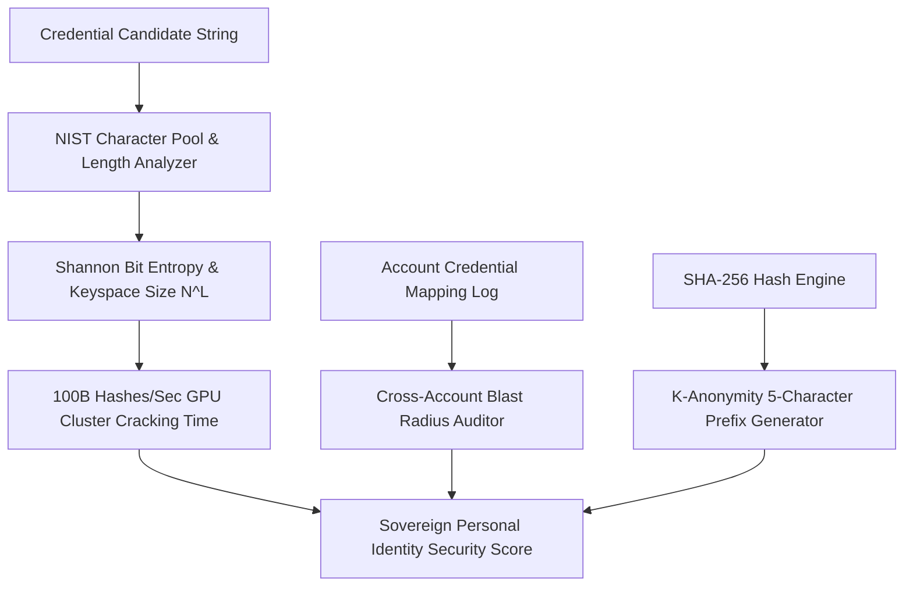

# genpark-personal-agent-credential-entropy-exposure-fiduciary-skill


GenPark Personal Agent Credential Entropy Exposure Fiduciary models NIST bit entropy, GPU brute-force cracking timelines, and k-anonymity privacy hashing.



## Features
- **NIST Bit Entropy Scoring**: Computes cryptographic keyspace and crack times against modern RTX 4090 GPU clusters.
- **Credential Reuse Blast Radius**: Audits catastrophic shared-password exposure between banking and social accounts.
- **K-Anonymity Zero-Knowledge Prefixing**: Safely audits breach registries without leaking credentials.

## Quickstart

```python
from client import PersonalAgentCredentialEntropyExposureFiduciary

sec = PersonalAgentCredentialEntropyExposureFiduciary()
res = sec.calculate_credential_bit_entropy_and_cracking_time("my_pass")
print("Strength:", res["cryptographic_strength"])
```

## FastMCP Integration

```bash
python -m genpark-personal-agent-credential-entropy-exposure-fiduciary-skill.mcp_server
```

## License
MIT
