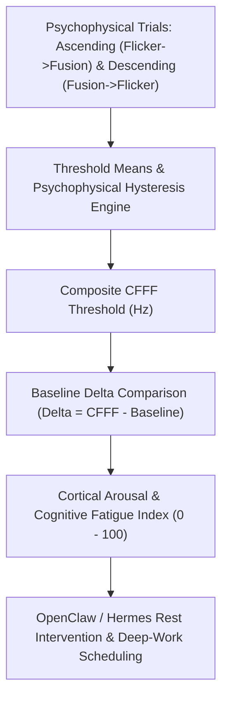

# Critical Flicker Fusion Frequency (CFFF) Skill

[](https://opensource.org/licenses/MIT)
[](https://www.python.org/downloads/)
[](https://github.com/alphaparkinc/genpark-personal-agent-critical-flicker-fusion-frequency-skill)
[](https://github.com/alphaparkinc/genpark-personal-agent-critical-flicker-fusion-frequency-skill)
[](https://modelcontextprotocol.io/)

A sovereign personal agent capability for computational visual psychophysics, evaluating Critical Flicker Fusion Frequency (CFFF), cortical arousal, and central nervous system (CNS) fatigue.

## Architecture



## Quickstart

```python
from client import CriticalFlickerFusionClient

client = CriticalFlickerFusionClient()

# Evaluate psychophysical trials (Hz)
asc = [38.2, 38.6, 38.4, 38.8]
desc = [39.4, 39.0, 39.2, 39.6]

res = client.evaluate_cfff_thresholds(asc, desc, baseline_cfff_hz=38.5)

print("Composite CFFF:", res["composite_cfff_hz"], "Hz")
print("Delta from Baseline:", res["delta_from_baseline_hz"], "Hz")
print("Cortical Arousal Index:", res["cortical_arousal_index"], "/ 100")
print("Status:", res["status"])
```

## MCP Server Integration

Add to your `claude_desktop_config.json` or OpenClaw tool registry:

```json
{
  "mcpServers": {
    "critical-flicker-fusion": {
      "command": "python",
      "args": ["/path/to/genpark-personal-agent-critical-flicker-fusion-frequency-skill/mcp_server.py"]
    }
  }
}
```

## License
MIT License.
