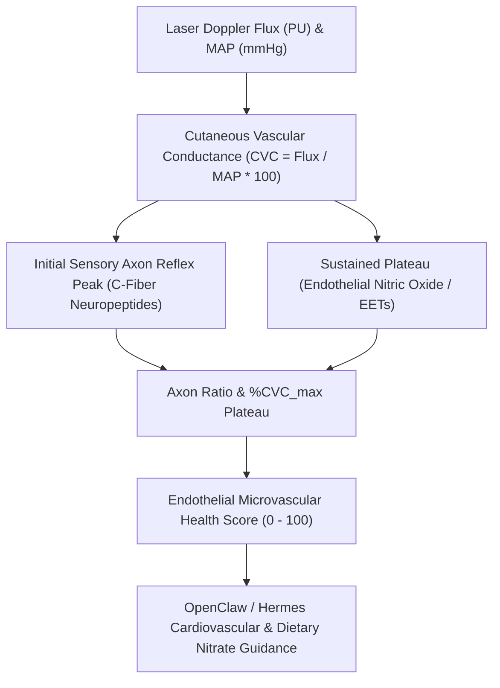

# Cutaneous Microcirculation & Laser Doppler Thermal Hyperemia Skill

[](https://opensource.org/licenses/MIT)
[](https://www.python.org/downloads/)
[](https://github.com/alphaparkinc/genpark-personal-agent-cutaneous-microcirculation-laser-doppler-skill)
[](https://github.com/alphaparkinc/genpark-personal-agent-cutaneous-microcirculation-laser-doppler-skill)
[](https://modelcontextprotocol.io/)

A sovereign personal agent capability for computational microvascular assessment, evaluating cutaneous laser Doppler flowmetry, sensory C-fiber axon reflexes, and endothelial nitric oxide capacity.

## Architecture



## Quickstart

```python
from client import CutaneousMicrocirculationClient

client = CutaneousMicrocirculationClient()

# Assess cutaneous local thermal hyperemia
res = client.evaluate_thermal_hyperemia(
    baseline_flux_pu=16.0,
    axon_peak_flux_pu=88.0,
    plateau_flux_pu=152.0,
    maximal_flux_pu=168.0,
    mean_arterial_pressure_mmhg=92.0
)

print("%CVCmax Plateau:", res["pct_cvc_max_plateau"], "%")
print("Axon Reflex Ratio:", res["axon_reflex_ratio"], "x")
print("Microvascular Health Score:", res["endothelial_microvascular_health_score"], "/ 100")
print("Classification:", res["classification"])
```

## MCP Server Integration

Add to your `claude_desktop_config.json` or OpenClaw tool registry:

```json
{
  "mcpServers": {
    "cutaneous-microcirculation": {
      "command": "python",
      "args": ["/path/to/genpark-personal-agent-cutaneous-microcirculation-laser-doppler-skill/mcp_server.py"]
    }
  }
}
```

## License
MIT License.
