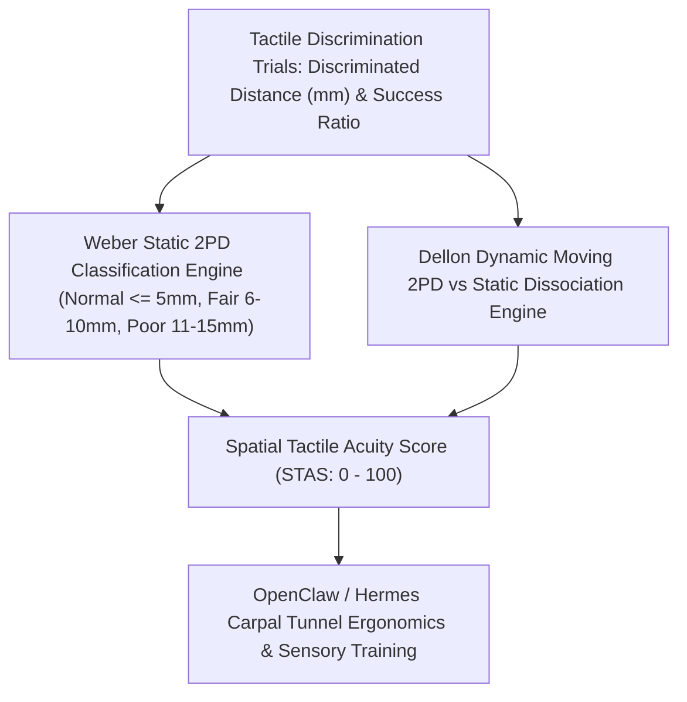

# Cutaneous Two-Point Discrimination (2PD) Skill

[](https://opensource.org/licenses/MIT)
[](https://www.python.org/downloads/)
[](https://github.com/alphaparkinc/genpark-personal-agent-cutaneous-two-point-discrimination-skill)
[](https://github.com/alphaparkinc/genpark-personal-agent-cutaneous-two-point-discrimination-skill)
[](https://modelcontextprotocol.io/)

A sovereign personal agent capability for computational tactile psychophysics, evaluating static and moving cutaneous two-point discrimination (2PD in mm), Merkel/Meissner spatial receptive density, and peripheral nerve health.

## Architecture



## Quickstart

```python
from client import TwoPointDiscriminationClient

client = TwoPointDiscriminationClient()

# Assess static 2PD threshold at fingertip
res = client.evaluate_static_2pd(
    smallest_discriminated_distance_mm=3.2,
    anatomical_site="fingertip_pulp",
    correct_response_ratio=0.875
)

print("Discriminated Distance:", res["discriminated_distance_mm"], "mm")
print("Acuity Score:", res["spatial_tactile_acuity_score"], "/ 100")
print("Classification:", res["classification"])
print("Guidance:", res["actionable_guidance"])
```

## MCP Server Integration

Add to your `claude_desktop_config.json` or OpenClaw tool registry:

```json
{
  "mcpServers": {
    "two-point-discrimination": {
      "command": "python",
      "args": ["/path/to/genpark-personal-agent-cutaneous-two-point-discrimination-skill/mcp_server.py"]
    }
  }
}
```

## License
MIT License.
