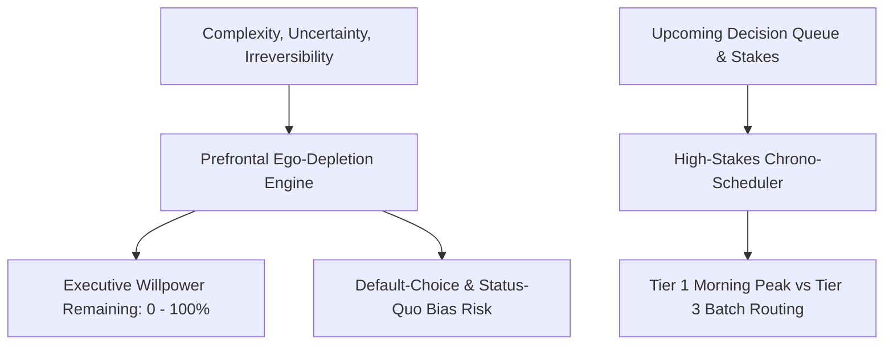

# Personal Agent Decision Fatigue Entropy Allocator Skill

[](https://github.com/Alpha-Park)
[](https://github.com/alphaparkinc)
[](https://www.python.org/)
[](https://modelcontextprotocol.io/)
[](https://github.com/Alpha-Park)

Zero-dependency Baumeister ego-depletion modeler, prefrontal executive cognitive load budgeter, default-choice bias auditor, and high-stakes decision timing optimizer.

## Architecture



## Quickstart

```python
from client import PersonalAgentDecisionFatigueEntropyAllocator

agent = PersonalAgentDecisionFatigueEntropyAllocator()
res = agent.audit_daily_decision_budget([{"name": "Architecture Refactor", "complexity": 9.0, "uncertainty": 8.0, "irreversibility": 9.0}])
print(f"Capacity Remaining: {res['prefrontal_executive_capacity_remaining']} | Bias Risk: {res['default_choice_bias_risk']}")
```
