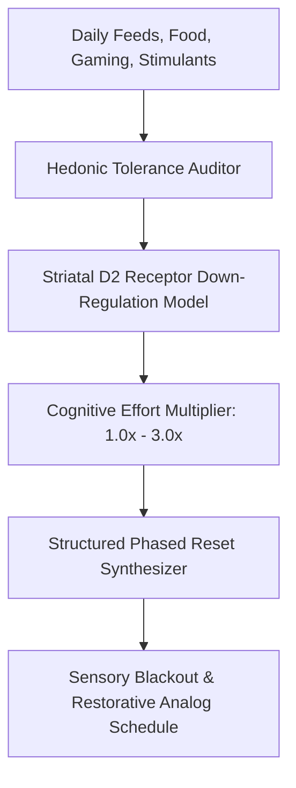

# Personal Agent Dopamine Reset Stimulus Tolerance Skill

[](https://github.com/Alpha-Park)
[](https://github.com/alphaparkinc)
[](https://www.python.org/)
[](https://modelcontextprotocol.io/)
[](https://github.com/Alpha-Park)

Zero-dependency hedonic tolerance estimator, striatal D2 receptor down-regulation modeler, and structured digital/sensory dopamine reset protocol synthesizer.

## Architecture



## Quickstart

```python
from client import PersonalAgentDopamineResetStimulusTolerance

agent = PersonalAgentDopamineResetStimulusTolerance()
res = agent.calculate_hedonic_tolerance([{"type": "short_video_feed", "duration_minutes": 60.0, "intensity": 8.0}])
print(f"D2 Availability: {res['estimated_d2_receptor_availability']} | Effort: {res['perceived_cognitive_effort_multiplier']}")
```
