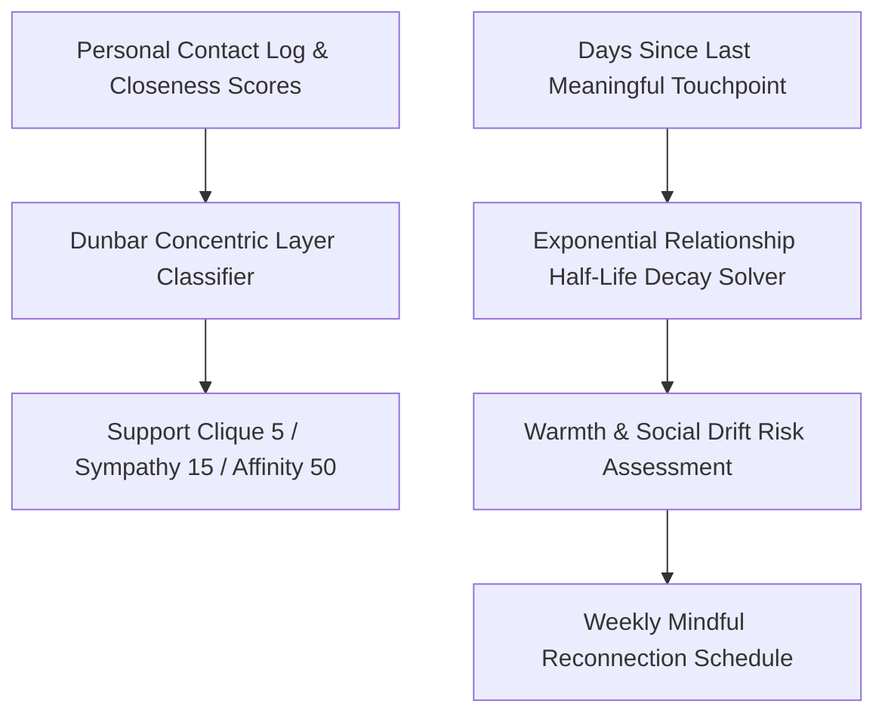

# genpark-personal-agent-dunbar-relationship-cadence-skill


GenPark Personal Agent Dunbar Relationship Cadence organizes personal contacts into Dunbar's concentric circles, computes relationship half-life decay, and schedules intentional reconnections without social spam.



## Features
- **Dunbar Circle Mapping**: Classifies close friends vs broader network according to anthropological Dunbar constraints.
- **Half-Life Warmth Decay**: Models realistic relationship entropy over time without artificial pressure.
- **Mindful Reconnection Cadence**: Schedules authentic touchpoints within user-defined weekly cognitive bandwidth.

## Quickstart

```python
from client import PersonalAgentDunbarRelationshipCadence

cadence = PersonalAgentDunbarRelationshipCadence()
res = cadence.classify_dunbar_layer_and_cadence("friend_1", 0.90, 14)
print("Warmth Level:", res["relationship_warmth_level"])
```

## FastMCP Integration

```bash
python -m genpark-personal-agent-dunbar-relationship-cadence-skill.mcp_server
```

## License
MIT
