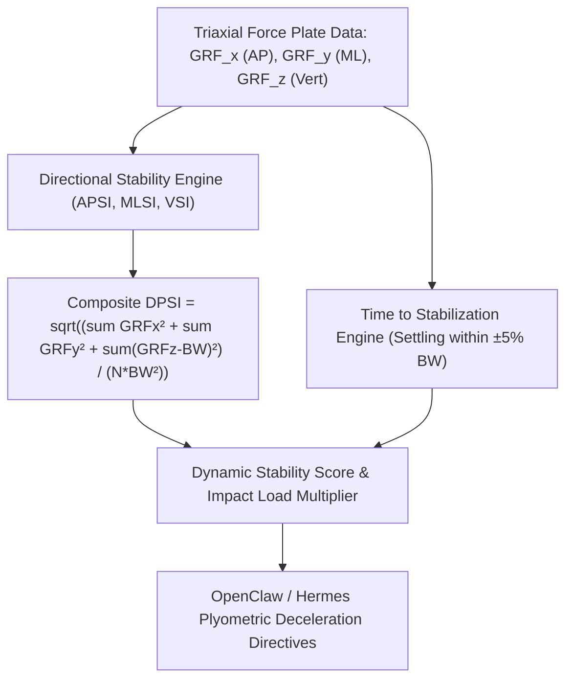

# Dynamic Postural Stability Index (DPSI) Skill

[](https://opensource.org/licenses/MIT)
[](https://www.python.org/downloads/)
[](https://github.com/alphaparkinc/genpark-personal-agent-dynamic-postural-stability-index-skill)
[](https://github.com/alphaparkinc/genpark-personal-agent-dynamic-postural-stability-index-skill)
[](https://modelcontextprotocol.io/)

A sovereign personal agent capability for computational biomechanics, evaluating the Dynamic Postural Stability Index (DPSI), jump-landing shock dissipation, and time to stabilization.

## Architecture



## Quickstart

```python
from client import DynamicPosturalStabilityClient

client = DynamicPosturalStabilityClient()

# Example triaxial landing series (Newtons)
fx = [25.0, 15.0, -10.0, 5.0, 0.0]
fy = [18.0, 10.0, -8.0, 3.0, 0.0]
fz = [1450.0, 1100.0, 850.0, 720.0, 705.0]

res = client.calculate_dpsi(fx, fy, fz, body_weight_newtons=700.0, landing_duration_sec=3.0)

print("Composite DPSI:", res["dpsi"])
print("Impact Load Multiplier:", res["impact_load_multiplier"], "x BW")
print("Time to Stabilization:", res["time_to_stabilization_sec"], "s")
print("Status:", res["status"])
```

## MCP Server Integration

Add to your `claude_desktop_config.json` or OpenClaw tool registry:

```json
{
  "mcpServers": {
    "dynamic-postural-stability": {
      "command": "python",
      "args": ["/path/to/genpark-personal-agent-dynamic-postural-stability-index-skill/mcp_server.py"]
    }
  }
}
```

## License
MIT License.
