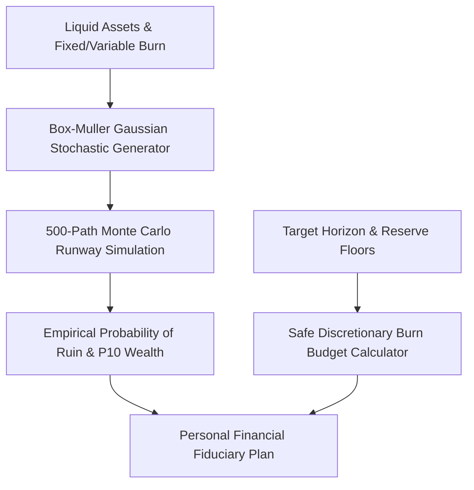

# genpark-personal-agent-financial-runway-monte-carlo-skill


GenPark Personal Agent Financial Runway Monte Carlo provides zero-dependency personal finance modeling, simulating stochastic income shocks and deriving safe discretionary burn caps.



## Features
- **Monte Carlo Runway Simulation**: Evaluates 500 stochastic paths incorporating income volatility.
- **Safe Discretionary Burn Budget**: Recommends daily and monthly spending caps to preserve runway.
- **Emergency Liquidity Buffer**: Quantifies zero-income survival days and resilience tiers.

## Quickstart

```python
from client import PersonalAgentFinancialRunwayMonteCarlo

fiduciary = PersonalAgentFinancialRunwayMonteCarlo()
res = fiduciary.compute_safe_discretionary_burn_budget(60000.0, 2500.0, 12)
print("Safe Daily Spend:", res["safe_daily_discretionary_spend_usd"])
```

## FastMCP Integration

```bash
python -m genpark-personal-agent-financial-runway-monte-carlo-skill.mcp_server
```

## License
MIT
