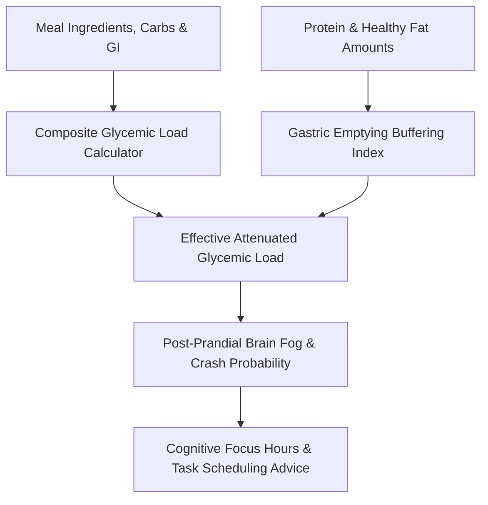

# genpark-personal-agent-glycemic-load-macro-balancer-skill


GenPark Personal Agent Glycemic Load Macro Balancer computes composite glycemic impact, models protein and fat gastric attenuation, and forecasts post-prandial mental stamina without external dependencies.



## Features
- **Composite Glycemic Load**: Aggregates glycemic index and carbohydrate mass across complex multi-ingredient meals.
- **Macronutrient Damping**: Models how amino acids and lipids flatten glycemic glucose spikes.
- **Cognitive Crash Forecaster**: Estimates post-lunch fatigue probability and stable working hours.

## Quickstart

```python
from client import PersonalAgentGlycemicMacroBalancer

balancer = PersonalAgentGlycemicMacroBalancer()
res = balancer.recommend_macronutrient_stabilizer(40.0)
print("Recommended Protein:", res["recommended_protein_addition_g"], "g")
```

## FastMCP Integration

```bash
python -m genpark-personal-agent-glycemic-load-macro-balancer-skill.mcp_server
```

## License
MIT
